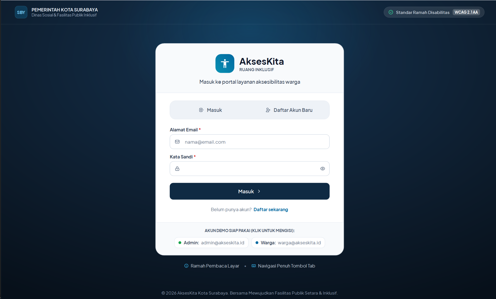
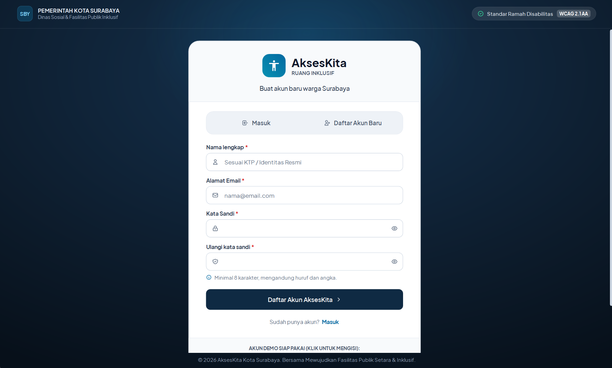
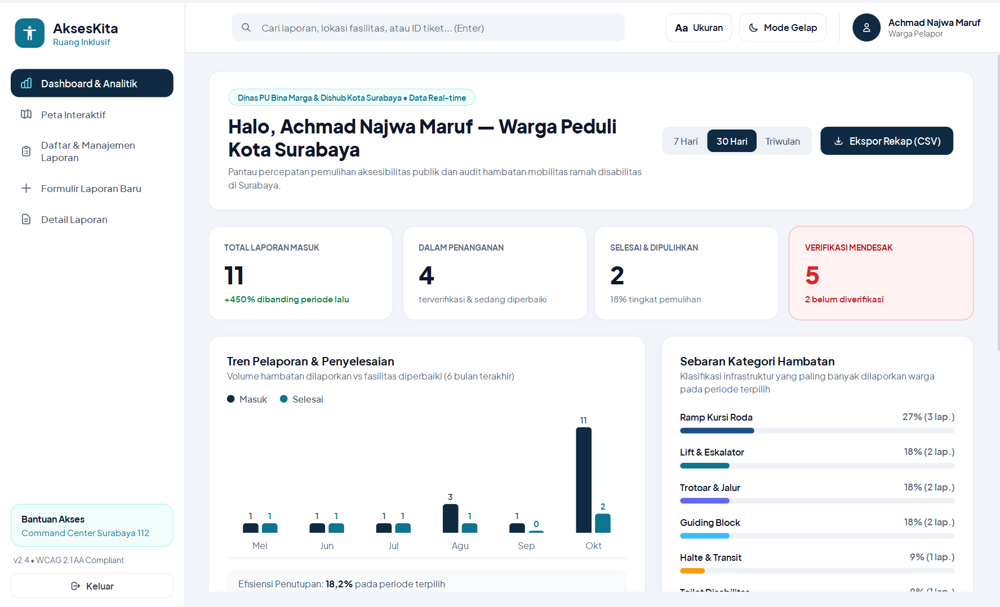
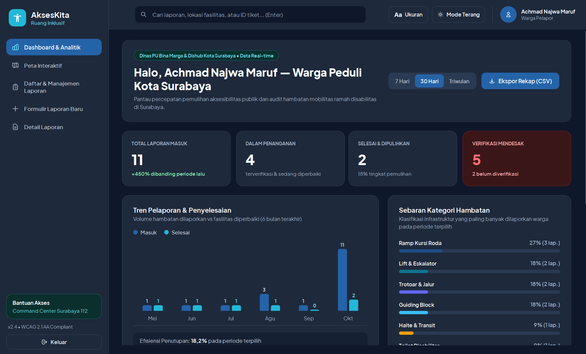
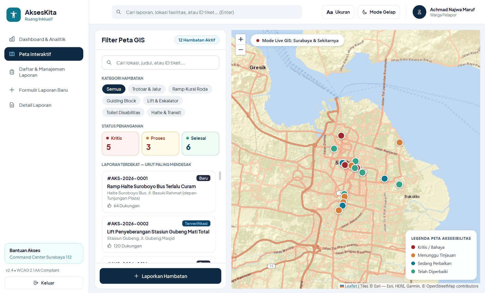
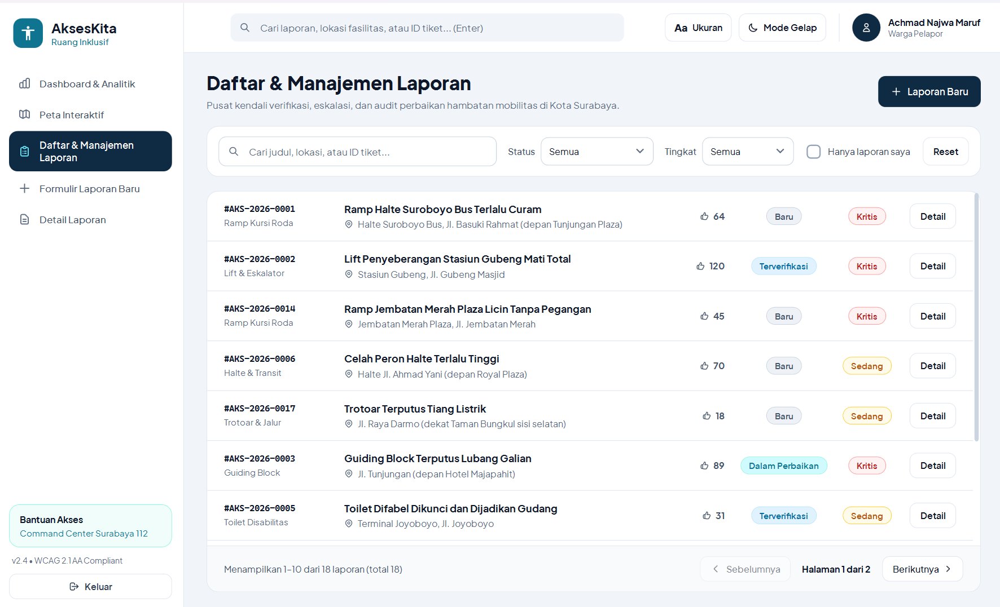
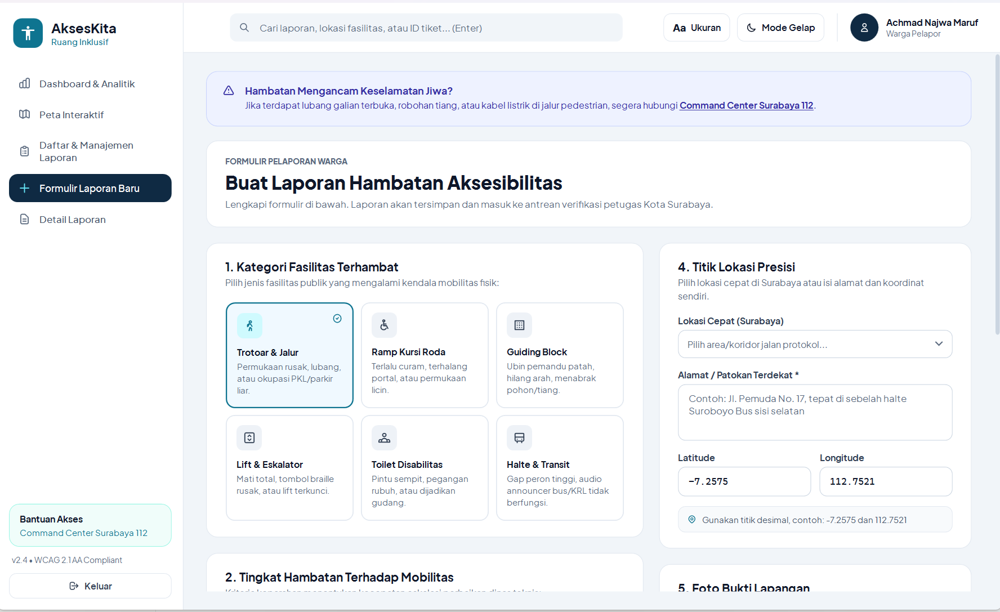
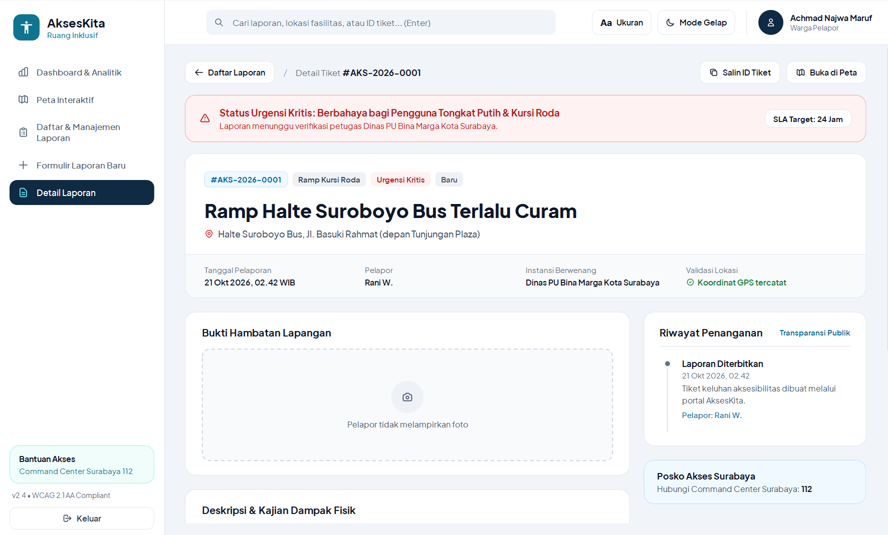
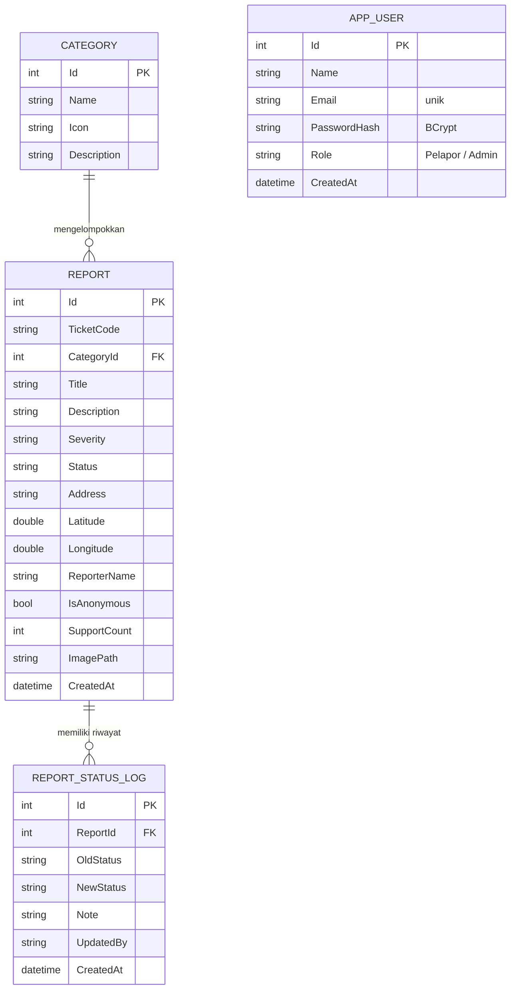
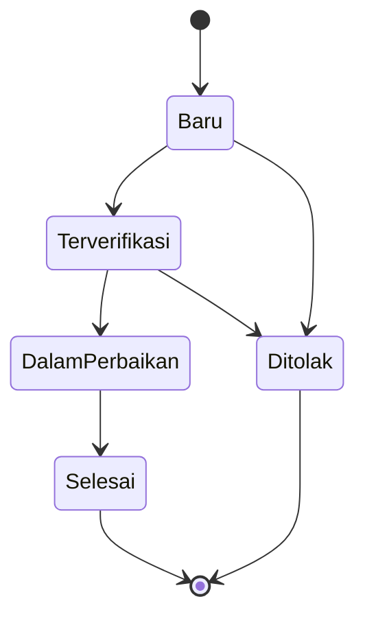

# AksesKita — Sistem Pelaporan Hambatan Aksesibilitas di Ruang Publik


**AksesKita** adalah aplikasi desktop yang memungkinkan warga melaporkan hambatan aksesibilitas di ruang publik, misalnya trotoar tanpa ramp, *guiding block* yang terputus, lift yang rusak, atau toilet yang tidak ramah pengguna kursi roda. Laporan diverifikasi dan ditindaklanjuti oleh petugas, sedangkan warga dapat memantau statusnya sampai selesai. Wilayah sasaran pada versi ini adalah **Kota Surabaya**.

Aplikasi ini dikerjakan untuk mata kuliah **Pemrograman Berbasis Kerangka Kerja (PBKK) Kelas D** menggunakan **.NET 8 (WPF)**, pola **MVVM**, dan basis data **SQLite**.

**Sorotan**

- Siklus laporan yang lengkap: buat, lihat, ubah, hapus, dan telusuri riwayat perubahan status.
- Dashboard, peta, dan daftar laporan seluruhnya dihitung dari basis data, bukan data tetap.
- Login dengan kata sandi ter-*hash* (BCrypt) dan hak akses berdasarkan peran.
- Mode terang dan gelap, serta pengaturan ukuran tampilan, sebagai bentuk perhatian pada aksesibilitas aplikasi itu sendiri.
- Aturan bisnis dipisahkan dari tampilan sehingga dapat diuji otomatis (133 unit test lulus).

---

## Identitas Kelompok

| No | Nama | NRP |
|----|------|-----|
| 1 | Leyan Harits R W | 5025231288 |
| 2 | Achmad Najwa Maruf | 5025231265 |
| 3 | Derryell Josua Ekklesio Pandiangan | 5025241175 |

---

## Daftar Isi

1. [Latar Belakang dan Tujuan](#1-latar-belakang-dan-tujuan)
2. [Pengguna dan Hak Akses](#2-pengguna-dan-hak-akses)
3. [Fitur](#3-fitur)
4. [Tampilan Aplikasi](#4-tampilan-aplikasi)
5. [Alur Penggunaan](#5-alur-penggunaan)
6. [Arsitektur dan Teknologi](#6-arsitektur-dan-teknologi)
7. [Model Data](#7-model-data)
8. [Aturan Bisnis dan Validasi](#8-aturan-bisnis-dan-validasi)
9. [Keamanan](#9-keamanan)
10. [Pengujian](#10-pengujian)
11. [Cara Menjalankan](#11-cara-menjalankan)
12. [Kesesuaian dengan Kebutuhan dan Indikator Penilaian](#12-kesesuaian-dengan-kebutuhan-dan-indikator-penilaian)
13. [Keterbatasan dan Pengembangan Lanjutan](#13-keterbatasan-dan-pengembangan-lanjutan)

---

## 1. Latar Belakang dan Tujuan

### Permasalahan

- Hambatan aksesibilitas sering tidak terdata, sehingga pengelola fasilitas tidak mengetahui lokasi dan jenis masalahnya.
- Laporan melalui media sosial atau pesan pribadi tersebar, tidak terstruktur, dan sulit dilacak tindak lanjutnya.
- Pengguna yang terdampak (pengguna kursi roda, tunanetra, lansia) belum memiliki saluran pelaporan yang jelas dan mudah diakses.
- Pengelola membutuhkan data yang terpilah (kategori, tingkat hambatan, lokasi) untuk menentukan prioritas perbaikan.

### Tujuan

1. Menyediakan satu tempat bagi warga untuk melaporkan hambatan beserta **lokasi, kategori, tingkat hambatan, dan foto bukti**.
2. Membantu petugas **memverifikasi, memprioritaskan, dan menindaklanjuti** laporan.
3. Menyajikan ringkasan data (jumlah laporan, status, kategori, tren) pada **dashboard yang dihitung dari basis data**.
4. Memberi **transparansi**: status dan riwayat penanganan setiap laporan dapat dilihat oleh pelapor.
5. Menerapkan struktur kode berlapis (MVVM, service, dan kelas aturan) agar mudah diuji dan dikembangkan.

---

## 2. Pengguna dan Hak Akses

Pengguna masuk menggunakan **email dan kata sandi**. Peran melekat pada akun dan tidak dapat dipilih sendiri: akun yang didaftarkan melalui aplikasi selalu berperan **Warga Pelapor**, sedangkan akun **Admin / Petugas** hanya berasal dari data awal. Kelima menu tersedia untuk kedua peran; perbedaannya ada pada aksi di dalam setiap halaman.

| Kemampuan | Warga Pelapor | Admin / Petugas |
|-----------|:-------------:|:---------------:|
| Melihat dashboard dan analitik | ✅ | ✅ |
| Melihat peta interaktif | ✅ | ✅ |
| Mencari dan memfilter daftar laporan | ✅ | ✅ |
| Membuat laporan baru (dengan foto dan lokasi) | ✅ | ✅ |
| Melihat detail dan riwayat penanganan | ✅ | ✅ |
| Mengubah laporan miliknya sendiri selama berstatus *Baru* | ✅ | — |
| Memberi dukungan "Saya mengalami hal serupa (+1)" | ✅ | — |
| Mengubah status penanganan disertai catatan resmi | — | ✅ |
| Mengubah laporan yang masih berjalan | — | ✅ |
| Menghapus laporan | — | ✅ |
| Mengekspor rekap ke CSV | ✅ | ✅ |

---

## 3. Fitur

### 3.1 Pengelolaan data (inti)

| Fungsi | Penjelasan |
|--------|------------|
| **Input** | Formulir laporan: kategori, tingkat hambatan, judul, deskripsi, lokasi (alamat dan koordinat), foto bukti, dan opsi anonim. Setiap laporan mendapat kode tiket otomatis, misalnya `#AKS-2026-0019`. |
| **Penyimpanan** | Seluruh data disimpan di **SQLite** melalui **Entity Framework Core** sehingga tetap ada setelah aplikasi ditutup. |
| **Tampil** | Daftar laporan, halaman detail, dashboard, dan peta membaca data dari basis data. |
| **Ubah** | Pelapor dapat mengubah laporannya selama masih *Baru*. Petugas mengubah status (*Baru → Terverifikasi → Dalam Perbaikan → Selesai*, atau *Ditolak*) disertai catatan; setiap perubahan tercatat sebagai riwayat. |
| **Hapus** | Petugas dapat menghapus laporan setelah dialog konfirmasi. |

### 3.2 Fitur pendukung

- **Login dan registrasi.** Kata sandi disimpan sebagai *hash* BCrypt, email dan kekuatan kata sandi divalidasi, dan akun dikunci 60 detik setelah 5 kali salah memasukkan kata sandi.
- **Dashboard dan analitik.** Kartu statistik, tren pelaporan 6 bulan terakhir, sebaran kategori, antrean prioritas kritis, dan log aktivitas. Periode dapat diganti antara **7 Hari, 30 Hari, dan Triwulan**.
- **Peta interaktif.** Penanda laporan di peta Surabaya berwarna sesuai status, dengan filter kategori, status, dan kata kunci. Popup penanda memuat ringkasan dan tombol menuju halaman detail.
- **Pencarian dan filter.** Pencarian global di bilah atas (tekan **Enter**) serta filter status, tingkat hambatan, dan "hanya laporan saya" pada daftar laporan. Daftar dibagi per halaman (10 laporan per halaman).
- **Mode gelap dan terang.** Tombol di bilah atas mengganti tema seketika dan pilihan tersimpan untuk pembukaan berikutnya.
- **Ukuran tampilan.** Tombol **Ukuran** memperbesar tampilan secara bertahap (100%, 112%, 125%).
- **Ekspor CSV** rekap laporan sesuai periode yang dipilih.
- **Lokasi cepat Surabaya.** Dua belas landmark (misalnya Tunjungan Plaza, Stasiun Gubeng, dan Taman Bungkul) yang mengisi alamat dan koordinat secara otomatis.
- **Target SLA** per tingkat hambatan ditampilkan pada halaman detail.
- **Penanganan kesalahan.** Kesalahan tak terduga ditampilkan sebagai pesan dan dicatat ke `crash.log`, sehingga aplikasi tidak tertutup tanpa keterangan.

---

## 4. Tampilan Aplikasi

> Antarmuka dirancang dengan **Google Stitch** dan diterapkan pada seluruh halaman, menggunakan font Plus Jakarta Sans dan ikon vektor. Tangkapan layar di bawah diambil pada peran **Warga Pelapor**. Pada peran Admin, halaman daftar menampilkan tombol **Hapus** dan halaman detail menampilkan panel **Aksi Petugas Verifikator**.

### 4.1 Masuk dan Daftar Akun

Layar pertama yang tampil. Pengguna dapat berpindah antara tab **Masuk** dan **Daftar Akun Baru**. Akun demo dapat diisi otomatis dengan sekali klik. Pada mode daftar, kolom nama dan ulangi kata sandi muncul beserta petunjuk syarat kata sandi.

| Masuk | Daftar Akun Baru |
|:-----:|:----------------:|
|  |  |

### 4.2 Dashboard dan Analitik

Ringkasan kondisi aksesibilitas Surabaya: total laporan masuk, laporan dalam penanganan, laporan selesai, dan laporan yang mendesak untuk diverifikasi. Di bawahnya terdapat grafik tren pelaporan dan penyelesaian serta sebaran kategori hambatan. Tampilan tersedia dalam mode terang dan gelap.





### 4.3 Peta Interaktif

Peta Surabaya dengan penanda laporan yang diberi warna menurut status. Panel kiri berisi pencarian, filter kategori, filter status (Kritis, Proses, Selesai), dan daftar laporan yang diurutkan dari yang paling mendesak. Legenda peta berada di sisi kanan bawah.



### 4.4 Daftar dan Manajemen Laporan

Daftar seluruh laporan dengan pencarian serta filter status dan tingkat hambatan. Setiap baris menampilkan kode tiket, kategori, lokasi, jumlah dukungan, serta lencana status dan tingkat hambatan. Pagination di bagian bawah menunjukkan posisi halaman dan total laporan.



### 4.5 Formulir Laporan Baru

Formulir bertahap: memilih kategori, menentukan tingkat hambatan, mengisi rincian, menentukan lokasi (lokasi cepat atau koordinat manual), mengunggah foto, dan mengatur privasi (anonim). Isian yang tidak valid menampilkan pesan penjelasan tanpa menghapus data yang sudah diketik.



### 4.6 Detail Laporan

Informasi lengkap satu tiket: banner tingkat urgensi dan target SLA, data pelapor dan instansi berwenang, bukti foto, deskripsi dampak, serta riwayat penanganan. Tersedia tombol **Salin ID Tiket** dan **Buka di Peta**.



---

## 5. Alur Penggunaan

### Alur Warga Pelapor

1. Buka aplikasi, lalu pilih **Daftar Akun Baru** (nama, email, kata sandi) atau masuk dengan akun demo `warga@akseskita.id`.
2. Buka menu **Formulir Laporan Baru**, pilih kategori dan tingkat hambatan, lalu isi judul dan deskripsi.
3. Tentukan lokasi (lokasi cepat Surabaya atau alamat dan koordinat manual) dan tambahkan foto bila ada.
4. Tekan **Kirim Laporan Hambatan**. Aplikasi membuka halaman detail dan menampilkan **kode tiket**.
5. Pantau status melalui **Detail Laporan**, **Daftar Laporan**, atau pencarian kode tiket di bilah atas.

### Alur Admin / Petugas

1. Masuk dengan akun petugas `admin@akseskita.id`.
2. Pantau **Dashboard**. Laporan kritis yang belum ditangani muncul pada *Antrean Prioritas Kritis*.
3. Pada **Detail Laporan**, di panel *Aksi Petugas Verifikator*, pilih status berikutnya, isi catatan, lalu simpan. Perubahan langsung tercatat pada riwayat penanganan dan log aktivitas.
4. Hapus laporan yang tidak valid dari daftar atau halaman detail.
5. Unduh rekap melalui tombol **Ekspor Rekap (CSV)** di dashboard.

---

## 6. Arsitektur dan Teknologi

### Pola MVVM

```
 View (XAML)  ⇄  ViewModel  →  Service  →  DbContext (EF Core)  →  SQLite
 tampilan         state &        logika       akses data            akseskita.db
                  command        bisnis
```

| Lapisan | Tanggung jawab |
|---------|----------------|
| **View** | Berkas `.xaml` yang hanya berisi tampilan dan *binding*. |
| **ViewModel** | Menyimpan state dan command menggunakan `CommunityToolkit.Mvvm` (`[ObservableProperty]`, `[RelayCommand]`). |
| **Service** | `ReportService` menangani operasi data laporan; `AuthService` menangani registrasi dan login; `ThemeService` mengatur tema terang dan gelap. Masing-masing memiliki antarmuka (`IReportService`, `IAuthService`). |
| **Rules dan Security** | Aturan murni tanpa ketergantungan WPF (transisi status, validasi, izin, validasi akun, pembatas login, palet tema) dan `PasswordHasher` (BCrypt), sehingga dapat diuji tanpa membuka aplikasi. |
| **Data** | `AksesKitaDbContext` membuat basis data dan mengisi data awal pada eksekusi pertama. |

### Teknologi

| Komponen | Teknologi |
|----------|-----------|
| Bahasa dan platform | C# · .NET 8 (`net8.0-windows`) · WPF |
| Pola arsitektur | MVVM dengan `CommunityToolkit.Mvvm` 8.4 |
| Basis data | SQLite melalui `Microsoft.EntityFrameworkCore.Sqlite` 8.0 |
| Keamanan kata sandi | `BCrypt.Net-Next` 4.0 |
| Peta | Leaflet di dalam `WebView2`, dengan ubin peta Esri |
| Pengujian | xUnit |
| Desain antarmuka | Google Stitch, font Plus Jakarta Sans |
| Editor | Visual Studio Code (`dotnet` CLI) |

### Struktur Folder

```
AksesKita/
├── README.md
├── Images/                         # tangkapan layar untuk dokumentasi
├── AksesKita.sln
├── AksesKita.Tests/                # unit test (xUnit)
└── AksesKita.Desktop/
    ├── AksesKita.Desktop.csproj
    ├── App.xaml(.cs)               # titik masuk, inisialisasi basis data dan tema
    ├── Converters.cs               # converter warna, visibilitas, dan enum
    ├── Formatters.cs               # format waktu, label status, target SLA
    ├── Ui.cs                       # bantuan tampilan
    ├── Assets/Map/index.html       # peta Leaflet (Surabaya)
    ├── Fonts/                      # Plus Jakarta Sans (lisensi OFL)
    ├── Themes/                     # Styles.xaml (palet, komponen), Icons.xaml (ikon vektor)
    ├── Models/                     # Report, Category, ReportStatusLog, AppUser, enum
    ├── Rules/                      # aturan murni: status, validasi, izin, akun, login, palet tema
    ├── Security/                   # PasswordHasher (BCrypt)
    ├── Data/                       # AksesKitaDbContext dan data awal
    ├── Services/                   # Report, Auth, Theme, dan sesi pengguna
    ├── ViewModels/                 # Main, Login, Dashboard, ReportList,
    │                               # CreateReport, ReportDetail, Map
    └── Views/                      # MainWindow, LoginView, DashboardView, MapView,
                                    # ReportListView, CreateReportView, ReportDetailView
```

---

## 7. Model Data



**Nilai enum**

| Enum | Nilai |
|------|-------|
| `SeverityLevel` (tingkat hambatan) | Rendah · Sedang · Kritis |
| `ReportStatus` (status penanganan) | Baru · Terverifikasi · Dalam Perbaikan · Selesai · Ditolak |
| `UserRole` | Pelapor · Admin |

**Kategori awal:** Trotoar & Jalur · Ramp Kursi Roda · Guiding Block · Lift & Eskalator · Toilet Disabilitas · Halte & Transit.

**Target SLA** (ditampilkan pada halaman detail): Kritis 24 jam · Sedang 3 hari · Rendah 7 hari.

### Alur status laporan



*Selesai* dan *Ditolak* merupakan status akhir. Perubahan menjadi *Ditolak* wajib disertai catatan.

---

## 8. Aturan Bisnis dan Validasi

| Isian | Aturan |
|-------|--------|
| Kategori | Wajib dipilih |
| Judul | Wajib, 5–100 karakter |
| Deskripsi | Wajib, minimal 20 karakter |
| Alamat atau patokan lokasi | Wajib diisi |
| Koordinat | Latitude −90 sampai 90, longitude −180 sampai 180 (format desimal) |
| Foto | Opsional, JPG atau PNG, maksimal 5 MB |
| Tingkat hambatan | Wajib; bawaan **Sedang** |
| Nama akun (registrasi) | Wajib, 3–60 karakter |
| Email | Format `nama@domain.tld`, harus unik; huruf besar dan kecil disamakan |
| Kata sandi | 8–72 karakter, mengandung huruf dan angka, dan harus sama dengan isian ulang |
| Ubah laporan oleh pelapor | Hanya laporan miliknya yang berstatus *Baru* |
| Ubah status | Mengikuti alur status pada bagian 7; catatan wajib untuk *Ditolak* |

Bila ada isian yang tidak valid, pesan penjelasan ditampilkan pada formulir dan data yang sudah diketik **tidak hilang**.

---

## 9. Keamanan

**Yang sudah diterapkan**

- **Kata sandi tidak disimpan apa adanya.** Disimpan sebagai *hash* BCrypt dengan *salt* acak yang tidak dapat dikembalikan ke teks asli.
- **Pesan galat login yang seragam.** Email yang salah dan kata sandi yang salah menampilkan pesan yang sama, sehingga daftar email terdaftar tidak mudah ditebak.
- **Pembatasan percobaan login.** Setelah 5 kali gagal berturut-turut, akun dikunci sementara selama 60 detik.
- **Hak akses berbasis peran.** Peran melekat pada akun, pendaftaran publik selalu menghasilkan *Warga Pelapor*, dan aturan izin diperiksa di lapisan service, bukan hanya dengan menyembunyikan tombol.
- **Query berparameter.** Akses data memakai Entity Framework Core sehingga aman dari SQL injection.
- **Validasi masukan** pada formulir laporan dan akun, serta pembatasan jenis dan ukuran foto.
- **Opsi laporan anonim.** Nama pelapor ditampilkan sebagai "Anonim (Warga Peduli)".

---

## 10. Pengujian

Pengujian otomatis memakai **xUnit** dan berfokus pada aturan bisnis yang dipisahkan dari tampilan. Keseluruhan **133 tes lulus**.

| Berkas tes | Yang diuji |
|------------|-----------|
| `StatusTransitionRulesTests` | Alur status yang diizinkan dan catatan wajib saat *Ditolak* |
| `ReportInputValidatorTests` | Validasi isian formulir laporan |
| `ReportPermissionsTests` | Izin mengubah dan menghapus laporan menurut peran dan kepemilikan |
| `CredentialValidatorTests` | Validasi nama, email, dan kekuatan kata sandi |
| `PasswordHasherTests` | *Hash* dan verifikasi kata sandi BCrypt, termasuk *hash* yang rusak |
| `LoginThrottleTests` | Penguncian setelah percobaan gagal, masa berlaku kunci, dan pengaturan ulang |
| `ThemePaletteTests` | Rasio kontras pasangan warna teks dan latar pada tema terang dan gelap (minimal 4,5 : 1) |

Cara menjalankan tes dijelaskan pada [bagian 11](#menjalankan-unit-test).

---

## 11. Cara Menjalankan

### Prasyarat

- **Windows 10/11** (WPF hanya berjalan di Windows).
- **.NET SDK 8 atau lebih baru.** Proyek menargetkan `net8.0-windows` dan otomatis mengikuti runtime terbaru yang terpasang (diuji pada .NET 9).
- **Microsoft Edge WebView2 Runtime** (sudah tersedia di Windows 11 dan sebagian besar Windows 10).
- **Koneksi internet** untuk memuat peta (Leaflet dan ubin peta). Bagian lain aplikasi berjalan tanpa internet.

### Langkah

```bash
# 1. Unduh repositori
git clone https://github.com/AchmdNaa/Pemrograman-Berbasis-Kerangka-Kerja.git

# 2. Masuk ke folder aplikasi
cd Pemrograman-Berbasis-Kerangka-Kerja/AksesKita/AksesKita/AksesKita.Desktop

# 3. Jalankan
dotnet run
```

Dengan **VS Code**: buka folder `AksesKita/AksesKita`, buka terminal, lalu jalankan langkah 2 dan 3. Visual Studio tidak diperlukan.

### Akun demo

| Peran | Email | Kata sandi |
|-------|-------|------------|
| Admin / Petugas | `admin@akseskita.id` | `Admin2026` |
| Warga Pelapor | `warga@akseskita.id` | `Warga2026` |

Akun baru dapat didaftarkan melalui tab **Daftar Akun Baru** dan selalu berperan Warga Pelapor.

### Menjalankan unit test

```bash
cd Pemrograman-Berbasis-Kerangka-Kerja/AksesKita/AksesKita
dotnet test
```

### Lokasi data dan mengatur ulang

Basis data dan foto yang diunggah disimpan di samping berkas aplikasi:

```
AksesKita.Desktop/bin/Debug/net8.0-windows/
├── akseskita.db*      # basis data SQLite
├── Uploads/           # foto bukti yang dilampirkan
└── theme.txt          # pilihan tema terakhir
```

Untuk **mengembalikan data awal**, tutup aplikasi lalu hapus `akseskita.db*` dan folder `Uploads`. Saat dijalankan kembali, basis data dibuat ulang beserta data contoh dan dua akun demo. Basis data dari versi sebelumnya juga dibuat ulang secara otomatis satu kali ketika skema berubah (penanda `SchemaVersion`).

### Pemecahan masalah

| Masalah | Penyebab dan solusi |
|---------|---------------------|
| `MSB1003: Specify a project or solution file` | Perintah dijalankan dari folder yang salah. Masuk ke folder `AksesKita.Desktop` untuk `dotnet run`, atau folder `AksesKita/AksesKita` (tempat `.sln`) untuk `dotnet build` dan `dotnet test`. |
| Peta kosong atau muncul pesan WebView2 | Pasang *Evergreen WebView2 Runtime* dan pastikan terhubung ke internet. |
| `dotnet build` gagal menyalin `.exe` | Aplikasi masih terbuka. Tutup terlebih dahulu, lalu bangun ulang. |
| *An Application Control policy has blocked this file* | Windows (Smart App Control) memblokir berkas `.exe` yang tidak bertanda tangan. Jalankan lewat `dotnet <folder-keluaran>\AksesKita.Desktop.dll`, atau nonaktifkan Smart App Control. |
| Muncul dialog "Terjadi kesalahan" | Detail teknis tersimpan di `crash.log` pada folder keluaran. |

---

## 12. Kesesuaian dengan Kebutuhan dan Indikator Penilaian

### Kebutuhan fungsional

| ID | Fitur | Status | Keterangan |
|----|-------|:------:|------------|
| F-01 | Registrasi dan login | ✅ Selesai | Registrasi, login email dan kata sandi (hash BCrypt), peran per akun, penguncian setelah 5 kali gagal |
| F-02 | Buat laporan | ✅ Selesai | Judul, kategori, tingkat, deskripsi, lokasi, foto, dan opsi anonim |
| F-03 | Daftar laporan | ✅ Selesai | Pencarian, filter, dan *pagination* (10 laporan per halaman) |
| F-04 | Detail laporan | ✅ Selesai | Informasi lengkap, foto, SLA, dan riwayat status |
| F-05 | Ubah dan hapus laporan | ✅ Selesai | Pelapor mengubah laporannya selama *Baru*; admin mengubah laporan berjalan dan menghapus |
| F-06 | Pencarian dan filter | 🟡 Sebagian | Kata kunci, status, tingkat hambatan, dan kategori di peta; belum ada filter tanggal |
| F-07 | Manajemen status | ✅ Selesai | Lima status dengan catatan, aturan alur, dan catatan wajib saat *Ditolak* |
| F-08 | Dashboard | ✅ Selesai | Kartu statistik, tren, dan sebaran kategori dari basis data |
| F-09 | Pelacakan dengan kode | 🟡 Sebagian | Pencarian kode tiket tersedia setelah masuk; belum ada pelacakan tanpa login |
| F-10 | Peta lokasi | ✅ Selesai | Peta Surabaya dengan penanda, filter, dan popup detail |
| F-11 | Dukungan laporan | 🟡 Sebagian | Tombol +1 berfungsi; belum disimpan per pengguna |
| F-12 | Ekspor data | ✅ Selesai | Ekspor CSV |
| F-13 | Mode gelap dan terang | ✅ Selesai | Tombol pengalih tema, pilihan tersimpan, kontras palet diuji |
| F-14 | Log aktivitas | ✅ Selesai | Riwayat perubahan status beserta nama pengubahnya |

### Indikator penilaian

| Indikator | Pemenuhan |
|-----------|-----------|
| CRUD | Buat, lihat, ubah, dan hapus laporan (F-02, F-04, F-05) |
| Pencarian | Pencarian global dan filter daftar (F-06) |
| Dashboard berbasis basis data | Statistik, tren, dan sebaran dihitung dari SQLite (F-08) |
| Kualitas antarmuka | Desain Stitch, mode gelap dan terang, serta pengaturan ukuran tampilan (F-13) |
| Validasi dan penanganan kesalahan | Validasi formulir dan akun, aturan alur status, serta pencatatan ke `crash.log`. Pesan khusus untuk kegagalan membuka basis data belum ada (lihat bagian 13) |
| Keamanan dasar | Login, peran per akun, hash BCrypt, dan query berparameter |
| Kode berlapis dan dapat diuji | MVVM, service, kelas aturan terpisah, dan 133 unit test |

---

## 13. Keterbatasan dan Pengembangan Lanjutan

**Keterbatasan saat ini**

- Aplikasi berjalan lokal dengan satu basis data di komputer pengguna dan belum mendukung banyak pengguna melalui jaringan.
- Belum ada pemulihan kata sandi maupun verifikasi email. Akun admin demo memakai kata sandi yang tercantum pada dokumen ini, sehingga sebaiknya diganti bila dipakai di luar keperluan tugas.
- Dukungan "+1" dibatasi satu kali per laporan selama aplikasi terbuka dan belum disimpan per pengguna.
- Belum ada filter tanggal pada daftar laporan, dan belum ada pelacakan laporan tanpa login.
- Pembatasan laju pengiriman laporan (anti-spam) belum ada.
- Halaman peta memerlukan koneksi internet.
- Kegagalan membuka basis data belum menampilkan pesan khusus; kesalahan tersebut ditangani oleh pencatat kesalahan umum (`crash.log`).

**Rencana pengembangan**

1. Pesan kesalahan khusus ketika basis data gagal dibuka.
2. Penyimpanan dukungan "+1" per pengguna dan filter tanggal.
3. Pelacakan laporan dengan kode tiket tanpa harus masuk.
4. Notifikasi perubahan status kepada pelapor.
5. Basis data bersama (misalnya server) agar petugas dan warga dapat memakai aplikasi dari komputer berbeda.

---

<p align="center">
  AksesKita · Proyek PBKK Kelas D · Kota Surabaya
</p>
