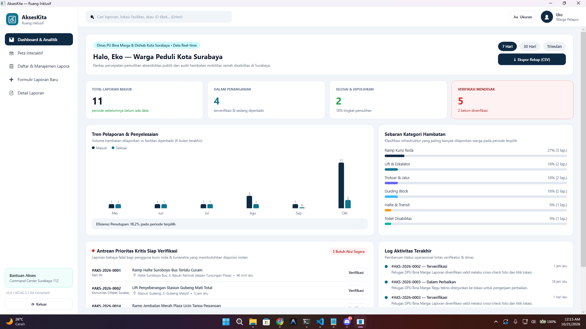
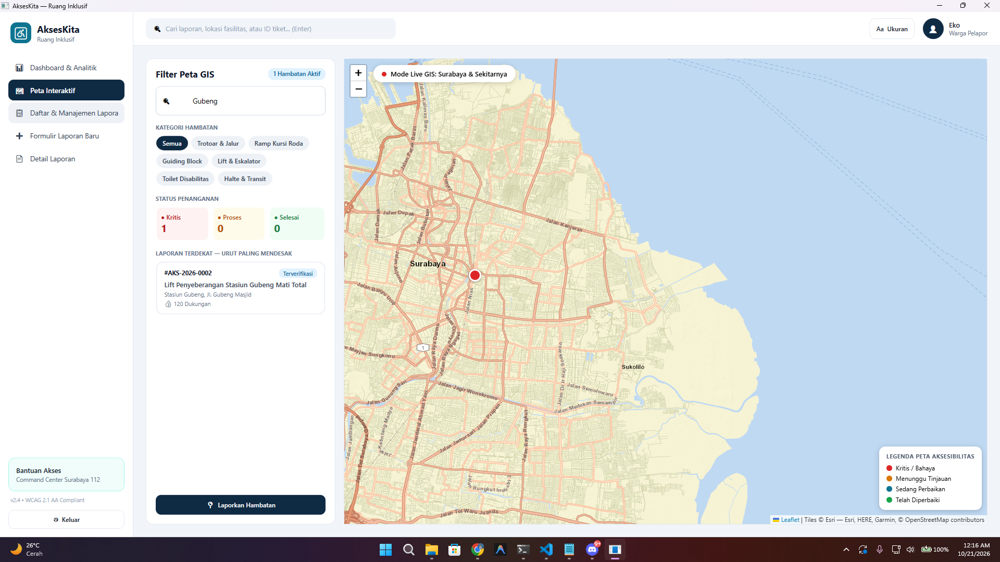
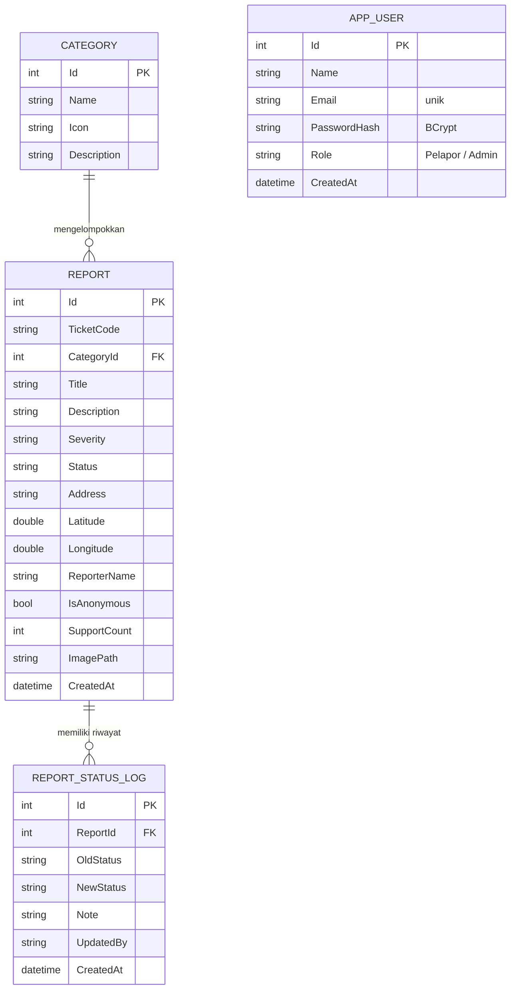

# AksesKita — Sistem Pelaporan Hambatan Aksesibilitas di Ruang Publik


**AksesKita** adalah aplikasi desktop untuk membantu warga melaporkan hambatan aksesibilitas di ruang publik, misalnya trotoar tanpa ramp, guiding block yang terputus, lift rusak, atau toilet yang tidak ramah kursi roda. Laporan dikelola oleh petugas, ditindaklanjuti, dan statusnya dapat dipantau. Wilayah sasaran saat ini adalah **Kota Surabaya**.

Proyek ini dikerjakan untuk mata kuliah **PBKK (Kelas D)**, berbasis **.NET (WPF)** dengan pola **MVVM** dan database **SQLite**.

---

## Identitas

| No | Nama | NRP |
|----|------|-----|
| 1 | Leyan Harits R W | 5025231288 |
| 2 | Achmad Najwa M | 5025231265 |
| 3 | Derryell Josua E P | 5025241175 |


---

## Daftar Isi

1. [Latar Belakang dan Tujuan](#1-latar-belakang-dan-tujuan)
2. [Pengguna dan Hak Akses](#2-pengguna-dan-hak-akses)
3. [Fitur Utama](#3-fitur-utama)
4. [Tampilan Aplikasi](#4-tampilan-aplikasi)
5. [Alur Penggunaan](#5-alur-penggunaan)
6. [Arsitektur dan Teknologi](#6-arsitektur-dan-teknologi)
7. [Model Data](#7-model-data)
8. [Aturan Validasi](#8-aturan-validasi)
9. [Cara Menjalankan](#9-cara-menjalankan)
10. [Data Contoh](#10-data-contoh)
11. [Keamanan dan Keterbatasan](#11-keamanan-dan-keterbatasan)
12. [Kesesuaian dengan PRD](#12-kesesuaian-dengan-prd)
13. [Pengembangan Lanjutan](#13-pengembangan-lanjutan)

---

## 1. Latar Belakang dan Tujuan

### Permasalahan

- Hambatan aksesibilitas sering tidak terdata sehingga pengelola tidak tahu lokasi dan jenis masalahnya.
- Laporan lewat media sosial atau pesan pribadi tersebar, tidak terstruktur, dan sulit dilacak tindak lanjutnya.
- Pengguna terdampak (pengguna kursi roda, tunanetra, lansia) tidak punya saluran yang jelas dan mudah diakses.
- Pengelola membutuhkan data terpilah (kategori, tingkat keparahan, lokasi) untuk menentukan prioritas perbaikan.

### Tujuan

1. Menyediakan satu tempat bagi warga untuk melaporkan hambatan beserta **lokasi, kategori, tingkat keparahan, dan foto**.
2. Membantu petugas **memverifikasi, memprioritaskan, dan menindaklanjuti** laporan.
3. Menampilkan ringkasan data (jumlah laporan, status, kategori, tren) pada **dashboard yang dihitung dari database**, bukan angka statis.
4. Memberi **transparansi**: status dan riwayat penanganan setiap laporan dapat dilihat.
5. Menerapkan struktur kode yang rapi (MVVM + lapisan service) agar mudah diuji dan dikembangkan.


---

## 2. Pengguna dan Hak Akses

Pengguna **masuk dengan email dan kata sandi**. Peran ditentukan oleh akun, bukan dipilih sendiri: akun baru yang didaftarkan lewat aplikasi selalu berperan **Warga Pelapor**, sedangkan akun **Admin / Petugas** hanya berasal dari data awal. Kelima menu tersedia untuk kedua peran; yang berbeda adalah aksi di dalam halamannya.

| Kemampuan | Warga Pelapor | Admin / Petugas |
|-----------|:-------------:|:---------------:|
| Melihat Dashboard & Analitik | ✅ | ✅ |
| Melihat Peta Interaktif | ✅ | ✅ |
| Melihat Daftar Laporan, mencari, dan memfilter | ✅ | ✅ |
| Membuat laporan baru (dengan foto & lokasi) | ✅ | ✅ |
| Melihat Detail Laporan dan riwayat penanganan | ✅ | ✅ |
| Memberi dukungan "Saya mengalami hal serupa (+1)" | ✅ | — |
| Mengubah status penanganan + catatan resmi | — | ✅ |
| Menghapus laporan | — | ✅ |
| Mengekspor rekap ke CSV | ✅ | ✅ |

---

## 3. Fitur Utama

### Kelola data (inti)

| Fungsi | Penjelasan |
|--------|------------|
| **Input** | Formulir laporan: kategori, tingkat hambatan, judul, deskripsi, lokasi (alamat + koordinat), foto bukti, opsi anonim. Setiap laporan mendapat kode tiket otomatis, misalnya `#AKS-2026-0019`. |
| **Penyimpanan** | Seluruh data tersimpan di database **SQLite** lewat **Entity Framework Core**, sehingga tetap ada setelah aplikasi ditutup. |
| **Tampil** | Daftar laporan, halaman detail, dashboard, dan peta, semuanya membaca dari database. |
| **Ubah** | Petugas mengubah status penanganan (Baru → Terverifikasi → Dalam Perbaikan → Selesai / Ditolak) disertai catatan; setiap perubahan tercatat sebagai riwayat. |
| **Hapus** | Petugas dapat menghapus laporan (dengan dialog konfirmasi). |

### Fitur tambahan

- **Dashboard & Analitik**: kartu statistik, tren pelaporan 6 bulan terakhir, sebaran kategori, antrean prioritas kritis, dan log aktivitas terakhir. Dapat difilter per **7 Hari / 30 Hari / Triwulan**.
- **Peta Interaktif (GIS)**: penanda laporan di peta Surabaya berwarna sesuai status, filter kategori / status / kata kunci, popup berisi ringkasan, tombol **rute jalan kaki** (membuka Google Maps), dan tombol menuju halaman detail.
- **Login dan registrasi**: kata sandi disimpan sebagai hash **BCrypt** (bukan teks asli), validasi email dan kekuatan kata sandi, serta penguncian sementara 60 detik setelah 5 kali salah memasukkan kata sandi.
- **Mode gelap/terang**: tombol di bilah atas mengganti tema seketika; pilihan diingat saat aplikasi dibuka lagi. Pasangan warna teks dan latar diuji agar memenuhi kontras WCAG AA (minimal 4,5:1).
- **Pencarian & filter**: pencarian global di bilah atas (tekan **Enter**) serta filter status, tingkat hambatan, dan "hanya laporan saya" pada daftar laporan.
- **Ekspor CSV** rekap laporan sesuai periode terpilih.
- **Lokasi cepat Surabaya**: 12 landmark (Tunjungan Plaza, Stasiun Gubeng, Balai Kota, Taman Bungkul, dan lainnya) yang mengisi alamat dan koordinat otomatis.
- **Aksesibilitas tampilan**: tombol **Ukuran** untuk memperbesar tampilan (100% → 112% → 125%), label teks pada setiap status (tidak bergantung warna saja), dan target SLA per tingkat hambatan.
- **Penanganan error**: kesalahan tak terduga ditampilkan sebagai pesan dan dicatat ke `crash.log`, aplikasi tidak menutup diam-diam.

---

## 4. Tampilan Aplikasi

> Seluruh tangkapan layar di bawah diambil pada peran **Warga Pelapor**. Pada peran Admin, halaman Daftar menampilkan tombol **Hapus** dan halaman Detail menampilkan panel **Aksi Petugas Verifikator**.

### 4.1 Dashboard & Analitik

Ringkasan kondisi aksesibilitas Surabaya: total laporan, laporan dalam penanganan, selesai, dan yang mendesak; tren bulanan, sebaran kategori, antrean prioritas kritis, dan log aktivitas.



### 4.2 Peta Interaktif

Peta Surabaya dengan penanda laporan. Panel kiri berisi pencarian, filter kategori, filter status (Kritis / Proses / Selesai), dan daftar laporan yang diurutkan dari yang paling mendesak. Pada contoh ini pencarian "Gubeng" menyisakan satu laporan.



### 4.3 Daftar & Manajemen Laporan

Daftar seluruh laporan dengan pencarian dan filter status / tingkat hambatan. Setiap baris menampilkan kode tiket, kategori, lokasi, jumlah dukungan, serta lencana status dan tingkat hambatan.


### 4.4 Formulir Laporan Baru

Formulir bertahap: pilih kategori, tingkat hambatan, isi rincian, tentukan lokasi (lokasi cepat atau koordinat manual), unggah foto, dan atur privasi (anonim).


### 4.5 Detail Laporan

Informasi lengkap satu tiket: banner urgensi dan target SLA, data pelapor, bukti foto, deskripsi dampak, koordinat lokasi, riwayat penanganan, dan tombol dukungan.


---

## 5. Alur Penggunaan

### Alur Warga Pelapor

1. Buka aplikasi, lalu **Daftar sekarang** (nama, email, kata sandi) atau masuk dengan akun demo `warga@akseskita.id`.
2. Buka menu **Formulir Laporan Baru**, pilih kategori dan tingkat hambatan, isi judul dan deskripsi.
3. Pilih lokasi (lokasi cepat Surabaya atau isi alamat dan koordinat), tambahkan foto bila ada.
4. Tekan **Kirim Laporan Hambatan**. Aplikasi membuka halaman detail dan menampilkan **kode tiket**.
5. Pantau status melalui **Detail Laporan**, **Daftar Laporan**, atau pencarian kode tiket di bilah atas.

### Alur Admin / Petugas

1. Masuk dengan akun petugas `admin@akseskita.id`.
2. Pantau **Dashboard**; laporan kritis yang belum ditangani muncul di *Antrean Prioritas Kritis* (tombol **Verifikasi** membuka detailnya).
3. Di **Detail Laporan**, pada panel *Aksi Petugas Verifikator*, pilih status baru, isi catatan, lalu **Simpan & Kirim Notifikasi Publik**. Perubahan langsung masuk ke riwayat dan log aktivitas dashboard.
4. Hapus laporan yang tidak valid dari daftar atau halaman detail.
5. Unduh rekap melalui tombol **Ekspor Rekap (CSV)** di dashboard.

---

## 6. Arsitektur dan Teknologi

### Pola MVVM

```
 View (XAML)  ⇄  ViewModel  →  Service  →  DbContext (EF Core)  →  SQLite
 tampilan         state &        logika       akses data            akseskita.db
                  command        bisnis
```

- **View**: file `.xaml` hanya berisi tampilan dan *binding*.
- **ViewModel**: menyimpan state dan command (`CommunityToolkit.Mvvm`: `[ObservableProperty]`, `[RelayCommand]`).
- **Service**: `IReportService` / `ReportService` menangani seluruh operasi data laporan (tambah, baca, ubah status, hapus, dukungan, log); `IAuthService` / `AuthService` menangani registrasi dan login; `ThemeService` mengatur tema terang/gelap.
- **Rules / Security**: aturan murni tanpa WPF (transisi status, validasi, izin, validasi akun, pembatas login, palet tema) dan `PasswordHasher` (BCrypt), sehingga mudah diuji.
- **Data**: `AksesKitaDbContext` membuat database dan mengisi data awal saat pertama dijalankan.

### Teknologi

| Komponen | Teknologi |
|----------|-----------|
| Bahasa / platform | C# · .NET 8 (`net8.0-windows`) · WPF |
| Pola arsitektur | MVVM dengan `CommunityToolkit.Mvvm` 8.4 |
| Database | SQLite via `Microsoft.EntityFrameworkCore.Sqlite` 8.0 |
| Keamanan kata sandi | `BCrypt.Net-Next` 4.0 |
| Peta | Leaflet di dalam `WebView2` + ubin peta Esri |
| Editor | Visual Studio Code (`dotnet` CLI) |

### Struktur Folder

```
AksesKita/
├── README.md
├── Images/                         # tangkapan layar untuk dokumentasi
├── AksesKita.sln
├── AksesKita.Tests/                # unit test (xUnit): status, validasi, izin, akun, BCrypt, login, kontras tema
└── AksesKita.Desktop/
    ├── AksesKita.Desktop.csproj
    ├── App.xaml(.cs)               # titik masuk, inisialisasi database
    ├── Converters.cs               # converter warna / visibilitas / enum
    ├── Formatters.cs               # format waktu, label status, target SLA
    ├── Assets/Map/index.html       # peta Leaflet (Surabaya)
    ├── Themes/Styles.xaml          # palet warna, kartu, tombol, chip
    ├── Models/                     # Report, Category, ReportStatusLog, enum
    ├── Rules/                      # aturan murni tanpa WPF: transisi status, validasi, izin ubah,
    │                               # validasi akun, pembatas login, palet tema
    ├── Security/                   # PasswordHasher (BCrypt)
    ├── Data/                       # AksesKitaDbContext + data awal (termasuk akun demo)
    ├── Services/                   # Report/Auth service, ThemeService, sesi pengguna
    ├── ViewModels/                 # Main, Login, Dashboard, ReportList,
    │                               # CreateReport, ReportDetail, Map
    └── Views/                      # MainWindow, LoginView, DashboardView,
                                    # MapView, ReportListView, CreateReportView,
                                    # ReportDetailView
```

---

## 7. Model Data



**Nilai enum**

| Enum | Nilai |
|------|-------|
| `SeverityLevel` (tingkat hambatan) | Rendah · Sedang · Kritis |
| `ReportStatus` (status penanganan) | Baru · Terverifikasi · Dalam Perbaikan · Selesai · Ditolak |

**Kategori hambatan awal:** Trotoar & Jalur · Ramp Kursi Roda · Guiding Block · Lift & Eskalator · Toilet Disabilitas · Halte & Transit.

**Target SLA** (informasi di halaman detail): Kritis 24 jam · Sedang 3 hari · Rendah 7 hari.

---

## 8. Aturan Validasi

| Isian | Aturan |
|-------|--------|
| Kategori | Wajib dipilih |
| Judul | Wajib, 5–100 karakter |
| Deskripsi | Wajib, minimal 20 karakter |
| Alamat / patokan lokasi | Wajib diisi |
| Koordinat | Latitude −90 s.d. 90, longitude −180 s.d. 180 (format desimal) |
| Foto | Opsional, JPG/PNG, maksimal 5 MB |
| Tingkat hambatan | Wajib; bawaan **Sedang** |
| Nama akun (registrasi) | Wajib, 3–60 karakter |
| Email | Format `nama@domain.tld`, tidak boleh sudah terdaftar; huruf besar/kecil disamakan |
| Kata sandi | Minimal 8 karakter, mengandung huruf dan angka, maksimal 72 karakter; harus sama dengan isian ulang |

Bila ada isian yang tidak valid, pesan penjelasan tampil di formulir dan data yang sudah diketik **tidak hilang**.

---

## 9. Cara Menjalankan

### Prasyarat

- **Windows 10/11** (WPF hanya berjalan di Windows)
- **.NET SDK 8 atau lebih baru** (dikembangkan dan diuji dengan .NET SDK 10; proyek menargetkan `net8.0-windows` dan otomatis mengikuti runtime yang tersedia)
- **Microsoft Edge WebView2 Runtime** (sudah ada di Windows 11 dan sebagian besar Windows 10 yang memakai Edge)
- **Koneksi internet** untuk memuat peta (Leaflet dan ubin peta). Bagian lain aplikasi berjalan tanpa internet.

### Langkah

```bash
# 1. Clone repository
git clone https://github.com/HaritsRambang/PBKK_D.git

# 2. Masuk ke folder proyek
cd PBKK_D/AksesKita/AksesKita.Desktop

# 3. Jalankan
dotnet run
```

Dengan **VS Code**: buka folder `AksesKita`, buka terminal, lalu jalankan perintah pada langkah 2–3. Visual Studio tidak diperlukan.

### Menggunakan aplikasi

1. Masuk dengan akun demo atau daftar akun baru:

   | Peran | Email | Kata sandi |
   |-------|-------|------------|
   | Admin / Petugas | `admin@akseskita.id` | `Admin2026` |
   | Warga Pelapor | `warga@akseskita.id` | `Warga2026` |

2. Jelajahi lima menu di sidebar kiri.
3. Tombol **Mode Gelap / Mode Terang** di bilah atas mengganti tema; tombol **Ukuran** mengubah ukuran tampilan.
4. Tombol **Keluar** di sidebar kiri bawah mengembalikan ke layar masuk.

### Lokasi data dan mengatur ulang

Database dan foto yang diunggah disimpan di samping file aplikasi:

```
AksesKita.Desktop/bin/Debug/net8.0-windows/
├── akseskita.db*      # database SQLite
└── Uploads/           # foto bukti yang dilampirkan
```

Untuk **mengembalikan data awal**, tutup aplikasi lalu hapus berkas `akseskita.db*` dan folder `Uploads` di lokasi tersebut. Saat dijalankan lagi, database dibuat ulang dan diisi data contoh serta dua akun demo. Pilihan tema tersimpan di `theme.txt` pada folder yang sama.

> Setelah memperbarui ke versi yang memiliki tabel pengguna, database lama otomatis dibuat ulang satu kali (penanda `SchemaVersion`).

### Menjalankan unit test

```bash
cd PBKK_D/AksesKita
dotnet test
```

Tes mencakup alur status (termasuk catatan wajib saat Ditolak), validasi isian formulir, izin mengubah laporan, validasi akun, hash dan verifikasi kata sandi BCrypt, pembatas percobaan login, serta kontras warna tema terang dan gelap.

### Pemecahan masalah

| Masalah | Penyebab / solusi |
|---------|-------------------|
| Peta kosong atau muncul pesan WebView2 | Pasang *Evergreen WebView2 Runtime* dan pastikan terhubung ke internet |
| `dotnet build` gagal menyalin `.exe` | Aplikasi masih terbuka; tutup dulu lalu build ulang |
| Muncul dialog "Terjadi kesalahan" | Detail teknis tersimpan di `crash.log` pada folder keluaran |

---

## 10. Data Contoh

Pada eksekusi pertama, database diisi otomatis dengan **2 akun demo**, **6 kategori**, dan **18 laporan contoh** di berbagai titik di Surabaya (Tunjungan, Stasiun Gubeng, Balai Kota, Taman Bungkul, Kampus ITS, Jembatan Merah, dan lainnya) dengan beragam tingkat hambatan, status, dan tanggal. Riwayat penanganan contoh juga dibuat sehingga grafik, dashboard, dan peta langsung terisi. Nama, alamat, dan angka pada data contoh hanyalah ilustrasi.

---

## 11. Keamanan dan Keterbatasan


**Yang sudah diterapkan**

- Akses data memakai **Entity Framework Core**, yaitu query berparameter, sehingga aman dari SQL injection.
- Validasi isian formulir, serta pembatasan jenis (JPG/PNG) dan ukuran (5 MB) foto.
- Opsi **laporan anonim**: nama pelapor ditampilkan sebagai "Anonim (Warga Peduli)".
- **Autentikasi**: login email + kata sandi, kata sandi disimpan sebagai hash BCrypt dengan salt acak, pesan galat yang sama untuk email salah maupun kata sandi salah, dan penguncian sementara setelah 5 kali gagal.
- **Hak akses berbasis peran**: peran melekat pada akun; pendaftaran publik selalu menghasilkan Warga Pelapor. Fitur admin (ubah status, hapus) tidak ditampilkan pada peran Warga, dan aturan izin juga diperiksa di lapisan service.

**Keterbatasan yang perlu diketahui**

- Aplikasi desktop lokal: tidak ada sesi server, pemulihan kata sandi, atau verifikasi email. Akun admin demo memakai kata sandi yang tercantum di dokumentasi ini dan sebaiknya diganti bila dipakai di luar keperluan tugas.
- Pembatasan laju pengiriman laporan (anti-spam) belum ada.
- Aplikasi berjalan lokal dengan satu database di komputer pengguna, belum multi-pengguna lewat jaringan.
- Dukungan "+1" hanya dibatasi satu kali per laporan selama aplikasi terbuka, belum disimpan per pengguna.

---

## 12. Kesesuaian dengan PRD

Rincian status terhadap kebutuhan fungsional pada PRD:

| ID | Fitur PRD | Status | Keterangan |
|----|-----------|:------:|------------|
| F-01 | Registrasi dan login | ✅ Selesai | Registrasi, login email + kata sandi (hash BCrypt), peran per akun, penguncian setelah 5 kali gagal |
| F-02 | Buat laporan | ✅ Selesai | Judul, kategori, tingkat, deskripsi, lokasi, foto, anonim |
| F-03 | Daftar laporan | ✅ Selesai | Pencarian, filter, dan *pagination* (10 laporan per halaman) |
| F-04 | Detail laporan | ✅ Selesai | Info lengkap, foto, riwayat status |
| F-05 | Ubah dan hapus laporan | ✅ Selesai | Pelapor dapat mengubah laporannya sendiri selama berstatus Baru; admin dapat mengubah laporan yang masih berjalan; hapus oleh admin |
| F-06 | Pencarian dan filter | 🟡 Sebagian | Kata kunci, status, tingkat hambatan; filter kategori di peta; belum ada filter tanggal |
| F-07 | Manajemen status | ✅ Selesai | Lima status + catatan, aturan alur status, dan catatan wajib saat Ditolak |
| F-08 | Dashboard | ✅ Selesai | Kartu statistik, tren, sebaran kategori, dari database |
| F-09 | Pelacakan dengan kode | 🟡 Sebagian | Pencarian kode tiket tersedia setelah masuk; belum ada pelacakan tanpa login |
| F-10 | Peta lokasi | ✅ Selesai | Peta Surabaya dengan penanda, filter, dan rute |
| F-11 | Dukungan laporan | 🟡 Sebagian | Tombol +1 berfungsi; belum disimpan per pengguna |
| F-12 | Ekspor data | ✅ Selesai | Ekspor CSV |
| F-13 | Mode gelap/terang | ✅ Selesai | Tombol pengalih tema, pilihan tersimpan, kontras diuji; tersedia juga pengaturan **Ukuran** tampilan |
| F-14 | Log aktivitas | ✅ Selesai | Riwayat perubahan status dan nama pengubahnya |


---


<p align="center">
  AksesKita · Proyek PBKK Kelas D · Kota Surabaya
</p>
