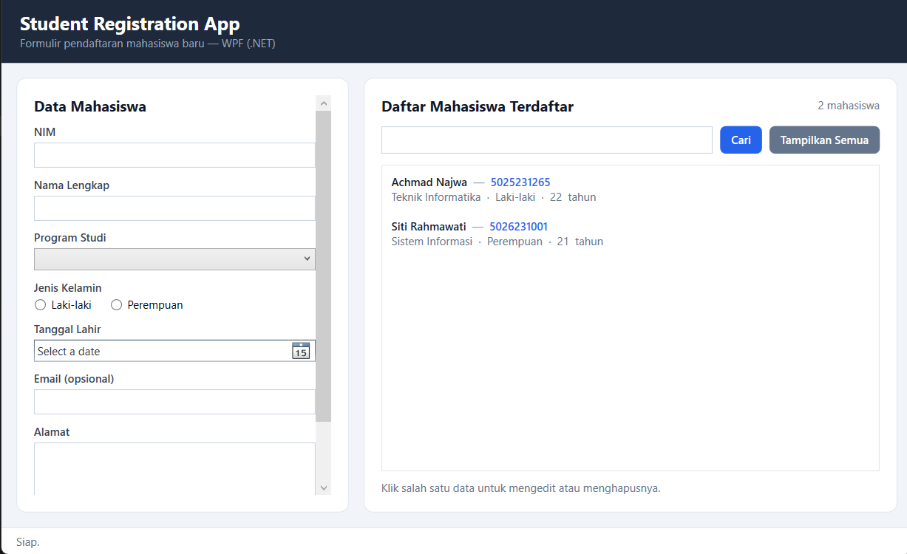
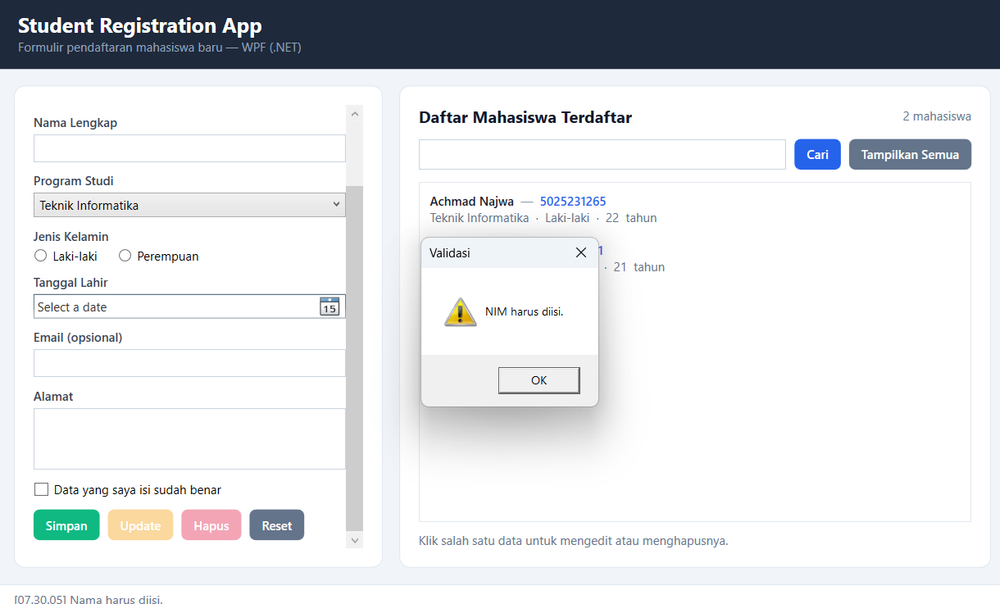
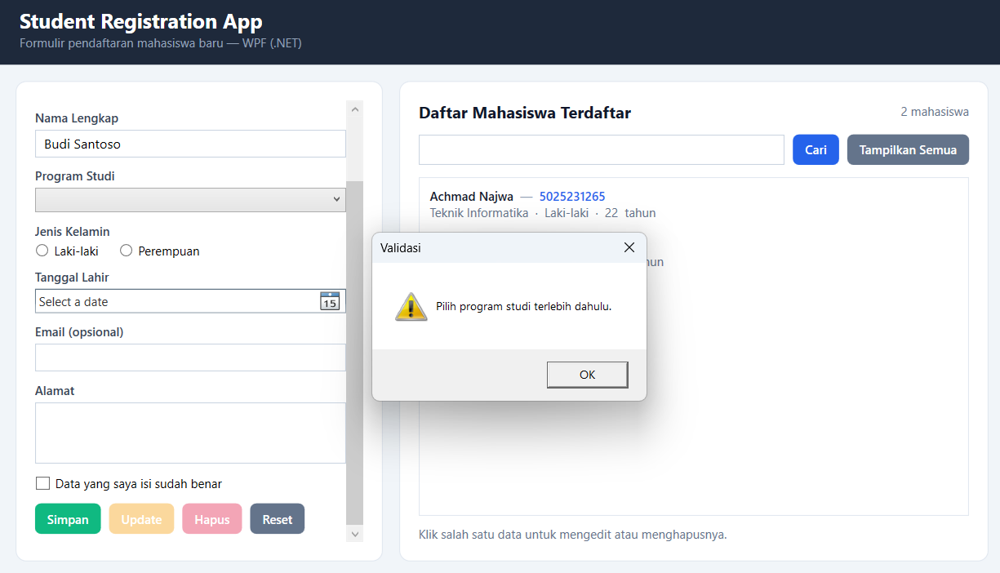
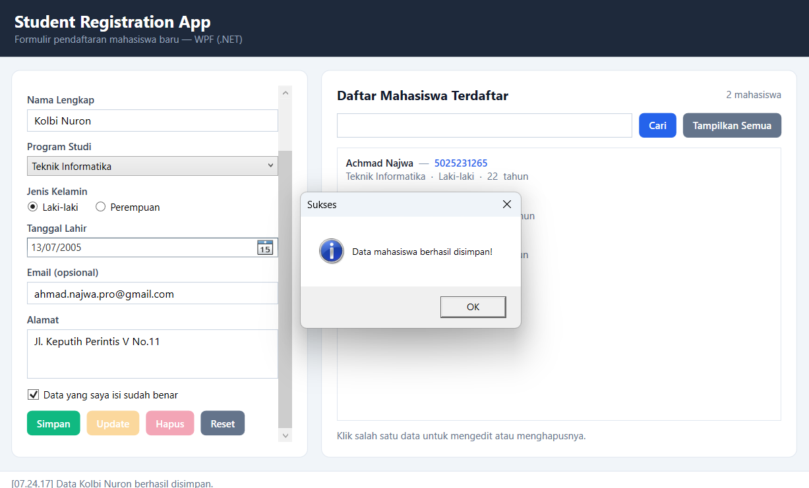
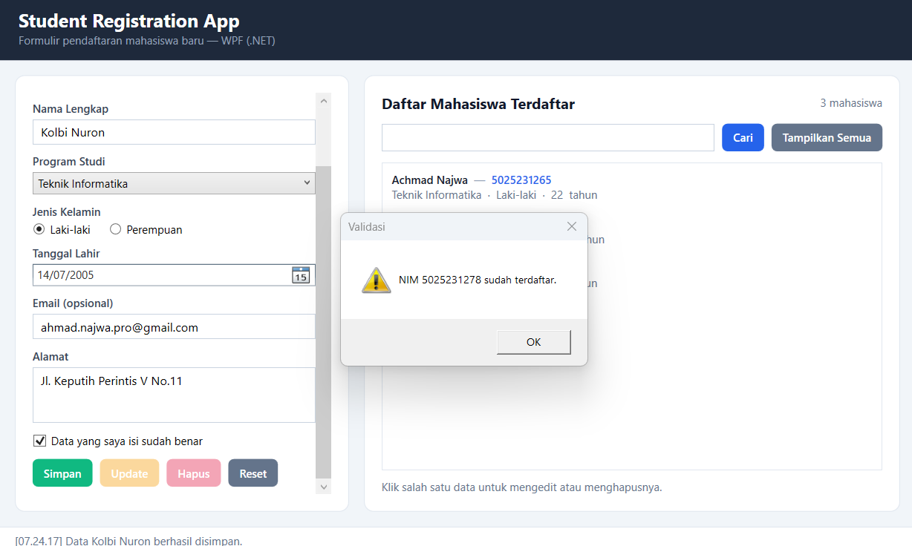
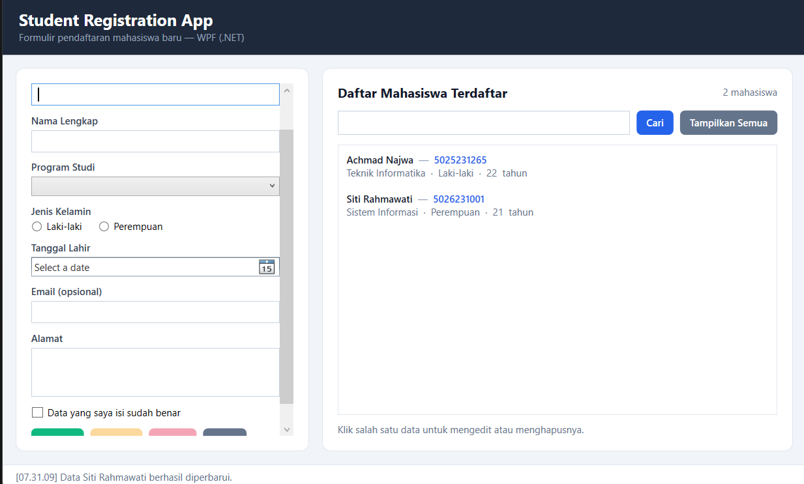
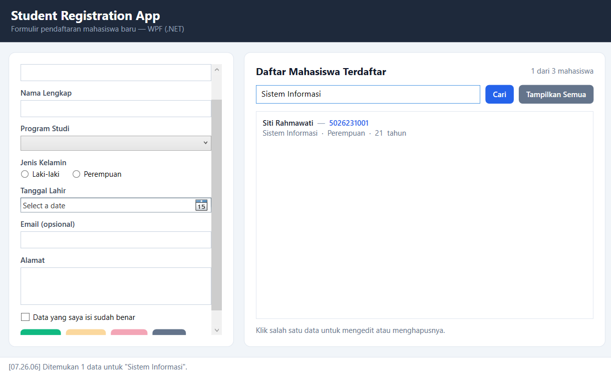
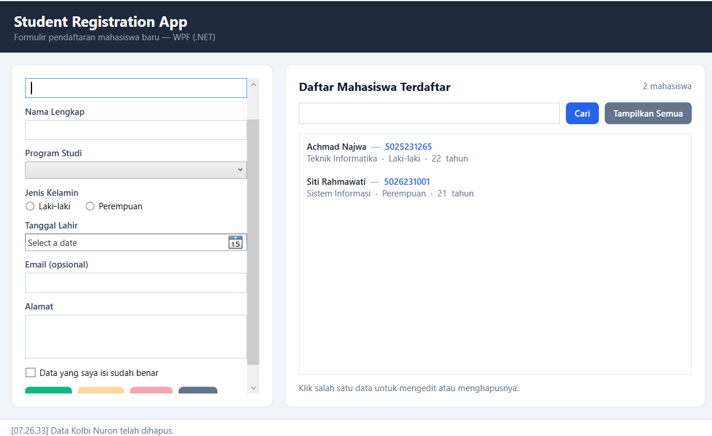
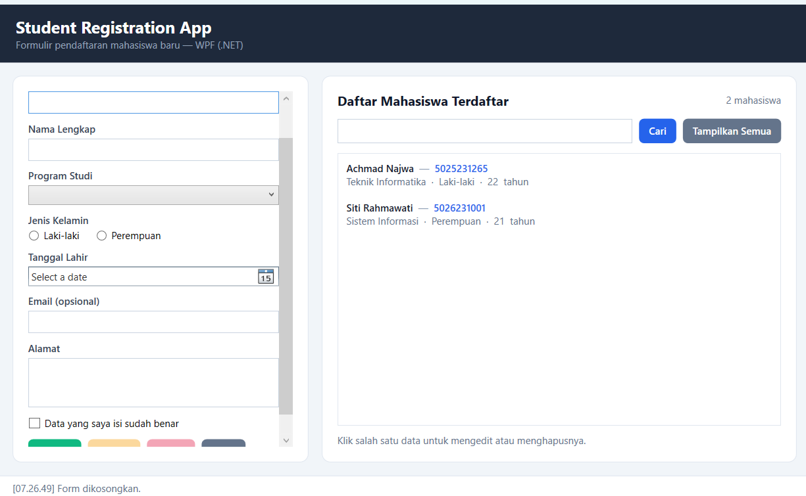

# Tugas Pemrograman Berbasis Kerangka Kerja (PBKK) — Minggu 4

**Nama:** Achmad Najwa
**NIM:** 5025231265
**Kelas:** PBKK D
**Departemen:** Teknik Informatika

---

## Daftar Isi

1. [Landasan Teori: Windows Presentation Foundation (WPF)](#1-landasan-teori-windows-presentation-foundation-wpf)
2. [Deskripsi Aplikasi](#2-deskripsi-aplikasi)
3. [Langkah Pengerjaan](#3-langkah-pengerjaan)
4. [Struktur Proyek](#4-struktur-proyek)
5. [Penjelasan Kode](#5-penjelasan-kode)
6. [Dokumentasi Pengujian](#6-dokumentasi-pengujian)

---

## 1. Landasan Teori: Windows Presentation Foundation (WPF)

WPF adalah framework antarmuka desktop di .NET yang menggantikan pendekatan Windows Forms. Perbedaan utamanya:

| Aspek | Windows Forms | WPF |
|---|---|---|
| Desain UI | Kode C# (Designer) | **XAML** (markup deklaratif) terpisah dari logika |
| Rendering | GDI+ (berbasis piksel) | DirectX (berbasis vektor, tajam di semua resolusi) |
| Layout | Posisi absolut (`Location`) | Panel fleksibel: `Grid`, `StackPanel`, `DockPanel`, `WrapPanel` |
| Styling | Properti per kontrol | `Style`, `ControlTemplate`, dan *resource* yang dapat dipakai ulang |
| Data | Diisi manual | **Data Binding** ke objek/koleksi |

Konsep yang dipakai pada latihan ini:

- **XAML** — mendeskripsikan tampilan. Setiap elemen XAML adalah objek .NET; atribut `x:Name` membuat field yang bisa diakses dari *code-behind*.
- **Layout panel** — `Grid` (baris/kolom), `StackPanel` (tumpuk vertikal/horizontal), `DockPanel` (menempel ke sisi), dan `WrapPanel` (membungkus ke baris berikutnya).
- **Event handler** — tombol memanggil method di `MainWindow.xaml.cs` lewat atribut `Click`.
- **Resource & Style** — warna dan gaya tombol didefinisikan sekali di `App.xaml` lalu dipakai berulang dengan `{StaticResource ...}`.
- **ObservableCollection + DataTemplate** — `ListBox` otomatis menampilkan data baru tanpa perlu di-*refresh* manual.

## 2. Deskripsi Aplikasi

**Student Registration App** adalah formulir pendaftaran mahasiswa baru. Data disimpan di memori (*in-memory*) selama aplikasi berjalan.

Fitur:

- **Simpan** — menambah mahasiswa baru setelah lolos validasi.
- **Edit/Update** — klik data di daftar, form terisi otomatis, ubah lalu klik **Update**.
- **Hapus** — menghapus data terpilih dengan dialog konfirmasi.
- **Cari** — mencari berdasarkan NIM, nama, atau program studi (tekan Enter atau klik **Cari**).
- **Reset** — mengosongkan seluruh isian form.
- **Validasi input**: NIM wajib 10 digit dan unik, nama minimal 3 karakter, program studi dan jenis kelamin wajib dipilih, usia minimal 15 tahun, format email (opsional), alamat wajib, dan kotak konfirmasi wajib dicentang.

Kontrol WPF yang digunakan: `TextBox`, `ComboBox`, `RadioButton`, `DatePicker`, `CheckBox`, `Button`, `ListBox` dengan `DataTemplate`, serta `MessageBox`.

## 3. Langkah Pengerjaan

```powershell
cd "D:\Semester 7\Pemrograman-Berbasis-Kerangka-Kerja\Minggu-04"
dotnet new wpf -n StudentRegistration
cd StudentRegistration
code .
```

Setelah file-file pada bagian 4 diisi, jalankan:

```powershell
dotnet run
```

## 4. Struktur Proyek

```text
Minggu-04/
└── StudentRegistration/
    ├── App.xaml                 # Resource global: warna & style tombol
    ├── App.xaml.cs
    ├── MainWindow.xaml          # Tampilan (form + daftar mahasiswa)
    ├── MainWindow.xaml.cs       # Event handler: Simpan, Update, Hapus, Cari, Reset
    ├── Models/
    │   ├── Student.cs           # Model data mahasiswa
    │   └── StudentValidator.cs  # Aturan validasi form
    ├── images/                  # Screenshot pengujian
    └── StudentRegistration.csproj
```

## 5. Penjelasan Kode

### 5.1 Model `Student`

```csharp
public class Student
{
    public string Nim { get; set; } = string.Empty;
    public string Nama { get; set; } = string.Empty;
    public string ProgramStudi { get; set; } = string.Empty;
    public string JenisKelamin { get; set; } = string.Empty;
    public DateTime TanggalLahir { get; set; }
    public string Email { get; set; } = string.Empty;
    public string Alamat { get; set; } = string.Empty;

    public int Usia { get { /* dihitung dari TanggalLahir */ } }
}
```

### 5.2 Validasi terpisah dari tampilan

Aturan validasi diletakkan di `StudentValidator` agar *code-behind* tetap ringkas dan aturan yang sama bisa dipakai ulang (misalnya pada versi MVVM minggu depan). Method mengembalikan `null` bila valid, atau pesan kesalahan pertama yang ditemukan.

```csharp
if (!NimPattern.IsMatch(nim.Trim()))
    return "NIM harus terdiri dari 10 digit angka.";
...
if (tanggalLahir.Value.Date > DateTime.Today.AddYears(-15))
    return "Usia mahasiswa minimal 15 tahun.";
```

### 5.3 Layout XAML

Jendela memakai `DockPanel`: header di atas, status bar di bawah, dan isi utama berupa `Grid` dua kolom (form 360 px di kiri, daftar mahasiswa mengisi sisa lebar di kanan).

```xml
<Grid.ColumnDefinitions>
    <ColumnDefinition Width="360"/>
    <ColumnDefinition Width="16"/>
    <ColumnDefinition Width="*"/>
</Grid.ColumnDefinitions>
```

`ListBox` memakai `DataTemplate` sehingga setiap item menampilkan nama, NIM, prodi, jenis kelamin, dan usia dalam dua baris:

```xml
<ListBox.ItemTemplate>
    <DataTemplate>
        <StackPanel Margin="4,6">
            <TextBlock FontWeight="SemiBold">
                <Run Text="{Binding Nama}"/> <Run Text=" — "/> <Run Text="{Binding Nim}"/>
            </TextBlock>
            ...
        </StackPanel>
    </DataTemplate>
</ListBox.ItemTemplate>
```

### 5.4 Event handler

```csharp
private readonly ObservableCollection<Student> _students = new();

private void BtnSimpan_Click(object sender, RoutedEventArgs e)
{
    if (!TryReadForm(out Student? student)) return;       // validasi
    if (_students.Any(s => s.Nim == student!.Nim)) { ... } // NIM unik
    _students.Add(student!);                               // ListBox otomatis ter-update
    ResetForm();
}
```

- Saat item `ListBox` dipilih (`SelectionChanged`), semua field form diisi dari data tersebut, tombol **Simpan** dinonaktifkan, sedangkan **Update** dan **Hapus** diaktifkan.
- **Update** mengganti item pada indeks yang sama (`_students[index] = updated`) sehingga tampilan ikut berubah.
- **Hapus** meminta konfirmasi `MessageBoxButton.YesNo` sebelum menghapus.
- **Cari** memfilter dengan LINQ `Where(...)` pada NIM, nama, atau prodi tanpa membedakan huruf besar/kecil.

## 6. Dokumentasi Pengujian

| No | Skenario | Hasil yang diharapkan | Screenshot |
|---|---|---|---|
| 1 | Tampilan awal | Form kosong dan dua data contoh tampil di daftar |  |
| 2 | NIM kosong / bukan 10 digit | Muncul peringatan validasi NIM | _Menyusul_ <!--  --> |
| 3 | Prodi atau jenis kelamin belum dipilih | Muncul peringatan untuk memilih | _Menyusul_ <!--  --> |
| 4 | Semua data benar lalu **Simpan** | Pesan sukses, data baru muncul di daftar | _Menyusul_ <!--  --> |
| 5 | NIM yang sama disimpan lagi | Peringatan "NIM sudah terdaftar" | _Menyusul_ <!--  --> |
| 6 | Pilih data, ubah, lalu **Update** | Data di daftar berubah | _Menyusul_ <!--  --> |
| 7 | **Cari** dengan kata kunci prodi | Hanya data yang cocok yang tampil |  |
| 8 | Pilih data lalu **Hapus** | Konfirmasi muncul, data terhapus |  |
| 9 | **Reset** | Seluruh isian form kembali kosong |  |
