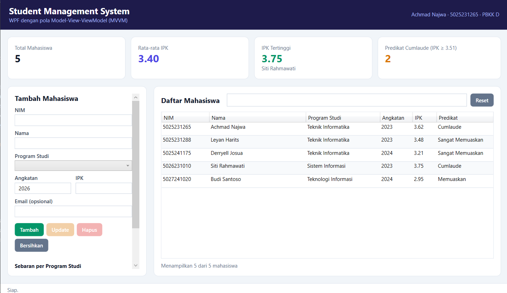
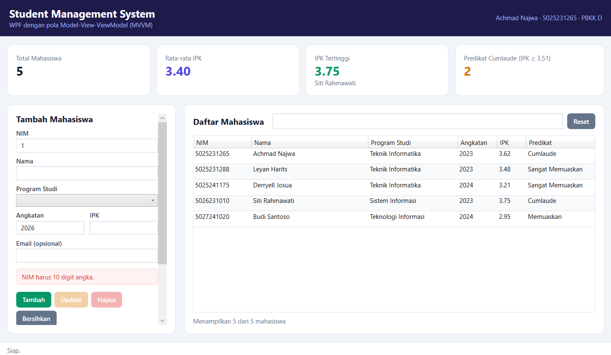
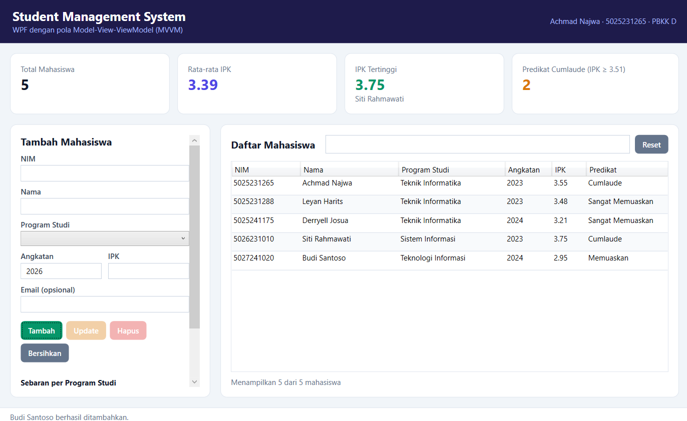
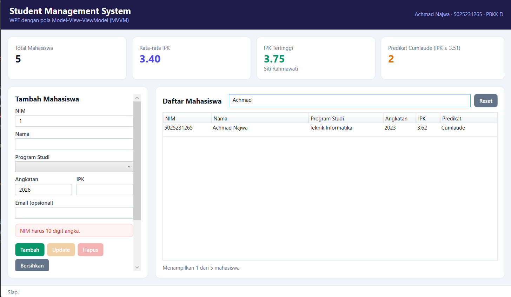
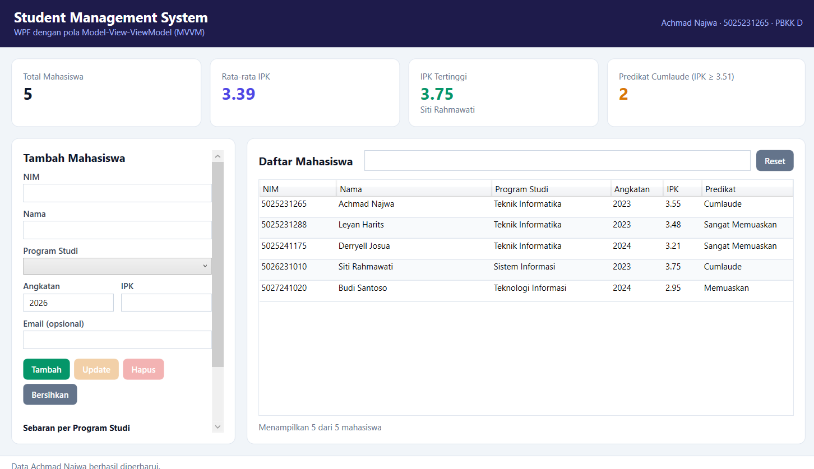
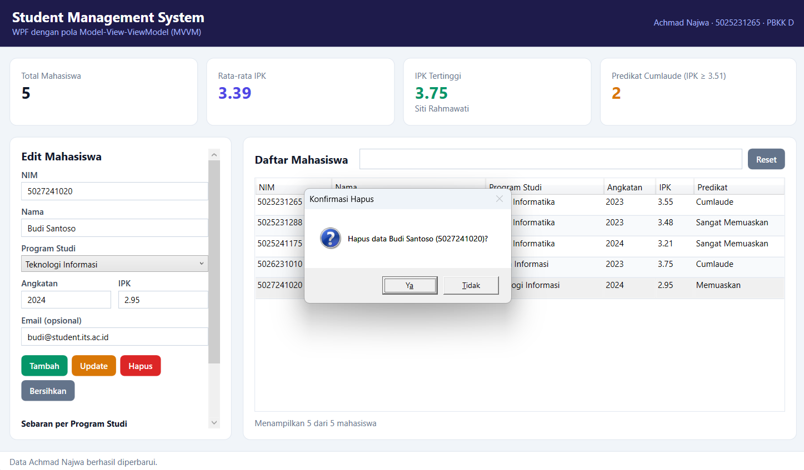
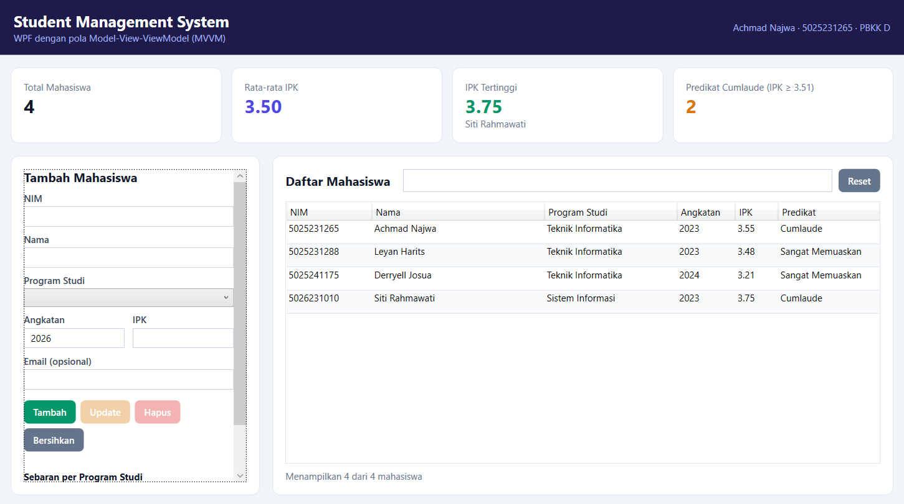

# Tugas Pemrograman Berbasis Kerangka Kerja (PBKK) — Minggu 5

**Nama:** Achmad Najwa
**NIM:** 5025231265
**Kelas:** PBKK D
**Departemen:** Teknik Informatika

---

## Daftar Isi

1. [Landasan Teori: Pola MVVM](#1-landasan-teori-pola-mvvm)
2. [Deskripsi Aplikasi](#2-deskripsi-aplikasi)
3. [Langkah Pengerjaan](#3-langkah-pengerjaan)
4. [Struktur Proyek](#4-struktur-proyek)
5. [Penjelasan Kode per Lapisan](#5-penjelasan-kode-per-lapisan)
6. [Perbandingan dengan Minggu 4 (Code-Behind)](#6-perbandingan-dengan-minggu-4-code-behind)
7. [Dokumentasi Pengujian](#7-dokumentasi-pengujian)

---

## 1. Landasan Teori: Pola MVVM

**Model-View-ViewModel (MVVM)** adalah pola arsitektur yang memisahkan aplikasi WPF menjadi tiga lapisan:

```
┌────────────┐   Data Binding    ┌───────────────┐   memanggil   ┌──────────────┐
│    View    │ ◄───────────────► │   ViewModel   │ ────────────► │    Model     │
│  (XAML)    │   Command         │ (state+logika)│               │ (data+repo)  │
└────────────┘                   └───────────────┘               └──────────────┘
```

| Lapisan | Tanggung jawab | Pada proyek ini |
|---|---|---|
| **Model** | Struktur data dan akses penyimpanan | `Student`, `IStudentRepository`, `JsonStudentRepository` |
| **View** | Tampilan saja, tanpa logika bisnis | `MainWindow.xaml` (code-behind kosong) |
| **ViewModel** | State form, daftar data, validasi, perintah | `MainViewModel` |

Mekanisme kunci MVVM di WPF:

- **Data Binding** — properti kontrol (`Text`, `ItemsSource`, `SelectedItem`) terhubung ke properti ViewModel lewat `{Binding ...}`.
- **INotifyPropertyChanged** — ViewModel memicu event `PropertyChanged` agar View memperbarui tampilan otomatis.
- **ObservableCollection&lt;T&gt;** — koleksi yang memberi tahu `DataGrid` saat item ditambah/dihapus.
- **ICommand** — tombol di-binding ke command (`Command="{Binding AddCommand}"`), bukan event `Click`. `CanExecute` otomatis menonaktifkan tombol.

Keuntungan: View dan logika terpisah, ViewModel dapat diuji tanpa membuka jendela, dan desain tampilan bisa diubah tanpa menyentuh logika.

## 2. Deskripsi Aplikasi

**Student Management System** adalah pengembangan dari aplikasi registrasi minggu lalu, kini dengan dashboard dan arsitektur MVVM.

Fitur:

- **Dashboard statistik**: total mahasiswa, rata-rata IPK, IPK tertinggi beserta namanya, dan jumlah mahasiswa cumlaude.
- **Sebaran per program studi**: jumlah dan rata-rata IPK tiap prodi dengan grafik batang sederhana.
- **CRUD**: tambah, pilih-untuk-edit, update, dan hapus (dengan konfirmasi).
- **Pencarian langsung** (*live search*) berdasarkan NIM, nama, atau prodi saat mengetik.
- **Validasi** ditampilkan inline di form: NIM 10 digit & unik, nama ≥ 3 karakter, prodi wajib, angkatan 2000–tahun ini, IPK 0–4 (menerima koma atau titik), email opsional.
- **Predikat kelulusan** otomatis dari IPK (Cumlaude, Sangat Memuaskan, Memuaskan, Cukup).
- **Penyimpanan persisten** ke file JSON di `%AppData%\StudentManagementMVVM\students.json`, sehingga data tetap ada setelah aplikasi ditutup.

## 3. Langkah Pengerjaan

```powershell
cd "D:\Semester 7\Pemrograman-Berbasis-Kerangka-Kerja\Minggu-05"
dotnet new wpf -n StudentManagementMVVM
cd StudentManagementMVVM
mkdir Models, ViewModels, Commands, Services, Views
```

Pindahkan `MainWindow.xaml` ke folder `Views`, ubah namespace-nya menjadi `StudentManagementMVVM.Views`, dan hapus `StartupUri` di `App.xaml` (jendela dibuat dari `App.xaml.cs`). Setelah semua file diisi:

```powershell
dotnet run
```

Tidak ada paket NuGet tambahan; `INotifyPropertyChanged`, `ICommand`, dan `System.Text.Json` sudah tersedia di .NET.

## 4. Struktur Proyek

```text
Minggu-05/
└── StudentManagementMVVM/
    ├── App.xaml / App.xaml.cs          # Resource global + composition root
    ├── Models/
    │   └── Student.cs                  # Data mahasiswa + Predikat
    ├── ViewModels/
    │   ├── ViewModelBase.cs            # INotifyPropertyChanged + SetProperty
    │   └── MainViewModel.cs            # State, validasi, statistik, command
    ├── Commands/
    │   └── RelayCommand.cs             # Implementasi ICommand
    ├── Services/
    │   ├── IStudentRepository.cs       # Abstraksi penyimpanan
    │   ├── JsonStudentRepository.cs    # Simpan/muat file JSON
    │   ├── IDialogService.cs           # Abstraksi dialog konfirmasi
    │   └── MessageBoxDialogService.cs  # Implementasi dengan MessageBox
    ├── Views/
    │   ├── MainWindow.xaml             # Tampilan dashboard
    │   └── MainWindow.xaml.cs          # Hanya InitializeComponent()
    └── images/                         # Screenshot pengujian
```

## 5. Penjelasan Kode per Lapisan

### 5.1 ViewModelBase — notifikasi perubahan

```csharp
public abstract class ViewModelBase : INotifyPropertyChanged
{
    public event PropertyChangedEventHandler? PropertyChanged;

    protected bool SetProperty<T>(ref T field, T value, [CallerMemberName] string? propertyName = null)
    {
        if (EqualityComparer<T>.Default.Equals(field, value)) return false;
        field = value;
        OnPropertyChanged(propertyName);   // View yang mem-binding properti ini ikut ter-update
        return true;
    }
}
```

`[CallerMemberName]` membuat nama properti terisi otomatis, sehingga cukup menulis `set => SetProperty(ref _nim, value);`.

### 5.2 RelayCommand — tombol tanpa event handler

```csharp
public class RelayCommand : ICommand
{
    public bool CanExecute(object? parameter) => _canExecute?.Invoke(parameter) ?? true;
    public void Execute(object? parameter) => _execute(parameter);
    public void RaiseCanExecuteChanged() => CanExecuteChanged?.Invoke(this, EventArgs.Empty);
}
```

Di ViewModel, tombol **Update** dan **Hapus** hanya aktif bila ada data terpilih:

```csharp
UpdateCommand = new RelayCommand(Update, () => SelectedStudent is not null);
DeleteCommand = new RelayCommand(Delete, () => SelectedStudent is not null);
```

### 5.3 MainViewModel — inti aplikasi

- **Properti form** (`Nim`, `Nama`, `ProgramStudi`, `Angkatan`, `Ipk`, `Email`) di-binding dua arah ke `TextBox`/`ComboBox` dengan `UpdateSourceTrigger=PropertyChanged`.
- **`SelectedStudent`** di-binding ke `DataGrid.SelectedItem`. Saat berubah, form diisi otomatis dan judul form menjadi "Edit Mahasiswa".
- **`SearchText`** memanggil `ApplyFilter()` di setter, sehingga daftar tersaring setiap kali pengguna mengetik.
- **Statistik** dihitung dengan LINQ lalu diumumkan ulang lewat `OnPropertyChanged` setiap data berubah:

```csharp
public string RataRataIpk => _allStudents.Average(s => s.Ipk).ToString("0.00", CultureInfo.InvariantCulture);
public int JumlahCumlaude => _allStudents.Count(s => s.Ipk >= 3.51);
```

- **Dialog** dipanggil lewat `IDialogService`, bukan `MessageBox` langsung, agar ViewModel tidak bergantung pada kelas UI.

### 5.4 View — hanya binding

```xml
<TextBox Text="{Binding Nim, UpdateSourceTrigger=PropertyChanged}" MaxLength="10"/>
<ComboBox ItemsSource="{Binding DaftarProdi}" SelectedItem="{Binding ProgramStudi}"/>

<Button Content="Tambah" Command="{Binding AddCommand}" .../>

<DataGrid ItemsSource="{Binding Students}"
          SelectedItem="{Binding SelectedStudent, Mode=TwoWay}" AutoGenerateColumns="False" IsReadOnly="True">
    <DataGridTextColumn Header="IPK" Binding="{Binding Ipk, StringFormat=0.00}"/>
    ...
</DataGrid>

<!-- Pesan error hanya muncul bila HasError = true -->
<Border Visibility="{Binding HasError, Converter={StaticResource BoolToVisibility}}">
    <TextBlock Text="{Binding ErrorMessage}"/>
</Border>
```

### 5.5 Composition root

```csharp
protected override void OnStartup(StartupEventArgs e)
{
    var viewModel = new MainViewModel(new JsonStudentRepository(), new MessageBoxDialogService());
    new MainWindow { DataContext = viewModel }.Show();
}
```

## 6. Perbandingan dengan Minggu 4 (Code-Behind)

| Aspek | Minggu 4 (code-behind) | Minggu 5 (MVVM) |
|---|---|---|
| Logika tombol | `Click="BtnSimpan_Click"` di code-behind | `Command="{Binding AddCommand}"` di ViewModel |
| Membaca isian form | `txtNim.Text` (akses kontrol langsung) | Properti `Nim` yang ter-binding |
| Enable/disable tombol | Diatur manual (`btnUpdate.IsEnabled = true`) | Otomatis dari `CanExecute` |
| Pengujian | Harus membuka jendela | ViewModel bisa diuji tanpa UI |
| Penyimpanan | Hilang saat aplikasi ditutup | Persisten di file JSON |

## 7. Dokumentasi Pengujian

| No | Skenario | Hasil yang diharapkan | Screenshot |
|---|---|---|---|
| 1 | Tampilan awal | Dashboard berisi statistik 5 data contoh |  |
| 2 | Tambah dengan NIM salah | Pesan merah "NIM harus 10 digit angka." |  |
| 3 | Tambah data valid | Data masuk tabel, statistik ikut berubah | _Menyusul_ <!--  --> |
| 4 | Ketik di kolom pencarian | Tabel tersaring langsung |  |
| 5 | Pilih baris lalu ubah IPK dan **Update** | Nilai dan predikat di tabel berubah |  |
| 6 | **Hapus** data terpilih | Muncul konfirmasi, data terhapus |  |
| 7 | Tutup lalu buka lagi aplikasi | Data terakhir masih ada (tersimpan di JSON) |  |
