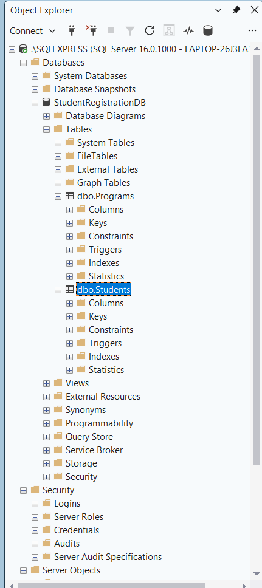
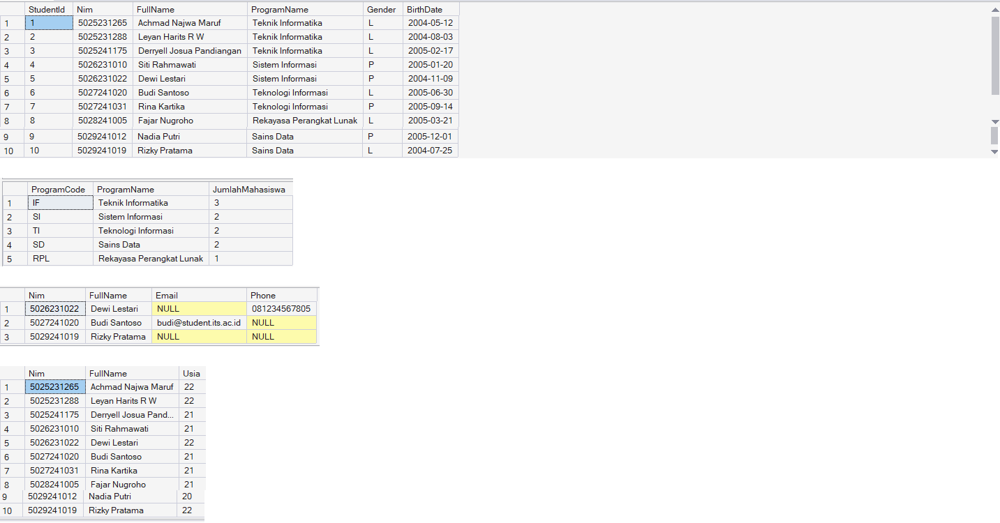
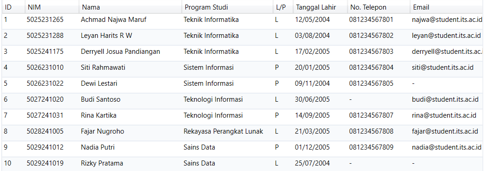
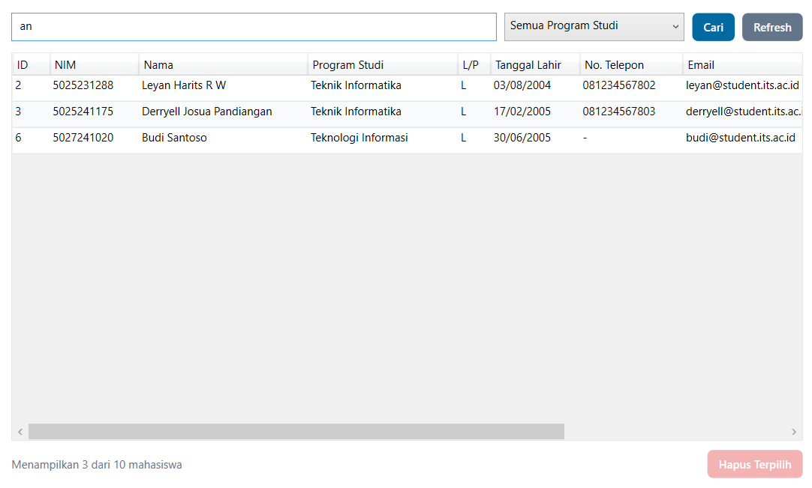
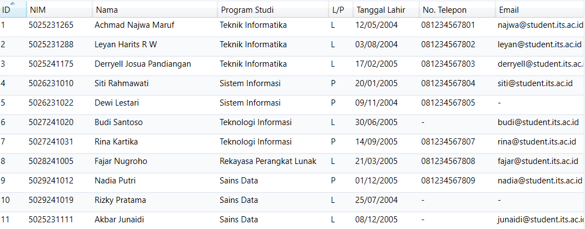
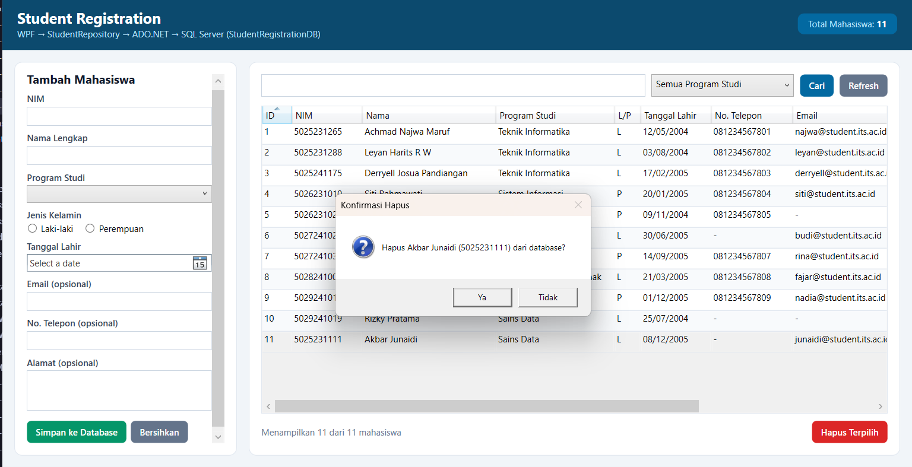
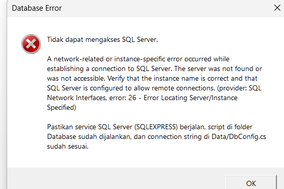

# Tugas Pemrograman Berbasis Kerangka Kerja (PBKK) — Minggu 6

**Nama:** Achmad Najwa
**NIM:** 5025231265
**Kelas:** PBKK D
**Departemen:** Teknik Informatika

---

## Daftar Isi

1. [Landasan Teori: SQL Server dan ADO.NET](#1-landasan-teori-sql-server-dan-adonet)
2. [Persiapan](#2-persiapan)
3. [Hands-On Lab 1 — Database Student Registration](#3-hands-on-lab-1--database-student-registration)
4. [Hands-On Lab 2 — Aplikasi WPF Terhubung SQL Server](#4-hands-on-lab-2--aplikasi-wpf-terhubung-sql-server)
5. [Mini Challenge](#5-mini-challenge)
6. [Dokumentasi Pengujian](#6-dokumentasi-pengujian)

---

## 1. Landasan Teori: SQL Server dan ADO.NET

**Microsoft SQL Server** adalah sistem manajemen basis data relasional (RDBMS) dari Microsoft. Bahasa query-nya adalah **T-SQL** (Transact-SQL). Untuk belajar dipakai edisi gratis **SQL Server Express**, dikelola melalui **SQL Server Management Studio (SSMS)**.

**ADO.NET** adalah komponen .NET untuk mengakses database. Alur yang dipakai pada lab ini:

```
WPF (MainWindow) → StudentRepository → ADO.NET → SQL Server → List<Student> → DataGrid
```

| Kelas ADO.NET | Fungsi |
|---|---|
| `SqlConnection` | Membuka koneksi ke SQL Server berdasarkan *connection string* |
| `SqlCommand` | Menyimpan perintah SQL beserta parameternya |
| `SqlParameter` | Mengirim nilai input secara aman (mencegah **SQL Injection**) |
| `SqlDataReader` | Membaca hasil `SELECT` baris per baris (*forward-only*, cepat) |
| `ExecuteScalar()` | Mengambil satu nilai, misalnya hasil `COUNT(*)` |
| `ExecuteNonQuery()` | Menjalankan `INSERT`/`UPDATE`/`DELETE`, mengembalikan jumlah baris terdampak |

`using var connection = ...` memastikan koneksi ditutup otomatis walaupun terjadi error.

## 2. Persiapan

1. Instal **SQL Server 2022 Express** (pilih *Basic*) dan **SSMS**.
2. Buka SSMS, login ke server `.\SQLEXPRESS` dengan *Windows Authentication*.
3. Proyek WPF memakai paket NuGet `Microsoft.Data.SqlClient`:

```powershell
cd "D:\Semester 7\Pemrograman-Berbasis-Kerangka-Kerja\Minggu-06"
dotnet new wpf -n StudentRegistrationSql
cd StudentRegistrationSql
dotnet add package Microsoft.Data.SqlClient
```

## 3. Hands-On Lab 1 — Database Student Registration

Script ada di folder [`Database/`](Database). Jalankan berurutan di SSMS (**File → Open → File**, lalu **Execute** / F5):

| File | Isi |
|---|---|
| [`01_create_database.sql`](Database/01_create_database.sql) | Membuat database `StudentRegistrationDB`, tabel `Programs` dan `Students`, constraint, dan index |
| [`02_seed_data.sql`](Database/02_seed_data.sql) | Mengisi 5 program studi dan 10 mahasiswa contoh |
| [`03_queries.sql`](Database/03_queries.sql) | Query latihan (JOIN, GROUP BY, LIKE, transaksi), `VIEW`, dan `STORED PROCEDURE` |

### 3.1 Rancangan tabel

```
Programs                          Students
──────────────────────            ──────────────────────────────
ProgramId   INT  PK  ◄──────┐     StudentId  INT  PK (IDENTITY)
ProgramCode NVARCHAR UNIQUE │     Nim        CHAR(10) UNIQUE
ProgramName NVARCHAR        │     FullName   NVARCHAR(100)
Faculty     NVARCHAR        │     Gender     CHAR(1)  CHECK ('L','P')
                            │     BirthDate  DATE
                            │     Email      NVARCHAR NULL
                            │     Phone      NVARCHAR NULL
                            │     Address    NVARCHAR NULL
                            └──── ProgramId  INT  FK
                                  CreatedAt  DATETIME2 DEFAULT SYSDATETIME()
```

Relasi **one-to-many**: satu program studi memiliki banyak mahasiswa.

### 3.2 Constraint yang dipakai

```sql
Nim       CHAR(10) NOT NULL CONSTRAINT UQ_Students_Nim UNIQUE,                 -- NIM tidak boleh kembar
Gender    CHAR(1)  NOT NULL CONSTRAINT CK_Students_Gender CHECK (Gender IN ('L','P')),
ProgramId INT      NOT NULL CONSTRAINT FK_Students_Programs REFERENCES dbo.Programs(ProgramId),
CreatedAt DATETIME2(0) NOT NULL CONSTRAINT DF_Students_CreatedAt DEFAULT SYSDATETIME(),
CONSTRAINT CK_Students_Nim CHECK (Nim NOT LIKE '%[^0-9]%')                     -- NIM hanya angka
```

### 3.3 Contoh query

```sql
-- Jumlah mahasiswa per prodi (LEFT JOIN agar prodi tanpa mahasiswa tetap muncul)
SELECT p.ProgramCode, p.ProgramName, COUNT(s.StudentId) AS JumlahMahasiswa
FROM dbo.Programs AS p
LEFT JOIN dbo.Students AS s ON s.ProgramId = p.ProgramId
GROUP BY p.ProgramCode, p.ProgramName
ORDER BY JumlahMahasiswa DESC;

-- Stored procedure: mahasiswa per kode prodi
EXEC dbo.sp_GetStudentsByProgram @ProgramCode = N'IF';
```

## 4. Hands-On Lab 2 — Aplikasi WPF Terhubung SQL Server

### 4.1 Struktur proyek

```text
StudentRegistrationSql/
├── App.xaml / App.xaml.cs
├── MainWindow.xaml            # Form tambah + DataGrid + pencarian/filter
├── MainWindow.xaml.cs         # Event handler, validasi, penanganan error
├── Data/
│   ├── DbConfig.cs            # Connection string
│   └── StudentRepository.cs   # Semua query ADO.NET
├── Models/
│   ├── Student.cs
│   └── StudyProgram.cs
└── StudentRegistrationSql.csproj
```

### 4.2 Connection string

```csharp
public const string ConnectionString =
    @"Server=.\SQLEXPRESS;Database=StudentRegistrationDB;Integrated Security=True;TrustServerCertificate=True;";
```

Jika nama instance berbeda (misalnya `(localdb)\MSSQLLocalDB`), ubah bagian `Server` di `Data/DbConfig.cs`.

### 4.3 Membaca data — `SqlDataReader`

```csharp
using var connection = new SqlConnection(_connectionString);
using var command = new SqlCommand(sql, connection);
command.Parameters.Add("@keyword", SqlDbType.NVarChar, 100).Value = (object?)kw ?? DBNull.Value;

connection.Open();
using SqlDataReader reader = command.ExecuteReader();
while (reader.Read())
{
    students.Add(new Student
    {
        StudentId = reader.GetInt32(reader.GetOrdinal("StudentId")),
        Nim       = reader.GetString(reader.GetOrdinal("Nim")),
        Email     = GetNullableString(reader, "Email"),   // kolom NULL ditangani
        ...
    });
}
```

Satu query dipakai untuk menampilkan semua data sekaligus pencarian: bila `@keyword` atau `@programId` bernilai `NULL`, kondisi filternya diabaikan.

```sql
WHERE (@keyword IS NULL OR s.Nim LIKE @pattern OR s.FullName LIKE @pattern)
  AND (@programId IS NULL OR s.ProgramId = @programId)
```

### 4.4 Menulis data — parameter dan `OUTPUT INSERTED`

```csharp
const string sql = @"
    INSERT INTO dbo.Students (Nim, FullName, Gender, BirthDate, Email, Phone, Address, ProgramId)
    OUTPUT INSERTED.StudentId
    VALUES (@nim, @name, @gender, @birthDate, @email, @phone, @address, @programId);";
...
return Convert.ToInt32(command.ExecuteScalar());   // ID baru dari IDENTITY
```

Input pengguna **tidak pernah** digabung langsung ke string SQL. Semuanya lewat parameter, sehingga input seperti `' OR 1=1 --` hanya dianggap teks biasa.

### 4.5 Penanganan error

Semua operasi database dibungkus `RunDb(...)`. Bila SQL Server mati atau connection string salah, aplikasi tidak *crash*, tetapi menampilkan `MessageBox` berjudul **Database Error** beserta petunjuk perbaikannya.

### 4.6 Fitur aplikasi

- Data dimuat otomatis saat jendela dibuka (`Loaded`) dan saat tombol **Refresh** diklik.
- `DataGrid` read-only berisi ID, NIM, Nama, Program Studi, L/P, Tanggal Lahir (`dd/MM/yyyy`), No. Telepon, Email, Alamat, dan Dibuat. Nilai `NULL` tampil sebagai `-`.
- Pencarian NIM/nama (Enter atau tombol **Cari**) dan filter program studi.
- Form **Tambah Mahasiswa** dengan validasi (NIM 10 digit & unik di database, nama, prodi, jenis kelamin, usia ≥ 15 tahun, email).
- **Hapus** baris terpilih dengan konfirmasi.

Menjalankan:

```powershell
dotnet run
```

## 5. Mini Challenge

| Challenge | Implementasi |
|---|---|
| Tampilkan kolom **Alamat** dan **Dibuat** | Kolom `Address` dan `CreatedAt` (`dd/MM/yyyy HH:mm`) ditambahkan ke query dan `DataGrid` |
| Tampilkan **Total Mahasiswa** | Method `GetCount()` menjalankan `SELECT COUNT(*) FROM dbo.Students` dengan `ExecuteScalar()`, ditampilkan di header |
| (Tambahan) Pencarian, filter prodi, tambah, dan hapus data | Query berparameter pada `Search`, `Insert`, dan `Delete` |

## 6. Dokumentasi Pengujian

| No | Skenario | Hasil yang diharapkan | Screenshot |
|---|---|---|---|
| 1 | Jalankan `01_create_database.sql` & `02_seed_data.sql` | Database dan tabel terbentuk di Object Explorer | _Menyusul_ <!--  --> |
| 2 | Jalankan `03_queries.sql` | Hasil JOIN, GROUP BY, VIEW, dan stored procedure | _Menyusul_ <!--  --> |
| 3 | Buka aplikasi WPF | 10 data tampil, Total Mahasiswa = 10 | _Menyusul_ <!--  --> |
| 4 | Cari "an" dan filter prodi | Data tersaring sesuai kata kunci & prodi | _Menyusul_ <!--  --> |
| 5 | Tambah mahasiswa baru | Data muncul di tabel & Total bertambah; cek juga di SSMS | _Menyusul_ <!--  --> |
| 6 | Hapus mahasiswa | Konfirmasi muncul, data hilang dari tabel | _Menyusul_ <!--  --> |
| 7 | Matikan service SQL Server lalu Refresh | Muncul MessageBox "Database Error" | _Menyusul_ <!--  --> |
