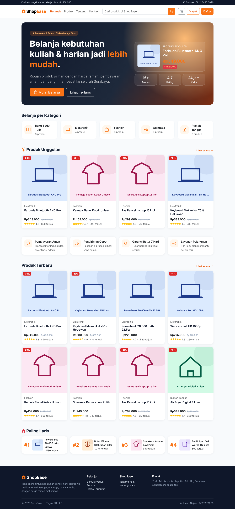
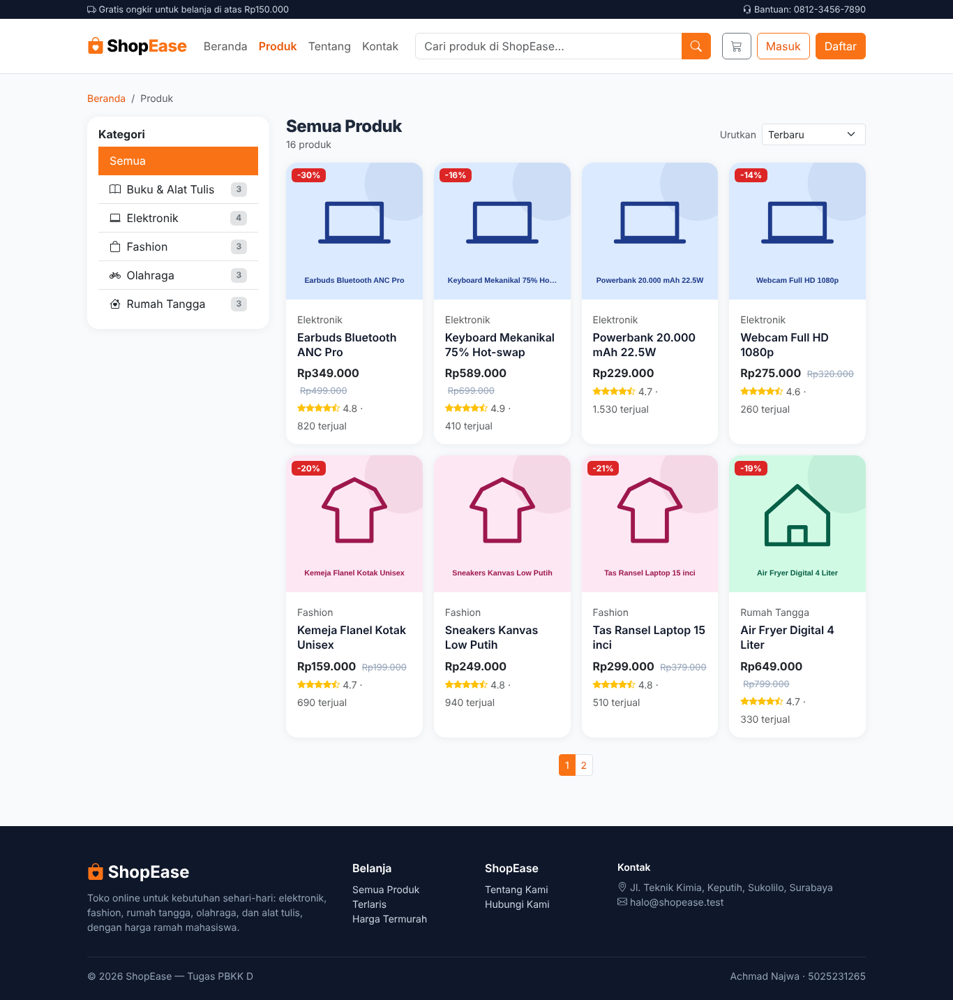
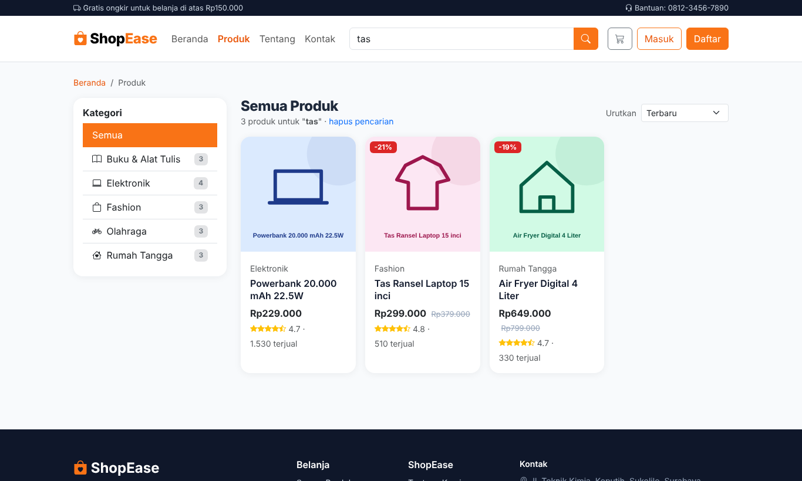
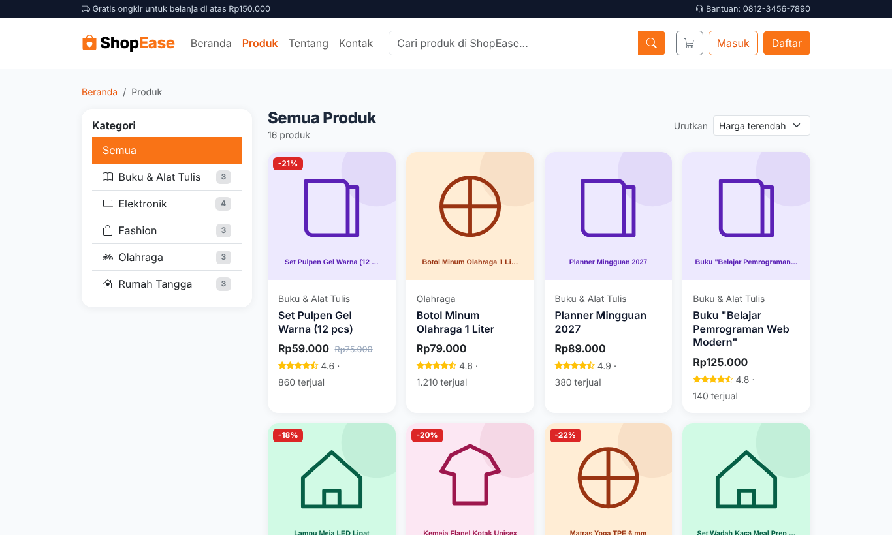
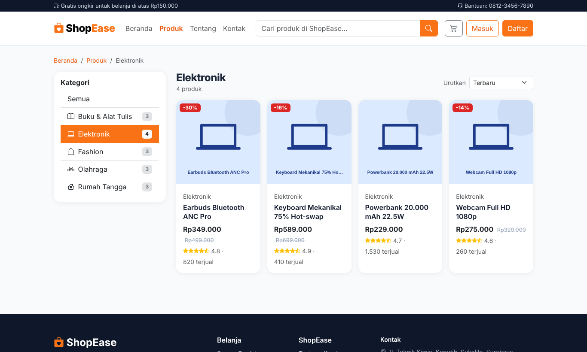
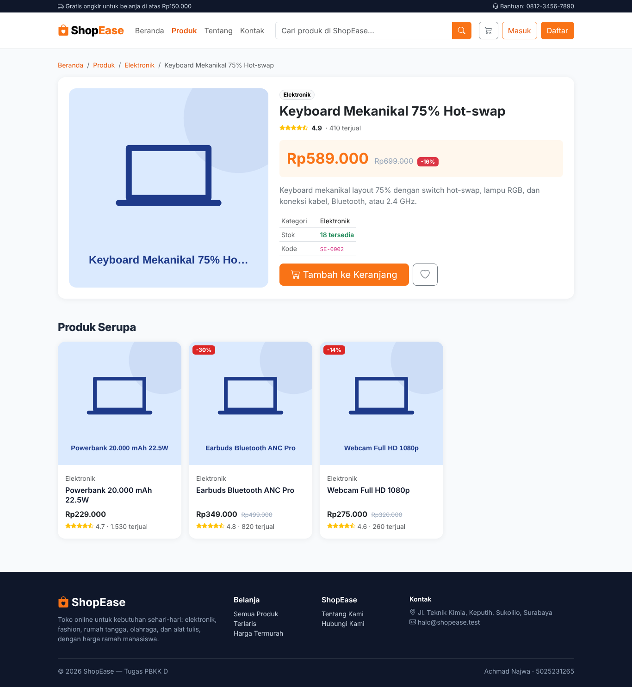
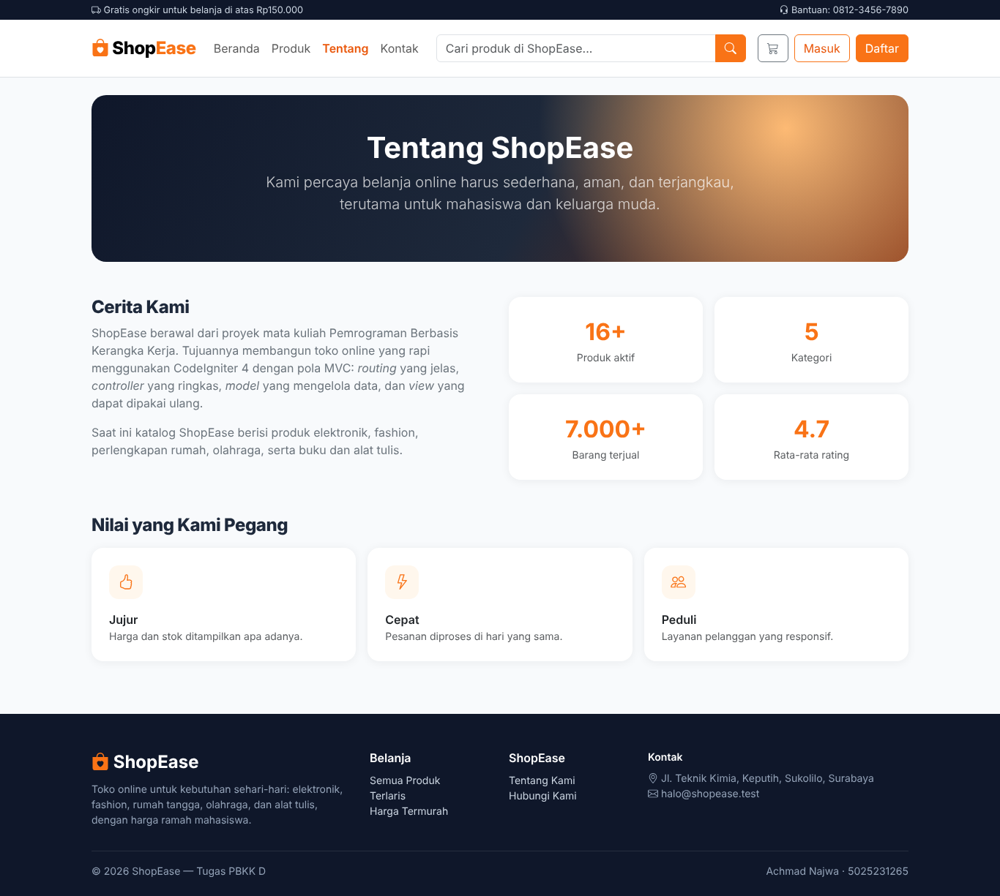
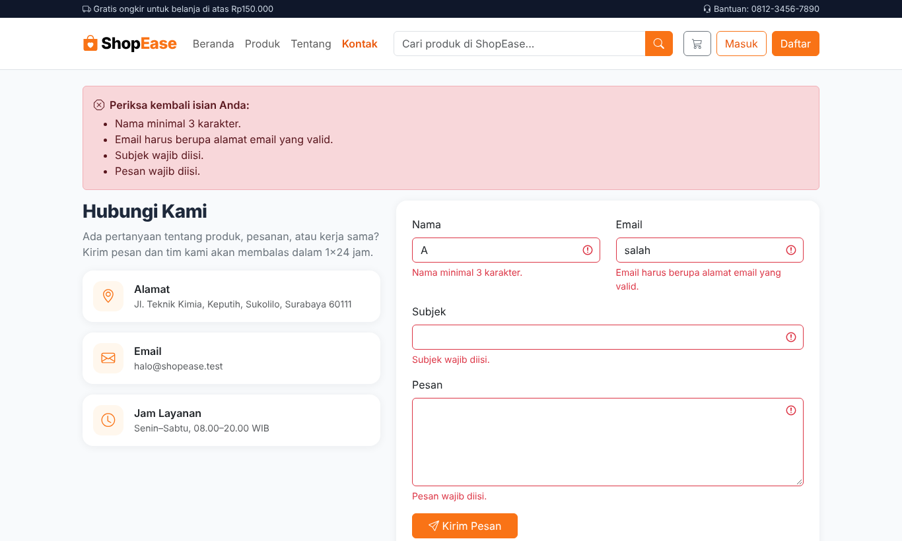
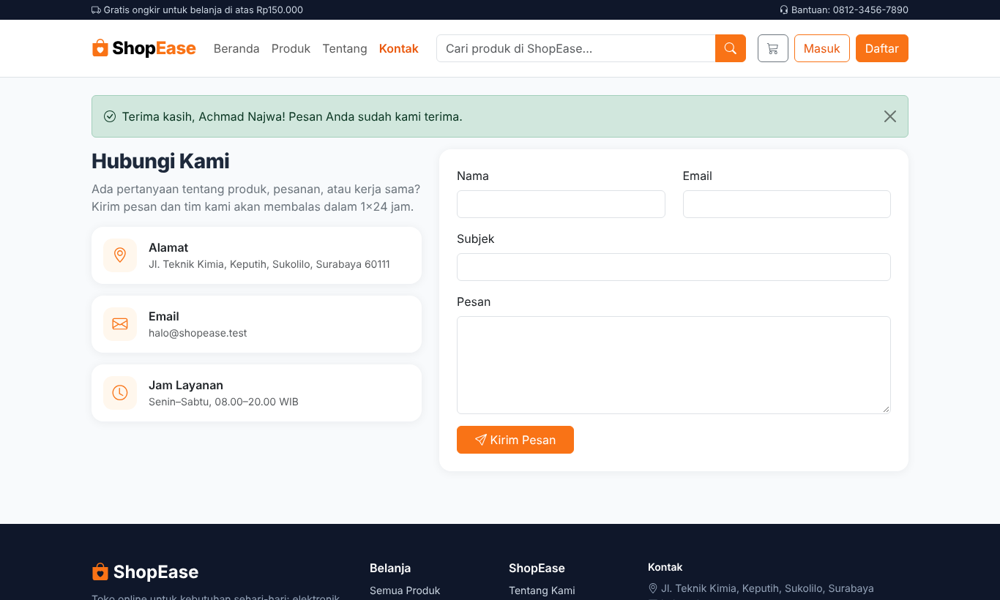
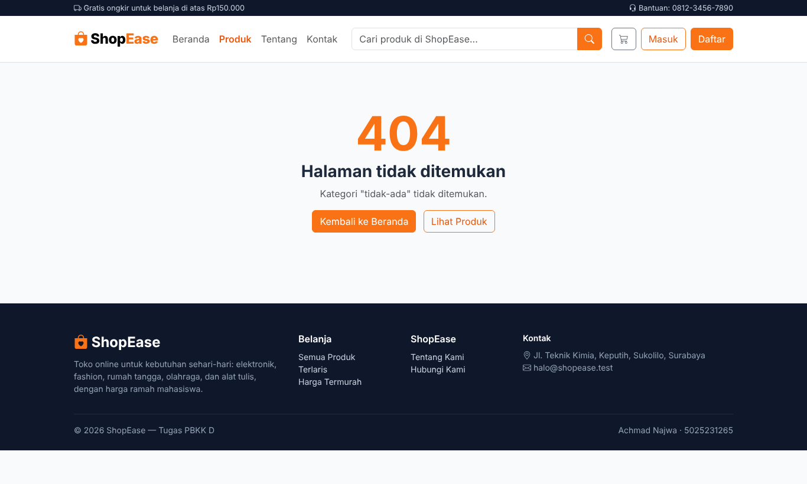

# Tugas Pemrograman Berbasis Kerangka Kerja (PBKK) — Minggu 10

**Nama:** Achmad Najwa
**NIM:** 5025231265
**Kelas:** PBKK D
**Materi:** MVC dan Routing CodeIgniter 4 — Landing Page E-Commerce **ShopEase**

---

## Daftar Isi

1. [Landasan Teori: MVC dan Routing](#1-landasan-teori-mvc-dan-routing)
2. [Deskripsi ShopEase](#2-deskripsi-shopease)
3. [Cara Menjalankan](#3-cara-menjalankan)
4. [Routing](#4-routing)
5. [Controller](#5-controller)
6. [Model dan Database](#6-model-dan-database)
7. [View, Layout, dan Partial](#7-view-layout-dan-partial)
8. [Struktur Proyek](#8-struktur-proyek)
9. [Dokumentasi Hasil](#9-dokumentasi-hasil)

---

## 1. Landasan Teori: MVC dan Routing

**MVC (Model-View-Controller)** memisahkan aplikasi web menjadi tiga peran:

| Lapisan | Pertanyaan yang dijawab | Di ShopEase |
|---|---|---|
| **Model** | *Data apa* yang dibutuhkan dan bagaimana mengambilnya? | `ProductModel::featured()`, `CategoryModel::withProductCount()` |
| **View** | *Bagaimana* data ditampilkan? | `home/index.php`, `partials/product_card.php` |
| **Controller** | *Apa* yang harus dilakukan untuk request ini? | `Products::category($slug)` |

**Routing** adalah peta dari URL ke controller. Alur satu request:

```
GET /kategori/fashion?urut=termurah
        │
        ▼  app/Config/Routes.php
$routes->get('kategori/(:segment)', 'Products::category/$1')
        │
        ▼  Controller
Products::category('fashion')  → CategoryModel::findBySlug('fashion')
                               → ProductModel::filter(null, 'fashion', 'termurah')->paginate(8)
        │
        ▼  View
view('products/index', [...]) → layouts/main → partials/navbar, product_card, footer
        │
        ▼
HTML dikirim ke browser
```

## 2. Deskripsi ShopEase

ShopEase adalah toko online dengan tema oranye dan biru gelap. Pada minggu ini dibangun bagian **publik**: landing page dan katalog. Fitur akun dibuat pada Minggu 11.

| Halaman | URL | Isi |
|---|---|---|
| Beranda | `/` | Hero promo + produk unggulan, kategori dengan jumlah produk, produk unggulan, keunggulan toko, produk terbaru, peringkat terlaris |
| Katalog | `/produk` | Sidebar kategori, pencarian `?q=`, pengurutan `?urut=` (terbaru/terlaris/termurah/termahal/rating), pagination |
| Kategori | `/kategori/{slug}` | Katalog yang difilter satu kategori, dengan breadcrumb |
| Detail produk | `/produk/{slug}` | Gambar, harga + harga coret + persen diskon, rating, stok, deskripsi, produk serupa |
| Tentang | `/tentang` | Profil toko |
| Kontak | `/kontak` | Form kontak (GET menampilkan, POST menyimpan ke database dengan validasi) |
| 404 kustom | URL apa pun yang tidak dikenal | Halaman "tidak ditemukan" bergaya ShopEase |

## 3. Cara Menjalankan

```powershell
cd "D:\Semester 7\Pemrograman-Berbasis-Kerangka-Kerja\Minggu-10\shopease"
composer install
copy .env.example .env          # atur koneksi database db_shopease
php spark migrate
php spark db:seed DatabaseSeeder
php spark serve                 # http://localhost:8080
```

## 4. Routing

Seluruh route ditulis eksplisit di `app/Config/Routes.php` (auto-routing CodeIgniter 4 tetap nonaktif, sehingga hanya URL yang terdaftar yang bisa diakses):

```php
$routes->get('/', 'Home::index', ['as' => 'home']);

// Katalog
$routes->get('produk', 'Products::index', ['as' => 'products']);
$routes->get('produk/(:segment)', 'Products::show/$1', ['as' => 'product']);
$routes->get('kategori/(:segment)', 'Products::category/$1', ['as' => 'category']);

// Halaman informasi
$routes->get('tentang', 'Pages::about', ['as' => 'about']);
$routes->get('kontak', 'Pages::contact', ['as' => 'contact']);
$routes->post('kontak', 'Pages::sendMessage');

// URL lama tetap berfungsi (redirect permanen)
$routes->addRedirect('shop', 'produk');

// Halaman 404 kustom
$routes->set404Override('App\Controllers\Errors::notFound');
```

Konsep routing yang dipakai:

| Konsep | Penjelasan |
|---|---|
| **HTTP verb** | `get()` untuk menampilkan, `post()` untuk mengirim form. URL `/kontak` yang sama menuju dua method berbeda |
| **Placeholder** | `(:segment)` menangkap slug, lalu diteruskan sebagai `$1` ke parameter method |
| **Named route** | `['as' => 'product']` sehingga view memakai `url_to('product', $slug)`, tidak menulis URL manual. Jika URL diganti di Routes, semua link ikut berubah |
| **Redirect route** | `/shop` diarahkan ke `/produk` (HTTP 301) |
| **404 override** | `PageNotFoundException` dari controller ditampilkan oleh `Errors::notFound` dengan layout ShopEase |

Daftar route bisa dicek dengan `php spark routes`.

## 5. Controller

| Controller | Method | Tugas |
|---|---|---|
| `Home` | `index()` | Mengumpulkan data beranda dari dua model |
| `Products` | `index()`, `category($slug)`, `show($slug)` | Katalog, halaman kategori, dan detail produk |
| `Pages` | `about()`, `contact()`, `sendMessage()` | Halaman informasi dan form kontak |
| `Errors` | `notFound()` | Halaman 404 |

Controller dibuat **tipis**: hanya membaca input, memanggil model, dan memilih view. `index()` dan `category()` memakai satu method privat `listing()` agar kode tidak terduplikasi:

```php
public function category(string $slug): string
{
    $category = (new CategoryModel())->findBySlug($slug)
        ?? throw PageNotFoundException::forPageNotFound("Kategori \"{$slug}\" tidak ditemukan.");

    return $this->listing(keyword: trim((string) $this->request->getGet('q')), category: $category, heading: $category['name']);
}
```

Nilai `?urut=` dicocokkan dengan daftar kunci yang diizinkan (`ProductModel::SORTS`) sebelum dipakai di `ORDER BY`, sehingga input pengguna tidak pernah langsung menjadi nama kolom SQL.

Form kontak memakai pola **Post/Redirect/Get**: setelah POST berhasil, pengguna di-redirect ke `GET /kontak` dengan *flash message*, sehingga menekan refresh tidak mengirim ulang pesan.

## 6. Model dan Database

Migration `CreateCatalogTables` membuat tiga tabel:

```
categories (id, name, slug UNIQUE, icon, description)
products   (id, category_id FK, name, slug UNIQUE, description, price, old_price,
            stock, sold, rating, is_featured, is_active, timestamps)
contact_messages (id, name, email, subject, message, created_at)
```

`CatalogSeeder` mengisi 5 kategori dan 16 produk.

Logika query dikumpulkan di model agar controller tetap ringkas:

```php
class ProductModel extends Model
{
    public function catalog(): self          // query dasar: produk aktif + JOIN kategori
    public function filter(?string $q, ?string $kategori, string $urut): self
    public function featured(int $limit = 4): array
    public function latest(int $limit = 8): array
    public function bestSellers(int $limit = 4): array
    public function findBySlug(string $slug): ?array
    public function related(array $product, int $limit = 4): array
}
```

`ContactMessageModel` menyimpan aturan validasi form kontak (`required`, `valid_email`, `min_length`), lengkap dengan label berbahasa Indonesia.

## 7. View, Layout, dan Partial

```
layouts/main.php            ← kerangka HTML, CSS, JS
 ├─ partials/navbar.php     ← topbar promo, menu aktif (url_is), kotak pencarian
 │   └─ partials/navbar_actions.php  ← tombol Masuk/Daftar (diganti pada Minggu 11)
 ├─ partials/flash.php      ← pesan sukses/error
 ├─ [section 'content']     ← diisi oleh halaman: home/index, products/index, ...
 └─ partials/footer.php
partials/product_card.php   ← kartu produk yang dipakai ulang di 4 halaman
```

Helper `shop_helper.php` berisi `rupiah()`, `discount_percent()`, `stars()`, dan `product_image()`. `product_image()` menghasilkan ilustrasi SVG sesuai kategori, sehingga katalog tetap rapi tanpa file gambar. Semua output memakai `esc()` untuk mencegah XSS.

## 8. Struktur Proyek

```text
Minggu-10/
├── README.md
├── images/
└── shopease/
    ├── app/
    │   ├── Config/Routes.php
    │   ├── Controllers/        # Home, Products, Pages, Errors
    │   ├── Database/
    │   │   ├── Migrations/2026-11-08-000001_CreateCatalogTables.php
    │   │   └── Seeds/          # DatabaseSeeder, CatalogSeeder
    │   ├── Helpers/shop_helper.php
    │   ├── Models/             # CategoryModel, ProductModel, ContactMessageModel
    │   └── Views/              # layouts, partials, home, products, pages, errors, Pager
    ├── public/assets/          # Bootstrap 5, Bootstrap Icons, shop.css
    ├── composer.json
    └── .env.example
```

## 9. Dokumentasi Hasil

| Beranda | Katalog |
|---|---|
|  |  |

| Pencarian `?q=tas` | Urut harga termurah |
|---|---|
|  |  |

| Halaman kategori `/kategori/elektronik` | Detail produk `/produk/{slug}` |
|---|---|
|  |  |

| Tentang | Validasi form kontak |
|---|---|
|  |  |

| Kontak berhasil dikirim | Halaman 404 kustom |
|---|---|
|  |  |
