# Tugas Pemrograman Berbasis Kerangka Kerja (PBKK) — Minggu 11

**Nama:** Achmad Najwa
**NIM:** 5025231265
**Kelas:** PBKK D
**Materi:** Authentication System & Model dengan CodeIgniter 4 — **ShopEase**

---

## Daftar Isi

1. [Landasan Teori: Autentikasi dan Otorisasi](#1-landasan-teori-autentikasi-dan-otorisasi)
2. [Fitur yang Ditambahkan](#2-fitur-yang-ditambahkan)
3. [Cara Menjalankan](#3-cara-menjalankan)
4. [Model Data Pengguna](#4-model-data-pengguna)
5. [Registrasi](#5-registrasi)
6. [Login dan Logout](#6-login-dan-logout)
7. [Filter: Auth, Guest, dan Role](#7-filter-auth-guest-dan-role)
8. [Dashboard per Peran](#8-dashboard-per-peran)
9. [Ringkasan Keamanan](#9-ringkasan-keamanan)
10. [Struktur Proyek](#10-struktur-proyek)
11. [Dokumentasi Pengujian](#11-dokumentasi-pengujian)

---

## 1. Landasan Teori: Autentikasi dan Otorisasi

| Istilah | Pertanyaan | Implementasi |
|---|---|---|
| **Autentikasi** | *Siapa* Anda? | Login email + password → identitas disimpan di **session** |
| **Otorisasi** | *Apa* yang boleh Anda lakukan? | Kolom `role` + **filter** di route (`role:admin`) |

Alur autentikasi berbasis session di CodeIgniter 4:

```
POST /masuk ──► Auth::login
                 ├─ validasi input
                 ├─ cek throttle (maks 5 gagal / 5 menit)
                 ├─ UserModel::findByEmail()
                 ├─ password_verify(input, password_hash)
                 ├─ session()->regenerate(true)          ← ID session baru
                 └─ session: user_id, user_name, user_email, user_role
                          │
GET /admin ──► Filter "auth" (sudah login? akun aktif?)
           ──► Filter "role:admin" (perannya admin?)
           ──► Admin\Dashboard::index
```

Password **tidak pernah** disimpan apa adanya. `password_hash()` menghasilkan hash bcrypt yang mengandung *salt* acak, dan `password_verify()` membandingkannya.

## 2. Fitur yang Ditambahkan

Proyek ini melanjutkan ShopEase Minggu 10 (katalog tetap sama) dan menambahkan:

| Fitur | URL | Akses |
|---|---|---|
| Registrasi customer | `/daftar` | Tamu |
| Login | `/masuk` | Tamu |
| Logout (POST + CSRF) | `/keluar` | Login |
| Ringkasan akun | `/akun` | Semua peran |
| Ubah profil & ganti password | `/akun/profil` | Semua peran |
| Dashboard operator: pantau & ubah stok | `/operator` | Operator, Admin |
| Dashboard admin: statistik pengguna, stok menipis, pesan kontak | `/admin` | Admin |
| Manajemen pengguna: filter, cari, ubah peran, aktif/nonaktifkan, buat akun staf | `/admin/pengguna` | Admin |

Tiga peran pengguna:

| Peran | Keterangan | Halaman awal setelah login |
|---|---|---|
| `customer` | Pembeli, didapat dari registrasi | `/akun` |
| `operator` | Staf toko yang mengurus stok | `/operator` |
| `admin` | Pengelola penuh | `/admin` |

Akun demo (dari `UserSeeder`):

| Peran | Email | Password |
|---|---|---|
| Admin | `admin@shopease.test` | `Admin#123` |
| Operator | `operator@shopease.test` | `Operator#123` |
| Customer | `najwa@student.its.ac.id` | `Customer#123` |

## 3. Cara Menjalankan

```powershell
cd "D:\Semester 7\Pemrograman-Berbasis-Kerangka-Kerja\Minggu-11\shopease"
composer install
copy .env.example .env          # atur koneksi database db_shopease
php spark migrate               # tabel katalog + tabel users
php spark db:seed DatabaseSeeder
php spark serve
```

## 4. Model Data Pengguna

Migration `2026-11-15-000001_CreateUsersTable`:

| Kolom | Tipe | Keterangan |
|---|---|---|
| `id` | INT PK AI | |
| `name` | VARCHAR(100) | |
| `email` | VARCHAR(120) **UNIQUE** | Disimpan huruf kecil |
| `phone` | VARCHAR(20) NULL | |
| `password_hash` | VARCHAR(255) | Hasil `password_hash()` |
| `role` | VARCHAR(20), default `customer` | `customer` / `operator` / `admin` |
| `is_active` | TINYINT, default 1 | Admin dapat menonaktifkan akun |
| `last_login_at` | DATETIME NULL | Diisi setiap login berhasil |
| `created_at`, `updated_at` | DATETIME | Otomatis (`useTimestamps`) |

`UserModel` memakai **model event** untuk meng-hash password secara otomatis, sehingga controller cukup mengirim field `password`:

```php
class UserModel extends Model
{
    protected $allowedFields = ['name', 'email', 'phone', 'password', 'password_hash', 'role', 'is_active', 'last_login_at'];
    protected $beforeInsert  = ['hashPassword'];
    protected $beforeUpdate  = ['hashPassword'];

    protected function hashPassword(array $data): array
    {
        if (isset($data['data']['password'])) {
            $data['data']['password_hash'] = password_hash($data['data']['password'], PASSWORD_DEFAULT);
            unset($data['data']['password']);
        }
        return $data;
    }
}
```

Aturan validasi registrasi disimpan sebagai konstanta `UserModel::REGISTER_RULES`, lalu dipakai ulang oleh registrasi, ubah profil, ganti password, dan pembuatan akun oleh admin.

## 5. Registrasi

| Field | Aturan |
|---|---|
| Nama lengkap | wajib, 3–100 karakter, hanya huruf/spasi/titik/petik |
| Email | wajib, format email, **unik** (`is_unique[users.email]`) |
| Nomor HP | opsional, diawali `08` atau `+628` |
| Password | 8–72 karakter, wajib mengandung huruf **dan** angka |
| Konfirmasi password | harus sama (`matches[password]`) |
| Syarat & ketentuan | wajib dicentang |

```php
$post = $this->request->getPost(['name', 'email', 'phone', 'password', 'password_confirm', 'terms']);
if (! $this->validateData($post, UserModel::REGISTER_RULES)) { ... }

$model->insert([
    'name' => $post['name'], 'email' => $post['email'], 'phone' => ...,
    'password'  => $post['password'],   // di-hash oleh model event
    'role'      => 'customer',          // selalu customer
    'is_active' => 1,
]);
```

Hanya field tertentu yang dibaca dari POST, dan `role` ditetapkan di server. Jika seseorang menambahkan `role=admin` ke form (diuji, lihat bagian 11), akun tetap dibuat sebagai `customer`. Setelah berhasil, pengguna langsung login dan diarahkan ke `/akun`.

## 6. Login dan Logout

```php
$throttler = service('throttler');
if ($throttler->check($throttleKey, 5, MINUTE * 5) === false) {
    return redirect()->back()->with('error', "Terlalu banyak percobaan login gagal. Coba lagi dalam {$wait} menit.");
}

$user = $model->findByEmail($email);
if ($user === null || ! password_verify($password, $user['password_hash'])) {
    return redirect()->back()->withInput()->with('error', 'Email atau password salah.');
}
if (! (int) $user['is_active']) { ... 'Akun Anda dinonaktifkan.' }

$this->startSession($user);   // session()->regenerate(true) + simpan identitas
return redirect()->to(session('intended_url') ?: dashboard_url($user['role']));
```

- **Pesan error yang sama** untuk email tidak terdaftar maupun password salah, sehingga penyerang tidak bisa mengetahui email mana yang terdaftar.
- **Throttling**: kunci `IP + email`, maksimal 5 percobaan gagal per 5 menit, memakai `Throttler` bawaan CodeIgniter.
- **Intended URL**: tamu yang membuka `/akun/profil` diarahkan ke login, lalu setelah login dikembalikan ke `/akun/profil`.
- **`password_needs_rehash()`**: hash diperbarui otomatis bila algoritma default PHP berubah.
- **Logout** memakai form POST dengan token CSRF (bukan link GET), lalu `session()->destroy()`.

## 7. Filter: Auth, Guest, dan Role

Didaftarkan di `app/Config/Filters.php` lalu dipasang per *route group*:

```php
$routes->group('', ['filter' => 'guest'], static function ($routes) {
    $routes->get('masuk', 'Auth::loginForm', ['as' => 'login']);
    $routes->get('daftar', 'Auth::registerForm', ['as' => 'register']);
    ...
});
$routes->group('akun', ['filter' => 'auth'], ...);
$routes->group('operator', ['filter' => ['auth', 'role:operator,admin'], ...], ...);
$routes->group('admin', ['filter' => ['auth', 'role:admin'], ...], ...);
```

| Filter | Fungsi |
|---|---|
| `AuthFilter` | Menolak tamu dan menyimpan `intended_url`. Setiap request juga mengecek ulang ke database bahwa akun masih ada dan **aktif**: jika admin menonaktifkan akun, sesi pengguna itu langsung berakhir pada request berikutnya |
| `GuestFilter` | Pengguna yang sudah login dan membuka `/masuk` atau `/daftar` diarahkan ke dashboard-nya |
| `RoleFilter` | Menerima argumen peran (`role:operator,admin`). Peran yang tidak cocok diarahkan ke dashboard sendiri dengan pesan "tidak memiliki akses" |

Helper `shop_helper.php` (di-autoload lewat `Config/Autoload.php` agar juga tersedia di filter) menyediakan `auth_check()`, `auth_user()`, `dashboard_url()`, dan `role_badge()`. Navbar memakai helper ini untuk menampilkan tombol **Masuk/Daftar** bagi tamu, atau menu akun (nama, email, peran, dashboard, profil, keluar) bagi pengguna yang login.

## 8. Dashboard per Peran

- **Customer** (`/akun`): sapaan, tanggal bergabung, login terakhir, data akun.
- **Profil & Keamanan** (`/akun/profil`): ubah nama/email/HP (email tetap unik, kecuali milik sendiri), ganti password (wajib password lama yang benar, password baru harus berbeda, lalu ID session diganti).
- **Operator** (`/operator`): jumlah produk habis & menipis, tabel produk diurutkan dari stok terkecil, ubah stok langsung per baris.
- **Admin** (`/admin`): jumlah customer/operator/admin, produk aktif, pengguna terbaru, stok menipis, pesan kontak terbaru.
- **Manajemen pengguna** (`/admin/pengguna`): filter per peran, cari nama/email, ubah peran & status aktif, serta buat akun operator/admin baru. Admin tidak bisa mengubah peran atau menonaktifkan akunnya sendiri, sehingga tidak bisa terkunci di luar sistem.

## 9. Ringkasan Keamanan

| Ancaman | Penanganan |
|---|---|
| Password bocor dari database | `password_hash()` (bcrypt + salt), kolom password asli tidak pernah ada |
| Brute force login | Throttler: 5 percobaan gagal / 5 menit per IP + email |
| Enumerasi email | Pesan login gagal yang seragam |
| Session fixation | `session()->regenerate(true)` saat login, daftar, dan ganti password |
| CSRF | Filter `csrf` global, semua form (termasuk logout) memakai `csrf_field()` |
| Eskalasi hak akses saat daftar | `role` ditetapkan server (`customer`), field POST dipilih eksplisit |
| Akses halaman tanpa izin | `AuthFilter` + `RoleFilter` di level route |
| Akun dinonaktifkan tetapi sesi masih aktif | `AuthFilter` mengecek `is_active` di setiap request |
| XSS | Semua output memakai `esc()` |

## 10. Struktur Proyek

File baru/diubah dibanding Minggu 10:

```text
shopease/app/
├── Config/
│   ├── Autoload.php          # helper 'shop' di-autoload
│   ├── Filters.php           # alias auth, guest, role
│   └── Routes.php            # route group autentikasi, akun, operator, admin
├── Controllers/
│   ├── Auth.php              # daftar, masuk, keluar
│   ├── Account.php           # ringkasan akun, profil, ganti password
│   ├── Admin/Dashboard.php, Admin/Users.php
│   └── Operator/Dashboard.php
├── Database/
│   ├── Migrations/2026-11-15-000001_CreateUsersTable.php
│   └── Seeds/UserSeeder.php
├── Filters/                  # AuthFilter, GuestFilter, RoleFilter
├── Helpers/shop_helper.php   # + auth_check, auth_user, dashboard_url, role_badge
├── Models/UserModel.php
└── Views/
    ├── layouts/auth.php, layouts/dashboard.php
    ├── auth/login.php, auth/register.php
    ├── account/index.php, account/profile.php
    ├── admin/dashboard.php, admin/users.php
    ├── operator/dashboard.php
    └── partials/navbar_actions.php   # menu akun di navbar
```

## 11. Dokumentasi Pengujian

### Hasil uji fungsional

| No | Skenario | Hasil |
|---|---|---|
| 1 | Daftar dengan data tidak valid | 6 pesan validasi muncul (nama, email, HP, password, konfirmasi, syarat) |
| 2 | Daftar dengan email yang sudah terdaftar (huruf besar/kecil berbeda) | "Email ini sudah terdaftar. Silakan login." |
| 3 | Daftar valid dengan tambahan `role=admin` di POST | Berhasil, langsung login, role tersimpan `customer`, hash diawali `$2y$` |
| 4 | Login password salah | "Email atau password salah." |
| 5 | Buka `/akun/profil` sebagai tamu → login | Kembali ke `/akun/profil` (intended URL) |
| 6 | Customer membuka `/admin` dan `/operator` | Diarahkan ke `/akun` dengan pesan tidak memiliki akses |
| 7 | Pengguna login membuka `/masuk` atau `/daftar` | Diarahkan ke dashboard |
| 8 | Ubah email ke email akun lain | "Email ini sudah dipakai akun lain." |
| 9 | Ganti password dengan password lama salah / benar | Ditolak / berhasil, lalu login dengan password baru berhasil |
| 10 | Operator membuka `/operator`, mengubah stok, lalu mengisi stok negatif | Halaman terbuka, stok tersimpan, nilai negatif ditolak |
| 11 | Operator membuka `/admin` | Ditolak |
| 12 | Admin membuat akun operator baru | Berhasil |
| 13 | Admin mencoba menonaktifkan akunnya sendiri | Ditolak |
| 14 | Admin menonaktifkan akun customer yang sedang login | Sesi customer langsung berakhir, login berikutnya ditolak "Akun Anda dinonaktifkan" |
| 15 | 6× login gagal berturut-turut | Percobaan ke-6 dan seterusnya: "Terlalu banyak percobaan login gagal" (termasuk dengan password benar sampai jeda habis) |

### Screenshot

| Halaman login | Login gagal |
|---|---|
| 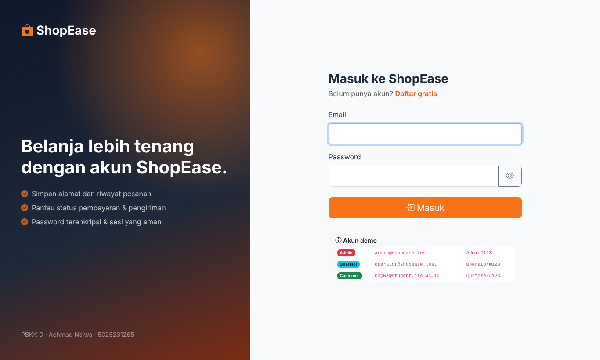 | 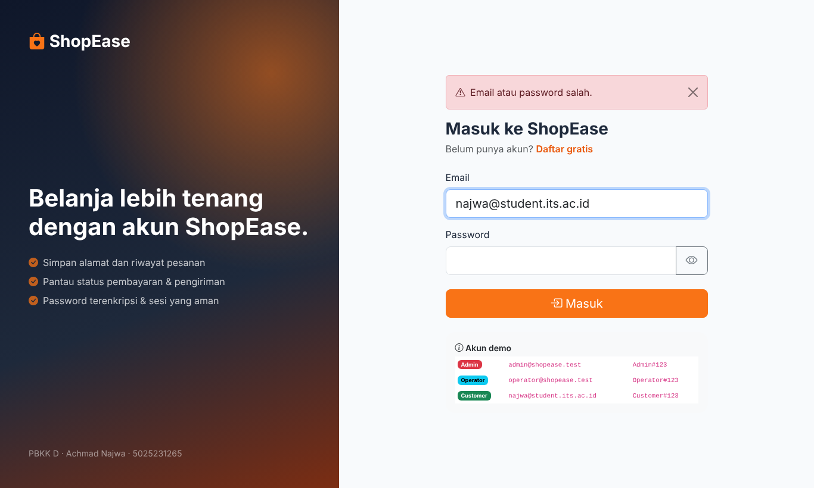 |

| Validasi registrasi | Registrasi berhasil → dashboard customer |
|---|---|
| 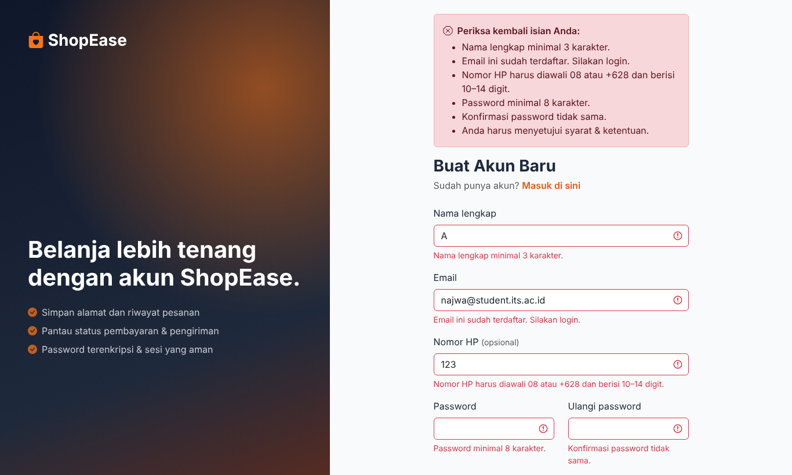 | 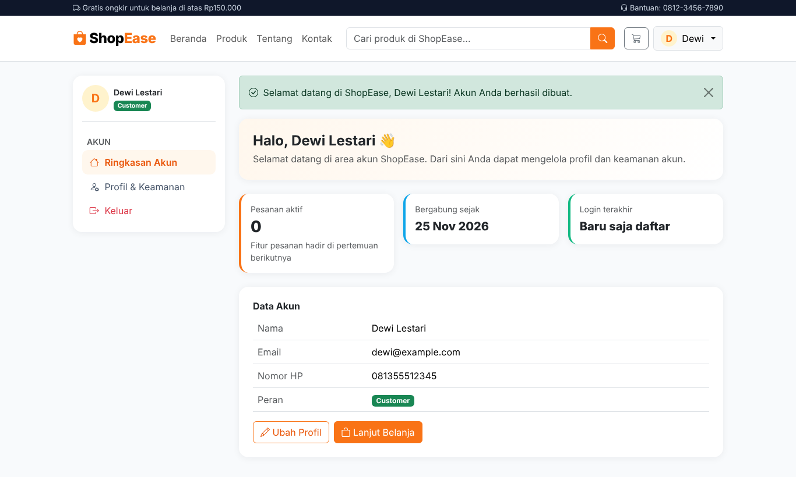 |

| Menu akun di navbar | Profil & ganti password |
|---|---|
| 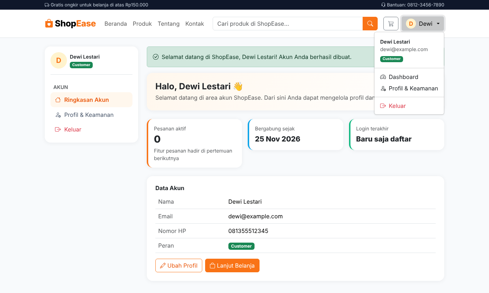 | 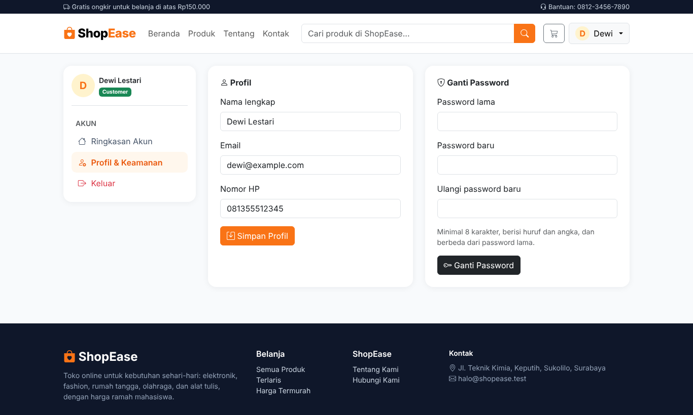 |

| Customer ditolak membuka `/admin` | Dashboard operator |
|---|---|
| 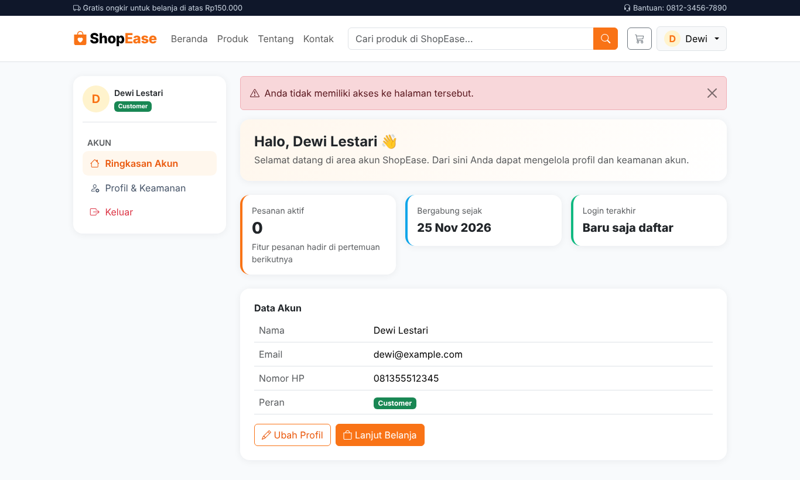 | 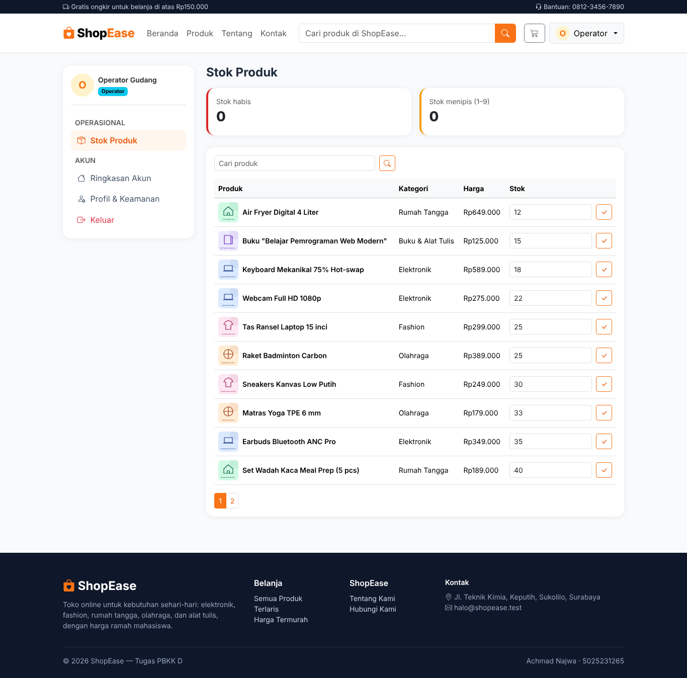 |

| Operator ditolak membuka `/admin` | Dashboard admin |
|---|---|
| 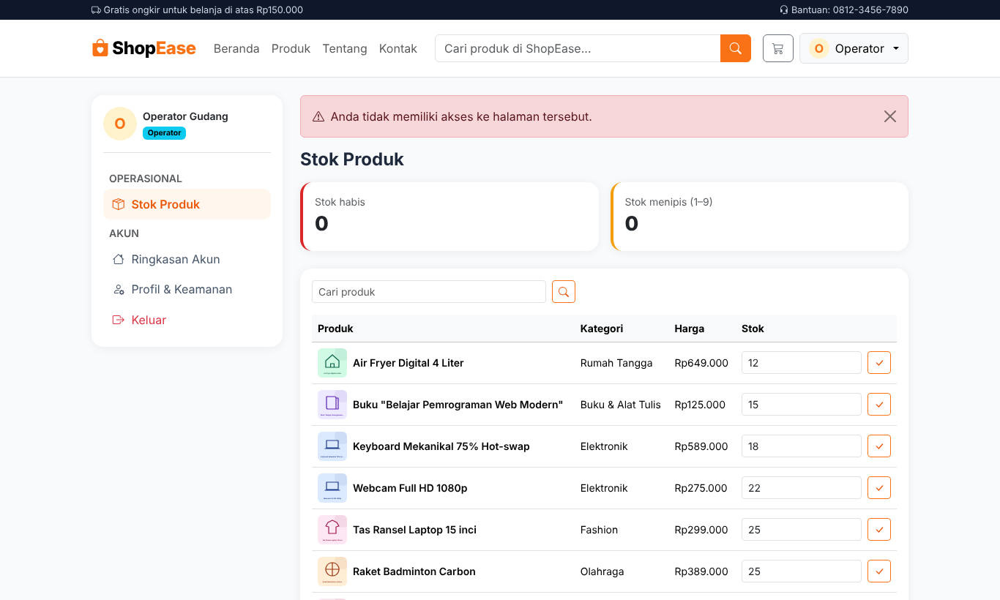 | 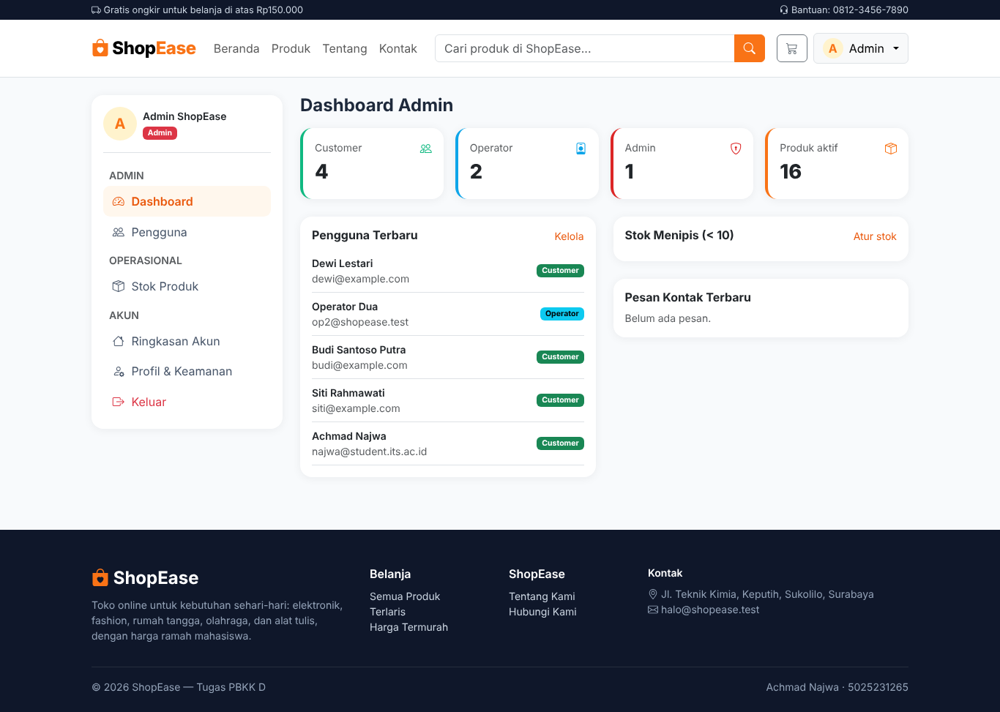 |

| Manajemen pengguna | Detail produk untuk tamu ("Masuk untuk Membeli") |
|---|---|
| 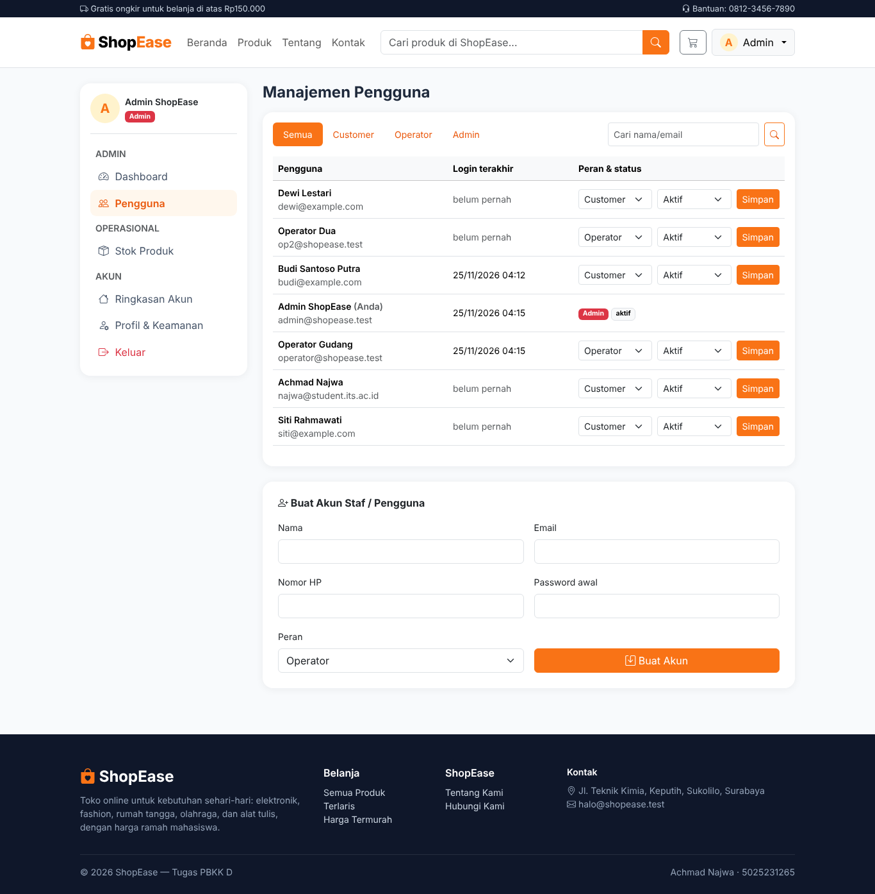 | 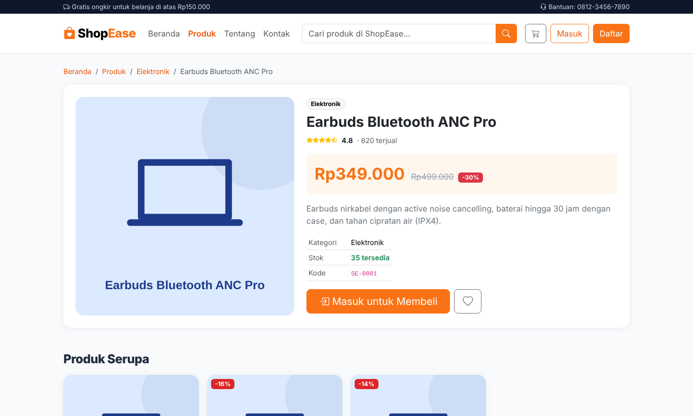 |
