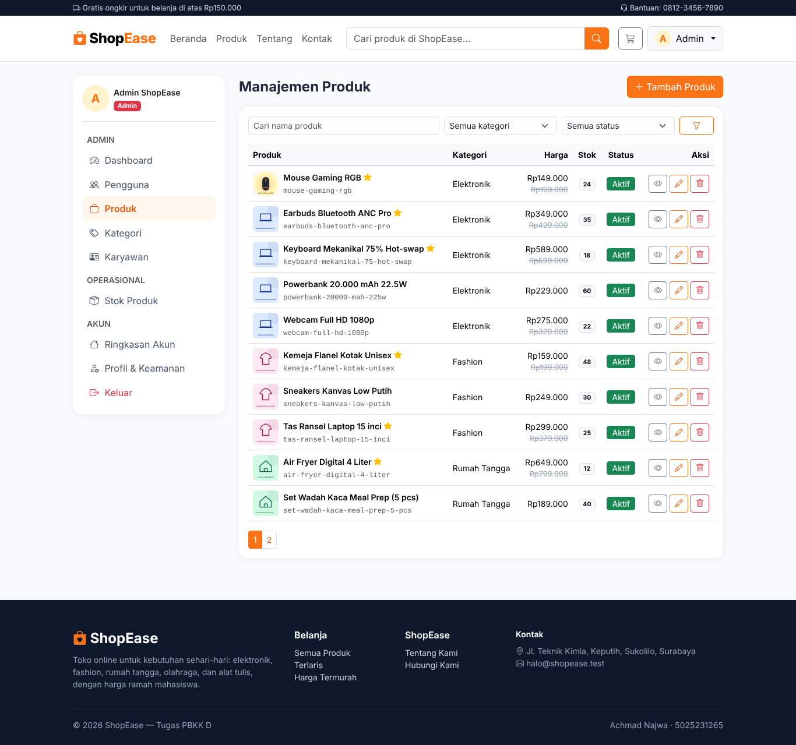
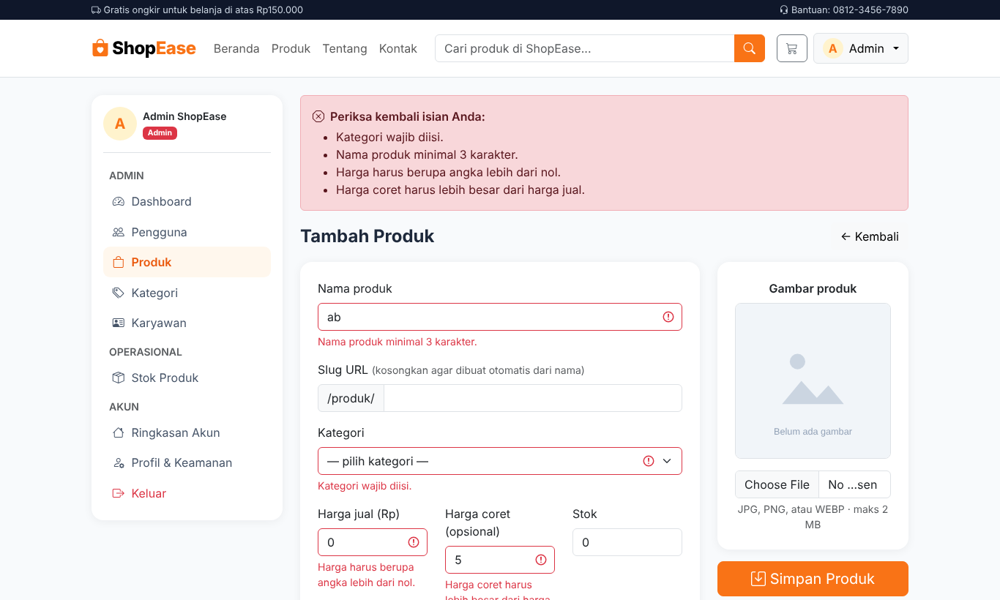
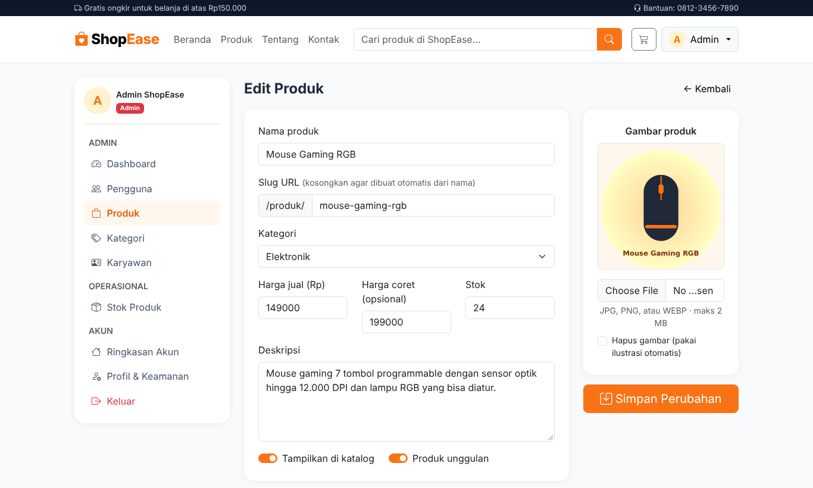
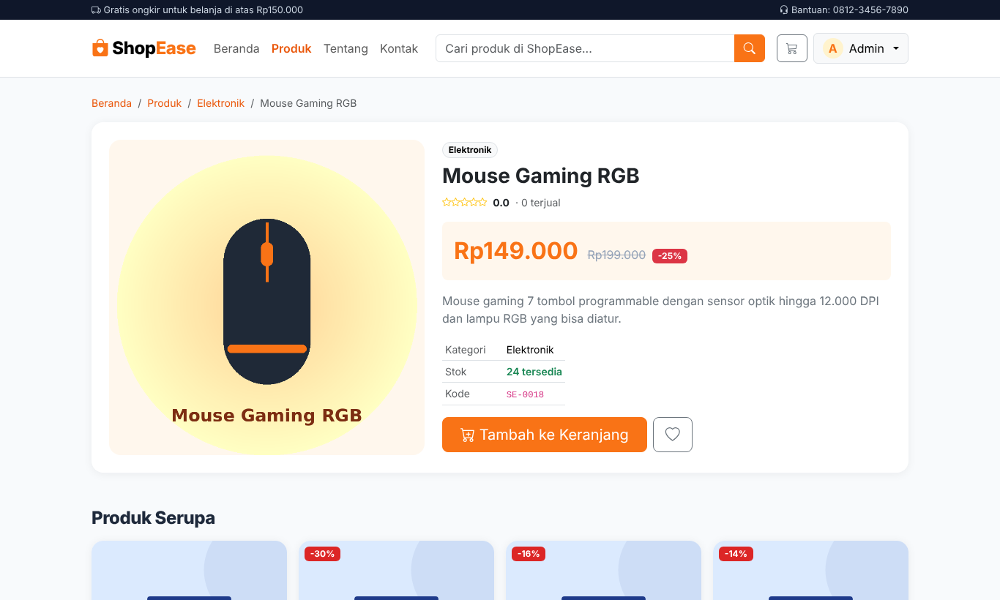
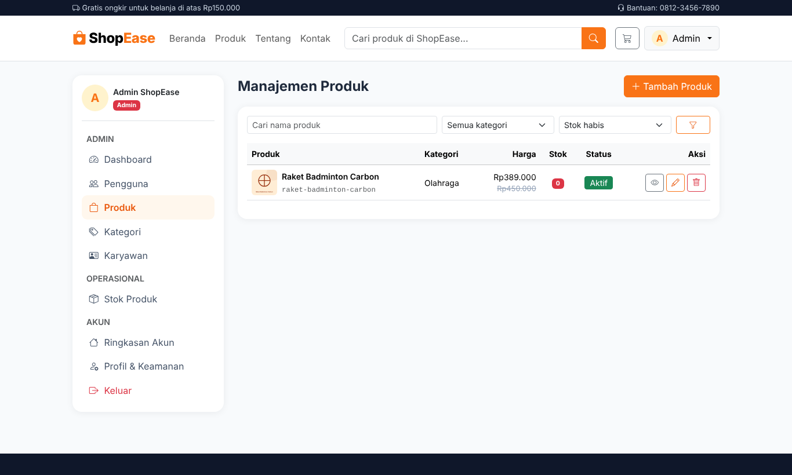
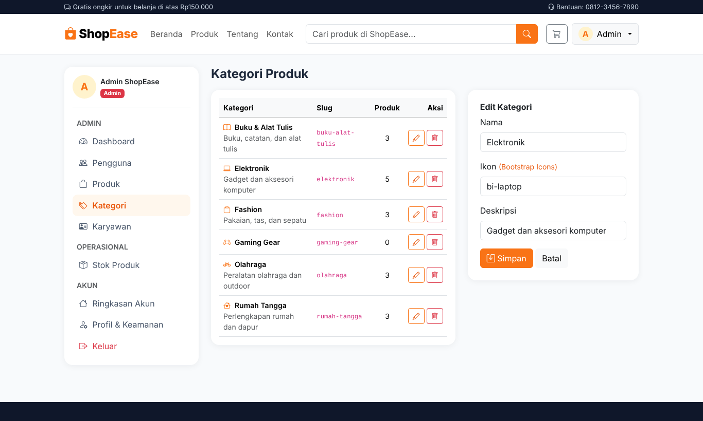
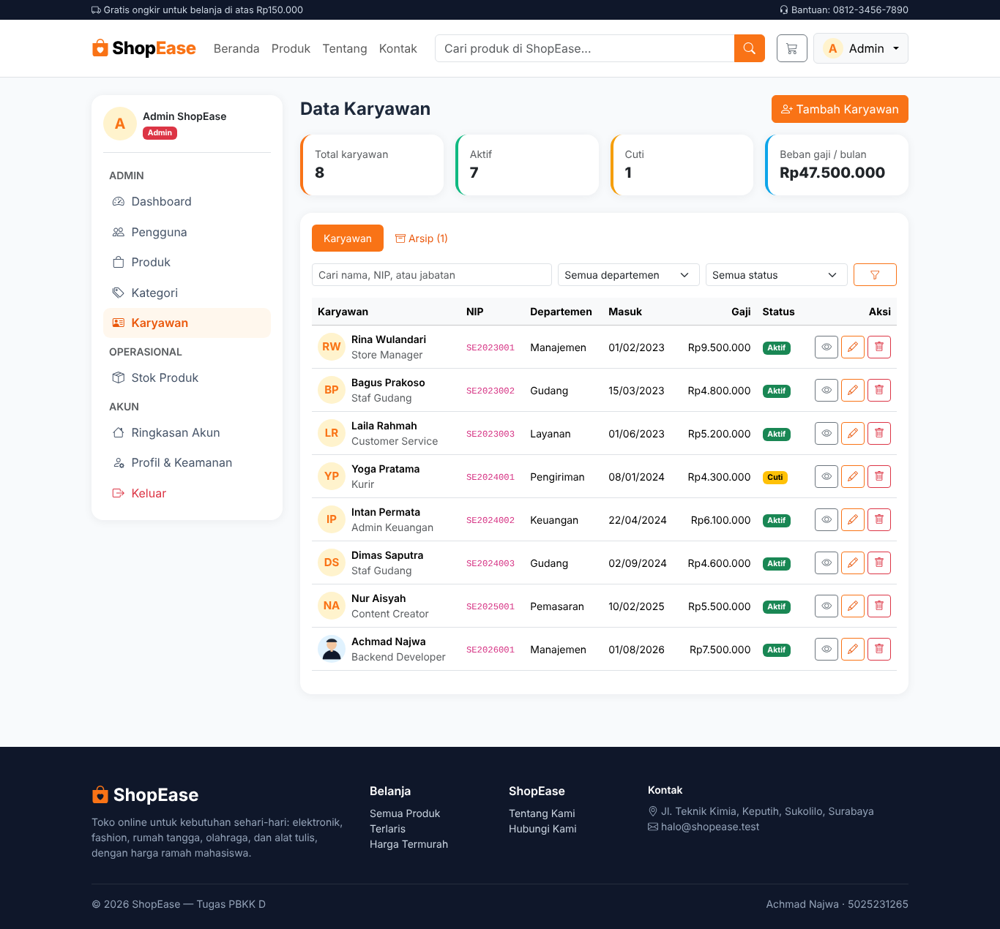
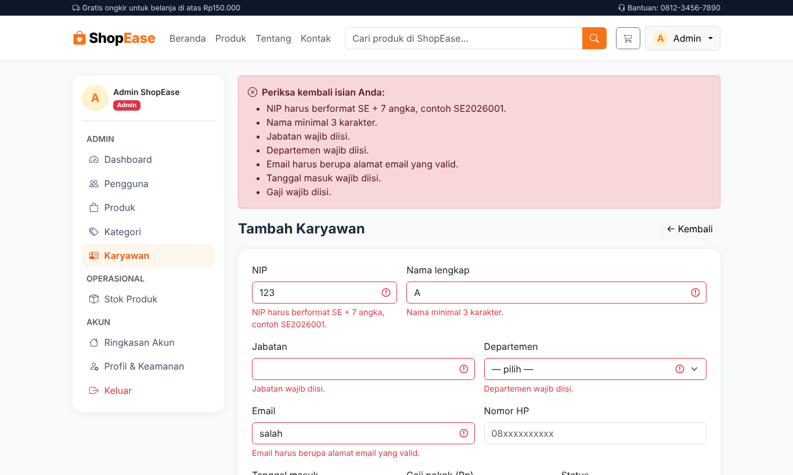
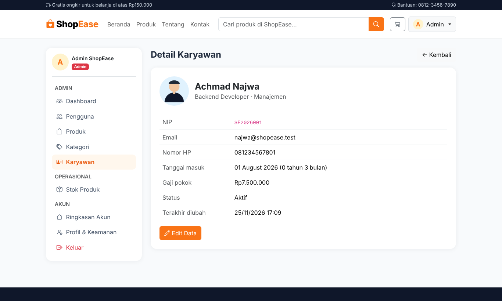
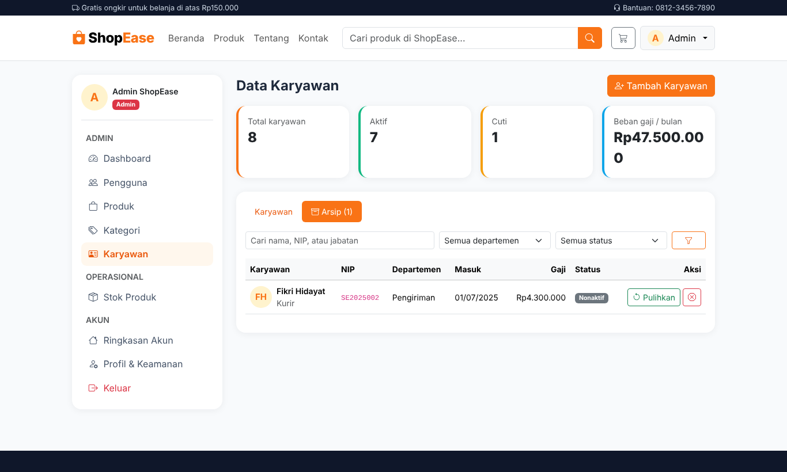

# Tugas Pemrograman Berbasis Kerangka Kerja (PBKK) — Minggu 12

**Nama:** Achmad Najwa
**NIM:** 5025231265
**Kelas:** PBKK D
**Materi:** Model dan CRUD dalam CodeIgniter 4 — Product Management ShopEase & Latihan Model Data Karyawan

---

## Daftar Isi

1. [Landasan Teori: Model dan CRUD](#1-landasan-teori-model-dan-crud)
2. [Fitur yang Ditambahkan](#2-fitur-yang-ditambahkan)
3. [Cara Menjalankan](#3-cara-menjalankan)
4. [Product Management (CRUD Produk & Kategori)](#4-product-management-crud-produk--kategori)
5. [Latihan: Model Data Karyawan](#5-latihan-model-data-karyawan)
6. [Struktur Proyek](#6-struktur-proyek)
7. [Dokumentasi Pengujian](#7-dokumentasi-pengujian)

---

## 1. Landasan Teori: Model dan CRUD

**CRUD** adalah empat operasi dasar pengelolaan data:

| Operasi | SQL | Method Model CI4 | Route ShopEase |
|---|---|---|---|
| **C**reate | `INSERT` | `insert()` / `save()` tanpa id | `GET /admin/produk/baru`, `POST /admin/produk` |
| **R**ead | `SELECT` | `find()`, `findAll()`, `paginate()` | `GET /admin/produk` |
| **U**pdate | `UPDATE` | `update()` / `save()` dengan id | `GET /admin/produk/{id}/edit`, `POST /admin/produk/{id}` |
| **D**elete | `DELETE` | `delete()` | `POST /admin/produk/{id}/hapus` |

**Model** di CodeIgniter 4 adalah kelas turunan `CodeIgniter\Model` yang mewakili satu tabel. Hanya dengan beberapa properti, model sudah bisa menjalankan CRUD, validasi, timestamp, dan soft delete tanpa menulis SQL:

| Properti | Fungsi |
|---|---|
| `$table`, `$primaryKey` | Tabel dan kunci utama |
| `$allowedFields` | Kolom yang boleh diisi; kolom lain diabaikan (mencegah *mass assignment*) |
| `$useTimestamps` | `created_at` dan `updated_at` terisi otomatis |
| `$useSoftDeletes` | `delete()` hanya mengisi `deleted_at`; data bisa dipulihkan |
| `$validationRules` | Validasi otomatis sebelum `insert`/`update`/`save` |
| `$beforeInsert`, `$beforeUpdate` | *Model event*, misalnya hash password (Minggu 11) |

## 2. Fitur yang Ditambahkan

Melanjutkan ShopEase Minggu 11. Seluruh fitur baru berada di panel admin (`role:admin`).

| Menu | URL | Fitur |
|---|---|---|
| Produk | `/admin/produk` | Daftar semua produk (aktif & nonaktif), cari, filter kategori/status/stok habis, tambah, edit, upload/hapus gambar, aktif/nonaktifkan, hapus |
| Kategori | `/admin/kategori` | Tambah, edit, hapus kategori dalam satu halaman. Kategori yang masih dipakai produk tidak bisa dihapus |
| Karyawan | `/admin/karyawan` | Latihan model: CRUD data karyawan + foto, cari, filter departemen/status, statistik, arsip (soft delete), pulihkan, hapus permanen |

Perubahan di halaman publik: gambar produk hasil upload langsung tampil di katalog dan detail produk. Produk yang dinonaktifkan tidak tampil lagi di katalog (detailnya menjadi 404).

## 3. Cara Menjalankan

```powershell
cd "D:\Semester 7\Pemrograman-Berbasis-Kerangka-Kerja\Minggu-12\shopease"
composer install
copy .env.example .env
php spark migrate                 # termasuk 2 migration baru
php spark db:seed DatabaseSeeder  # katalog, akun, dan 8 karyawan contoh
php spark serve
```

Masuk sebagai admin: `admin@shopease.test` / `Admin#123`.

## 4. Product Management (CRUD Produk & Kategori)

### 4.1 Migration

`2026-11-22-000001_AddImageToProducts` menambah kolom `image` ke tabel `products` yang sudah ada (contoh migration yang **mengubah** tabel, bukan membuat tabel baru):

```php
$this->forge->addColumn('products', [
    'image' => ['type' => 'VARCHAR', 'constraint' => 255, 'null' => true, 'after' => 'description'],
]);
```

### 4.2 Validasi di Model

```php
protected $validationRules = [
    'id'          => 'permit_empty|is_natural_no_zero',
    'category_id' => ['label' => 'Kategori', 'rules' => 'required|is_not_unique[categories.id]'],
    'name'        => ['label' => 'Nama produk', 'rules' => 'required|min_length[3]|max_length[150]'],
    'slug'        => ['label' => 'Slug', 'rules' => 'required|alpha_dash|is_unique[products.slug,id,{id}]'],
    'price'       => ['label' => 'Harga', 'rules' => 'required|is_natural_no_zero'],
    'old_price'   => ['label' => 'Harga coret', 'rules' => 'permit_empty|is_natural_no_zero|greater_than[{price}]'],
    'stock'       => ['label' => 'Stok', 'rules' => 'required|is_natural'],
    ...
];
```

- `is_not_unique[categories.id]` memastikan kategori yang dipilih benar-benar ada.
- `is_unique[products.slug,id,{id}]` membuat slug unik, tetapi produk boleh menyimpan slug miliknya sendiri saat diedit.
- `greater_than[{price}]` memastikan harga coret lebih besar dari harga jual (placeholder `{price}` diambil dari data yang sama).
- Saat operator hanya mengubah stok (`update($id, ['stock' => 7])`), CI4 hanya memvalidasi field yang dikirim, sehingga aturan lain tidak mengganggu.

### 4.3 Controller `Admin\Products`

Satu method privat `persist()` dipakai untuk **create** dan **update**. `save()` otomatis memilih `INSERT` atau `UPDATE` berdasarkan ada tidaknya `id`:

```php
$data = [
    'category_id' => ..., 'name' => $name,
    'slug'  => url_title($slugInput !== '' ? $slugInput : $name, '-', true),   // slug otomatis
    'price' => ..., 'old_price' => ... ?: null, 'stock' => ...,
    'is_featured' => $this->request->getPost('is_featured') ? 1 : 0,
    'is_active'   => $this->request->getPost('is_active') ? 1 : 0,
];
if ($old !== null) { $data['id'] = $old['id']; }

if (! $this->model->save($data)) {
    $this->uploader->delete($image ?: null);                  // batalkan upload bila validasi gagal
    return redirect()->back()->withInput()->with('errors', $this->model->errors());
}
```

### 4.4 Upload gambar — `App\Libraries\ImageUploader`

Logika upload dipisah ke library agar dipakai ulang oleh produk dan karyawan:

```php
$image = $this->uploader->store($this->request, 'image');
// null  → tidak ada file diunggah (gambar lama dipertahankan)
// false → file tidak valid, pesan di $this->uploader->error()
// string → nama file acak di public/uploads/products/
```

Validasinya `uploaded|is_image|max_size|ext_in[jpg,jpeg,png,webp]`. File lama dihapus dari disk saat gambar diganti, saat dicentang **Hapus gambar**, atau saat produk dihapus. Bila produk belum punya gambar, helper `product_image()` tetap menampilkan ilustrasi otomatis per kategori.

### 4.5 Kategori

Slug dibuat dari nama, dan ikon divalidasi dengan pola `bi-nama-ikon` (Bootstrap Icons). Penghapusan dicek dulu di aplikasi (selain foreign key `RESTRICT` di database) agar pesannya jelas: *"Kategori masih dipakai 1 produk. Pindahkan produknya terlebih dahulu."*

## 5. Latihan: Model Data Karyawan

> Latihan: *"Membuat Model untuk menyimpan data karyawan."*

### 5.1 Tabel `employees`

| Kolom | Tipe | Aturan |
|---|---|---|
| `nip` | VARCHAR(12) UNIQUE | Format `SE` + 7 angka, contoh `SE2026001` |
| `name`, `position` | VARCHAR | Wajib, minimal 3 karakter |
| `department` | VARCHAR(40) | Salah satu dari Manajemen, Gudang, Layanan, Pengiriman, Keuangan, Pemasaran |
| `email` | VARCHAR(120) UNIQUE | Email valid |
| `phone` | VARCHAR(20) NULL | Diawali `08` / `+628` |
| `hire_date` | DATE | Tanggal valid `Y-m-d` |
| `salary` | INT | Rp1.000.000 – Rp100.000.000 |
| `status` | VARCHAR(20) | `aktif` / `cuti` / `nonaktif` |
| `photo` | VARCHAR NULL | Nama file foto |
| `created_at`, `updated_at`, `deleted_at` | DATETIME | Timestamp + soft delete |

### 5.2 `EmployeeModel`

```php
class EmployeeModel extends Model
{
    protected $table          = 'employees';
    protected $useTimestamps  = true;
    protected $useSoftDeletes = true;
    protected $allowedFields  = ['nip', 'name', 'position', 'department', 'email', 'phone', 'hire_date', 'salary', 'status', 'photo'];
    protected $validationRules = [ /* lihat tabel di atas */ ];

    public function search(?string $keyword, ?string $department, ?string $status): self { ... }
    public function summary(): array { ... }   // jumlah per status + total beban gaji
}
```

Contoh pemakaian model di controller:

| Kebutuhan | Kode |
|---|---|
| Daftar + paginasi | `$this->model->search($q, $dept, $status)->paginate(10)` |
| Tambah / ubah | `$this->model->save($data)` |
| Arsipkan (soft delete) | `$this->model->delete($id)` → `deleted_at` terisi |
| Lihat arsip | `$this->model->onlyDeleted()->...` |
| Hapus permanen | `$this->model->delete($id, true)` |

Halaman karyawan menampilkan kartu statistik (total, aktif, cuti, dan beban gaji bulanan tanpa karyawan nonaktif), tabel dengan avatar inisial atau foto, detail karyawan beserta masa kerja, serta tab **Arsip** untuk memulihkan atau menghapus permanen data.

## 6. Struktur Proyek

File baru/diubah dibanding Minggu 11:

```text
shopease/
├── app/
│   ├── Config/Routes.php                      # route produk, kategori, karyawan
│   ├── Controllers/Admin/
│   │   ├── Products.php                       # CRUD produk
│   │   ├── Categories.php                     # CRUD kategori
│   │   └── Employees.php                      # CRUD karyawan + arsip
│   ├── Database/
│   │   ├── Migrations/2026-11-22-000001_AddImageToProducts.php
│   │   ├── Migrations/2026-11-22-000002_CreateEmployeesTable.php
│   │   └── Seeds/EmployeeSeeder.php
│   ├── Libraries/ImageUploader.php
│   ├── Models/
│   │   ├── ProductModel.php                   # + validasi & adminList()
│   │   ├── CategoryModel.php                  # + validasi
│   │   └── EmployeeModel.php                  # baru
│   ├── Helpers/shop_helper.php                # product_image() memakai gambar upload
│   └── Views/admin/
│       ├── products/index.php, products/form.php
│       ├── categories/index.php
│       └── employees/index.php, form.php, show.php, _avatar.php
└── public/uploads/{products,employees}/       # hasil upload (diabaikan git)
```

## 7. Dokumentasi Pengujian

### Hasil uji fungsional

| No | Skenario | Hasil |
|---|---|---|
| 1 | Tambah produk: nama 2 huruf, kategori tidak ada, harga 0, harga coret < harga, stok negatif | 5 pesan validasi muncul |
| 2 | Upload file bukan gambar | "Gambar harus berupa gambar.", tidak ada file tersimpan |
| 3 | Tambah produk valid + gambar | Tersimpan, slug `mouse-gaming-rgb` dibuat otomatis, gambar tampil di katalog |
| 4 | Tambah produk dengan nama yang sama | "Slug/nama produk sudah dipakai produk lain." |
| 5 | Edit produk + centang Hapus gambar | Kolom `image` menjadi NULL, file dihapus dari disk |
| 6 | Nonaktifkan produk | Hilang dari katalog, detail produk menjadi 404 |
| 7 | Operator mengubah stok produk | Tetap berhasil (validasi hanya untuk field yang dikirim) |
| 8 | Hapus kategori yang masih dipakai | Ditolak dengan pesan jumlah produk |
| 9 | Tambah kategori dengan nama yang sudah ada + ikon tidak valid | 2 pesan validasi |
| 10 | Tambah karyawan dengan 9 field tidak valid | 9 pesan validasi muncul |
| 11 | NIP/email karyawan duplikat | Ditolak; saat edit, NIP/email milik sendiri tetap diterima |
| 12 | Arsipkan → pulihkan → arsipkan → hapus permanen | `deleted_at` terisi lalu kosong lagi; data dan foto benar-benar terhapus saat purge |
| 13 | Operator membuka `/admin/produk` atau `/admin/karyawan` | Ditolak oleh `role:admin` |

### Screenshot

| Daftar produk | Validasi form produk |
|---|---|
|  |  |

| Edit produk + gambar upload | Gambar upload tampil di katalog |
|---|---|
|  |  |

| Filter stok habis | Kategori |
|---|---|
|  |  |

| Data karyawan | Validasi form karyawan |
|---|---|
|  |  |

| Detail karyawan | Arsip (soft delete) |
|---|---|
|  |  |
