# Tugas Pemrograman Berbasis Kerangka Kerja (PBKK) — Minggu 13

**Nama:** Achmad Najwa
**NIM:** 5025231265
**Kelas:** PBKK D
**Materi:** Quiz CodeIgniter — Aplikasi Pemesanan Tiket (**TiketBus**)

---

## Daftar Isi

1. [Soal Quiz](#1-soal-quiz)
2. [Tugas 1 — Deskripsi Aplikasi dan Ruang Lingkup Fitur](#2-tugas-1--deskripsi-aplikasi-dan-ruang-lingkup-fitur)
3. [Tugas 2 — Desain Antarmuka](#3-tugas-2--desain-antarmuka)
4. [Tugas 3 — Implementasi dengan CodeIgniter 4](#4-tugas-3--implementasi-dengan-codeigniter-4)
5. [Cara Menjalankan](#5-cara-menjalankan)
6. [Dokumentasi Pengujian](#6-dokumentasi-pengujian)
7. [Tugas 4 — Video Dokumentasi](#7-tugas-4--video-dokumentasi)

---

## 1. Soal Quiz

Membuat sistem pemesanan tiket online untuk penumpang moda transportasi. Sistem mencatat ketersediaan kursi, jadwal, dan kapasitas kendaraan, lalu menghasilkan **e-tiket PDF** untuk setiap penumpang. Alurnya:

- **Booking**: pengguna melihat deskripsi tiket, memilih kursi dari *checkbox* kursi yang tersedia, mengisi identitas, lalu memilih metode pembayaran.
- **Payment**: setelah booking, pelanggan mengisi form pembayaran (nama pengirim, bank, nomor rekening) dan mengunggah bukti pembayaran.

Tugas: (1) deskripsi aplikasi & ruang lingkup fitur, (2) desain antarmuka, (3) implementasi dengan framework CodeIgniter, (4) dokumentasi video YouTube di blog.

Moda yang dipilih: **bus antarkota**.

## 2. Tugas 1 — Deskripsi Aplikasi dan Ruang Lingkup Fitur

### 2.1 Deskripsi

**TiketBus** adalah aplikasi web pemesanan tiket bus antarkota. Pelanggan dapat mencari jadwal berdasarkan kota asal, tujuan, dan tanggal, melihat denah kursi secara langsung, memesan hingga 6 kursi sekaligus, membayar lewat transfer bank, lalu mengunduh e-tiket ber-QR code untuk setiap penumpang. Admin mengelola armada, rute, jadwal, rekening, memverifikasi pembayaran, dan melihat laporan penjualan.

### 2.2 Pengguna

| Peran | Keterangan |
|---|---|
| **Tamu** | Mencari jadwal, melihat denah kursi, cek status tiket, mendaftar |
| **Pelanggan** | Semua fitur tamu + memesan, membayar, membatalkan, mencetak e-tiket, mengelola profil |
| **Admin** | Panel admin untuk data master, transaksi, dan laporan |

### 2.3 Ruang lingkup fitur

| Kelompok | Fitur | Status |
|---|---|---|
| **Pelanggan** | Cari jadwal (asal, tujuan, tanggal) + filter kelas bus | ✅ |
| | Lihat detail jadwal: jam, durasi, fasilitas, harga, sisa kursi | ✅ |
| | Pilih kursi pada denah (checkbox; kursi terisi terkunci), maks 6 kursi | ✅ |
| | Isi identitas per penumpang (nama, NIK 16 digit, HP opsional) | ✅ |
| | Pilih metode pembayaran (rekening tujuan) | ✅ |
| | Batas waktu bayar 2 jam; lewat batas → pesanan kedaluwarsa & kursi dilepas otomatis | ✅ |
| | Form pembayaran: nama pengirim, bank, no. rekening, jumlah, upload bukti (JPG/PNG/PDF) | ✅ |
| | Pembatalan tiket sebelum pembayaran diverifikasi | ✅ |
| | E-tiket per penumpang dengan **QR code**, cetak / simpan sebagai **PDF** | ✅ |
| | Cek tiket berdasarkan kode booking (publik, nama disamarkan) | ✅ |
| | Riwayat pesanan, ubah profil, ganti password | ✅ |
| **Admin** | Dashboard: pendapatan & tiket terjual bulan ini, antrean verifikasi, keberangkatan hari ini | ✅ |
| | Kelola armada bus (kelas, tata letak kursi 2-2 / 1-2, fasilitas) | ✅ |
| | Kelola rute (asal, tujuan, jarak, durasi) | ✅ |
| | Kelola jadwal (waktu tiba dihitung otomatis dari durasi rute, status aktif/batal) | ✅ |
| | Kelola pemesanan: filter status, cari kode/nama, detail penumpang | ✅ |
| | Verifikasi pembayaran: lihat bukti, terima → lunas, tolak + alasan → pelanggan bisa unggah ulang | ✅ |
| | Kelola rekening bank tujuan transfer (aktif/nonaktif) | ✅ |
| | Laporan penjualan per periode: per rute dan daftar transaksi, bisa dicetak | ✅ |
| | Daftar pelanggan terdaftar beserta jumlah pesanan & total belanja | ✅ |
| **Umum** | Registrasi & login (password ter-hash, throttling login), hak akses per peran, CSRF | ✅ |

### 2.4 Siklus status pemesanan

```
                ┌──────────── (lewat 2 jam) ───────────► kedaluwarsa
                │
pesan ──► menunggu_pembayaran ──(unggah bukti)──► menunggu_verifikasi ──(admin terima)──► lunas ──► e-tiket
                ▲      │                                  │
                │      └──(pelanggan batal)──► dibatalkan ◄┘ (pelanggan batal)
                └────────────(admin tolak + alasan)───────┘
```

Kursi dianggap **terisi** selama pemesanan berstatus `menunggu_pembayaran`, `menunggu_verifikasi`, atau `lunas`.

## 3. Tugas 2 — Desain Antarmuka

Antarmuka dirancang dengan Bootstrap 5 dan tema hijau toska. Hasil implementasinya ada di bagian 6. Rancangan halamannya:

| Halaman | Komponen utama |
|---|---|
| Beranda | Hero, kotak pencarian (asal ⇄ tujuan, tanggal), keunggulan, rute populer, keberangkatan terdekat |
| Hasil pencarian | Filter kelas, kartu jadwal (jam berangkat–tiba, durasi, PO, kelas, harga, sisa kursi) |
| Pilih kursi | Ringkasan jadwal · **(1)** denah kursi bus dengan sopir di depan dan lorong di tengah · **(2)** form penumpang yang muncul otomatis per kursi · **(3)** pilihan rekening + total harga |
| Pembayaran | Batas waktu, rekening tujuan & nominal, form konfirmasi + upload bukti |
| E-tiket | Satu kartu per penumpang: rute, jam, kursi, NIK tersamar, QR code; tombol Cetak/Simpan PDF |
| Panel admin | Sidebar (Transaksi, Operasional, Pengaturan), kartu statistik, tabel + form di satu halaman |

Tata letak kursi digambar dari data bus: `seat_rows × seat_cols`, label `1A`, `1B`, …; 4 kursi per baris → 2-2 (Ekonomi/Eksekutif), 3 kursi → 1-2 (Sleeper).

## 4. Tugas 3 — Implementasi dengan CodeIgniter 4

### 4.1 Teknologi

| Komponen | Pilihan |
|---|---|
| Framework | CodeIgniter 4.7 (PHP 8.2+) |
| Database | MySQL / MariaDB (bisa juga SQLite) melalui Migration & Seeder |
| UI | Bootstrap 5, Bootstrap Icons (disimpan lokal) |
| QR code | `qrcode-generator` (JavaScript, lokal di `public/assets/vendor/qrcode`) |
| PDF | Halaman e-tiket dengan CSS `@media print` → dialog cetak browser "Simpan sebagai PDF" (contoh: [contoh-e-tiket.pdf](images/contoh-e-tiket.pdf)) |

### 4.2 Rancangan database

```
users (id, name, email UNIQUE, phone, password_hash, role: pelanggan|admin)
buses (id, code UNIQUE, operator, class, seat_rows, seat_cols, facilities)
routes (id, origin, destination, distance_km, duration_min, UNIQUE(origin, destination))
schedules (id, bus_id FK, route_id FK, depart_at, arrive_at, price, status: aktif|batal)
bank_accounts (id, bank, account_no, account_name, is_active)
bookings (id, code UNIQUE, user_id FK, schedule_id FK, bank_account_id FK, total, status, expires_at, paid_at)
booking_passengers (id, booking_id FK, seat_no, name, id_number, phone)
payments (id, booking_id FK, sender_name, sender_bank, sender_account, amount, proof, status, note, verified_at)
```

### 4.3 Struktur MVC

| Lapisan | File |
|---|---|
| Routes | `app/Config/Routes.php`: grup publik, `guest`, pelanggan (`auth` + `role:pelanggan`), admin (`auth` + `role:admin`) |
| Controller publik | `Home` (beranda, cari, detail jadwal, cek tiket), `Auth` |
| Controller pelanggan | `Bookings` (pesan, riwayat, bayar, batal, e-tiket, bukti, profil) |
| Controller admin | `Admin\Dashboard`, `Admin\Schedules`, `Admin\Bookings` (verifikasi), `Admin\Reports`, serta `Admin\Buses`, `Admin\Routes`, `Admin\Banks` yang mewarisi kelas abstrak `Admin\Crud` |
| Model | `UserModel`, `BusModel`, `RouteModel`, `ScheduleModel`, `BookingModel`, `PassengerModel`, `PaymentModel`, `BankAccountModel` |
| Filter | `AuthFilter`, `GuestFilter`, `RoleFilter` |
| Helper | `tiket_helper.php`: `rupiah()`, `tgl()`, `durasi()`, `status_badge()`, `seat_layout()`, `auth_user()` |

### 4.4 Potongan kode penting

**Ketersediaan kursi** dihitung dari pemesanan yang masih aktif, setelah pemesanan kedaluwarsa dibersihkan:

```php
// BookingModel
public const OCCUPYING = ['menunggu_pembayaran', 'menunggu_verifikasi', 'lunas'];

public function expireStale(): int
{
    $this->builder()->where('status', 'menunggu_pembayaran')->where('expires_at <', date('Y-m-d H:i:s'))
        ->update(['status' => 'kedaluwarsa', 'updated_at' => date('Y-m-d H:i:s')]);
    return $this->db->affectedRows();
}

public function bookedSeats(int $scheduleId): array { /* JOIN booking_passengers ↔ bookings, status IN OCCUPYING */ }
```

**Membuat pemesanan**: validasi setiap kursi (ada di bus, nama, NIK 16 digit), lalu di dalam **transaksi** kursi dicek ulang agar dua pelanggan tidak bisa memesan kursi yang sama:

```php
$db->transStart();
$taken = array_intersect($seats, $bookings->bookedSeats($scheduleId));
if ($taken !== []) {
    $db->transRollback();
    return redirect()->back()->withInput()->with('error', 'Kursi ' . implode(', ', $taken) . ' baru saja dipesan orang lain.');
}
$bookingId = $bookings->insert([... 'status' => 'menunggu_pembayaran', 'expires_at' => date('Y-m-d H:i:s', strtotime('+2 hours'))]);
foreach ($seats as $seat) { $pm->insert([... 'seat_no' => $seat, 'name' => ..., 'id_number' => ...]); }
$db->transComplete();
```

**Form penumpang dinamis**: saat kursi dicentang, JavaScript membuat input `passengers[3C][name]`, `passengers[3C][id_number]`, dan seterusnya. Isian yang sudah diketik tidak hilang saat kursi ditambah atau dikurangi, dan tetap kembali setelah validasi gagal (`old('passengers')`).

**Bukti pembayaran** disimpan di `writable/uploads/payments` (di luar folder publik) dan hanya bisa dibuka pemilik pesanan atau admin lewat `GET /bukti/{id}`:

```php
'amount' => ['rules' => "required|is_natural_no_zero|greater_than_equal_to[{$b['total']}]"],
'proof'  => ['rules' => 'uploaded[proof]|max_size[proof,2048]|ext_in[proof,jpg,jpeg,png,pdf]|mime_in[proof,image/jpeg,image/png,application/pdf]'],
```

**E-tiket QR**: setiap penumpang mendapat QR berisi `kode|kursi|nama`, dibuat di browser:

```js
const qr = qrcode(0, 'M'); qr.addData(el.dataset.qr); qr.make();
el.innerHTML = qr.createSvgTag({ cellSize: 4, margin: 0 });
```

**CRUD data master** memakai kelas abstrak `Admin\Crud` (index + save + delete), sehingga controller bus, rute, dan rekening hanya berisi pemetaan input dan aturan "tidak boleh dihapus bila masih dipakai".

## 5. Cara Menjalankan

```powershell
cd "D:\Semester 7\Pemrograman-Berbasis-Kerangka-Kerja\Minggu-13\tiketbus"
composer install
copy .env.example .env          # atur database db_tiketbus
php spark migrate
php spark db:seed DatabaseSeeder  # akun, 4 bus, 6 rute, jadwal 7 hari ke depan, 3 rekening
php spark serve
```

| Peran | Email | Password |
|---|---|---|
| Admin | `admin@tiketbus.test` | `Admin#123` |
| Pelanggan | `najwa@student.its.ac.id` | `Pelanggan#123` |

## 6. Dokumentasi Pengujian

### Hasil uji fungsional

| No | Skenario | Hasil |
|---|---|---|
| 1 | Cari dengan asal = tujuan | Pesan "Kota asal dan tujuan tidak boleh sama" |
| 2 | Pesan dengan nama 1 huruf, NIK 3 digit, kursi `9Z`, tanpa rekening | 4 pesan validasi |
| 3 | Pesan 2 kursi valid | Pesanan dibuat, total = 2 × harga, batas bayar 2 jam |
| 4 | Pelanggan lain memesan kursi yang sama | Ditolak: "Kursi 2A baru saja dipesan orang lain" |
| 5 | Pelanggan lain membuka pesanan / e-tiket milik orang lain | 404 |
| 6 | Konfirmasi bayar dengan nominal kurang & file bukan gambar | Ditolak dengan pesan per field |
| 7 | Konfirmasi bayar valid | Status menjadi `menunggu_verifikasi`, e-tiket belum bisa dibuka |
| 8 | Admin menolak tanpa alasan → dengan alasan | Ditolak dulu, lalu status kembali `menunggu_pembayaran` dengan batas waktu baru |
| 9 | Pelanggan unggah ulang → admin terima | Status `lunas`, e-tiket tersedia; verifikasi kedua kali ditolak "sudah diproses" |
| 10 | Membatalkan pesanan yang sudah lunas | Ditolak |
| 11 | Pesanan melewati batas bayar | Otomatis `kedaluwarsa`, kursi kembali tersedia |
| 12 | Pelanggan membatalkan pesanan yang belum dibayar | `dibatalkan`, kursi dilepas |
| 13 | Admin: data bus/rute tidak valid, rute asal = tujuan | Pesan validasi |
| 14 | Admin menambah jadwal | Waktu tiba otomatis = berangkat + durasi rute |
| 15 | Hapus bus/jadwal/rekening yang sudah dipakai | Ditolak dengan saran (nonaktifkan / ubah status batal) |
| 16 | Pelanggan membuka `/admin` | Ditolak |
| 17 | Parameter laporan diisi teks berbahaya (`x';drop`) | Diabaikan, laporan tetap memakai tanggal default |

### Screenshot

| Beranda | Hasil pencarian |
|---|---|
| 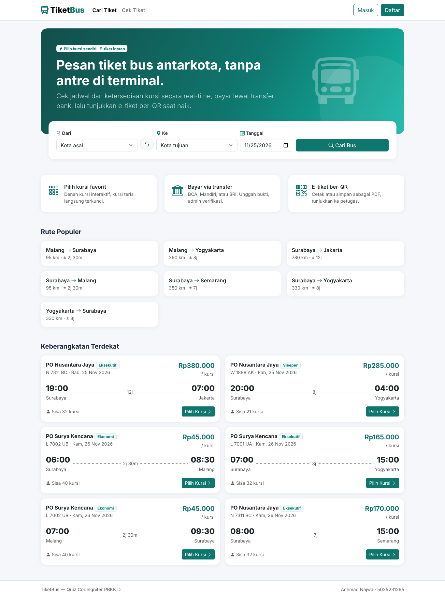 | 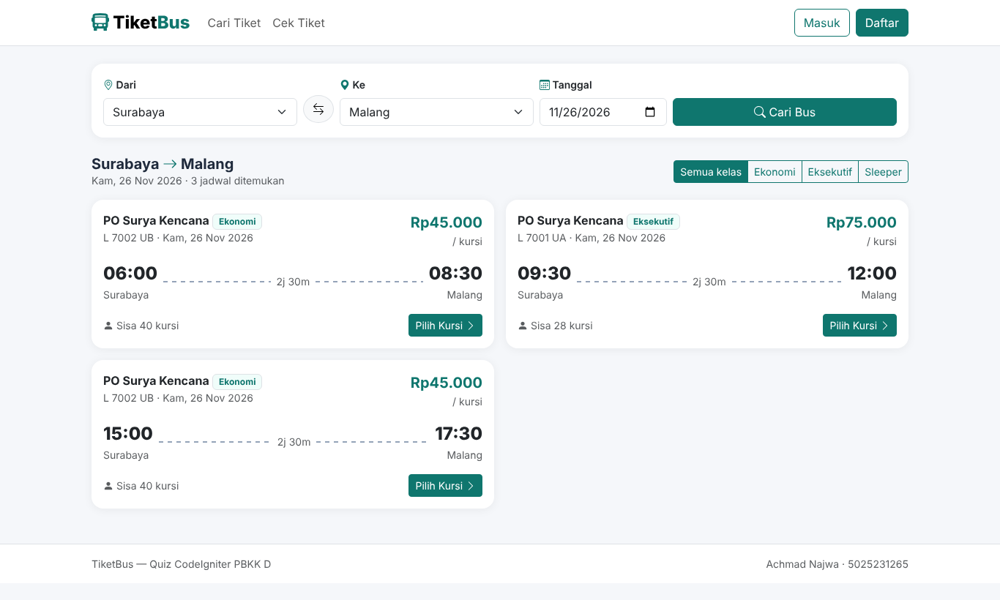 |

| Pilih kursi + data penumpang | Halaman pembayaran |
|---|---|
| 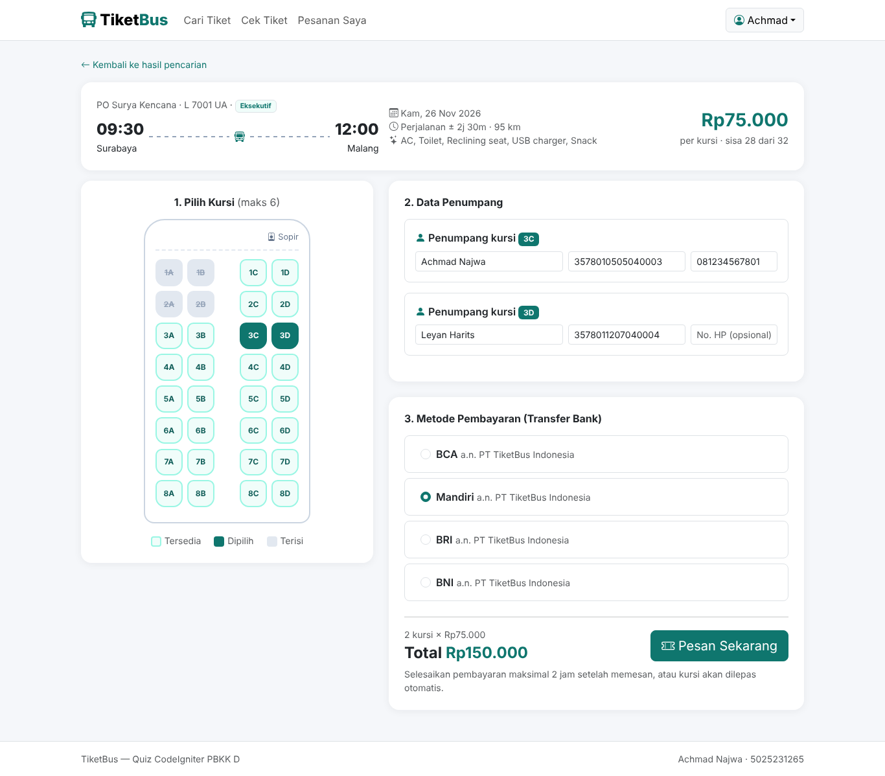 | 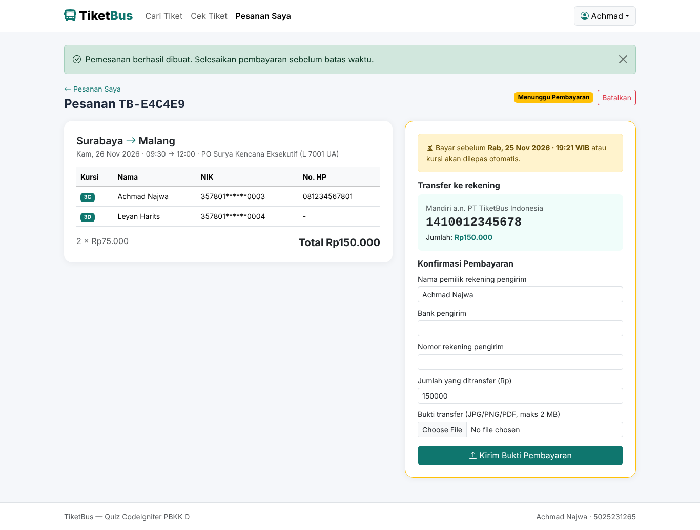 |

| Dashboard admin | Verifikasi pembayaran |
|---|---|
| 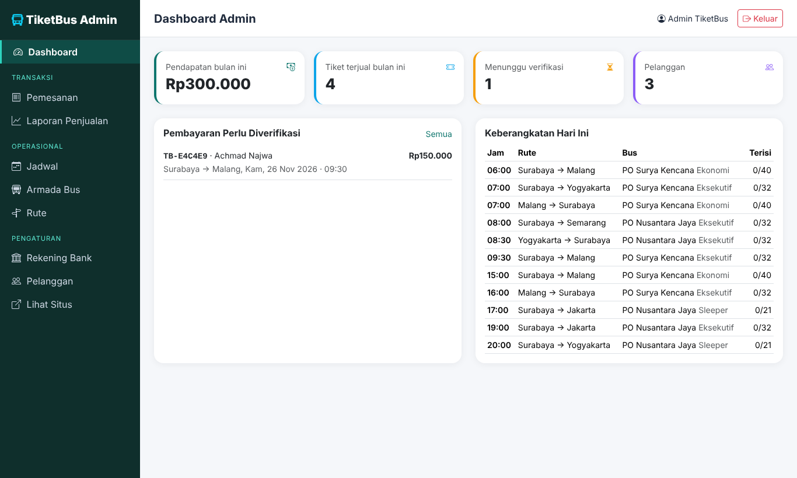 | 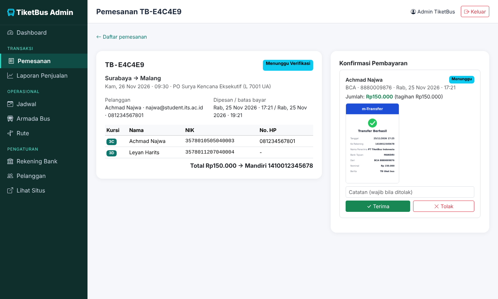 |

| Daftar pemesanan | Jadwal |
|---|---|
| 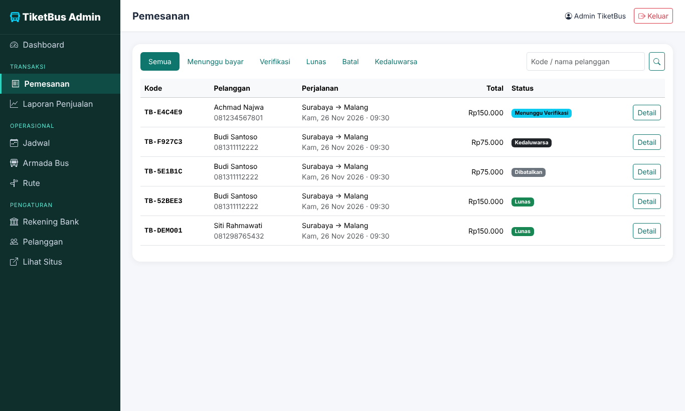 | 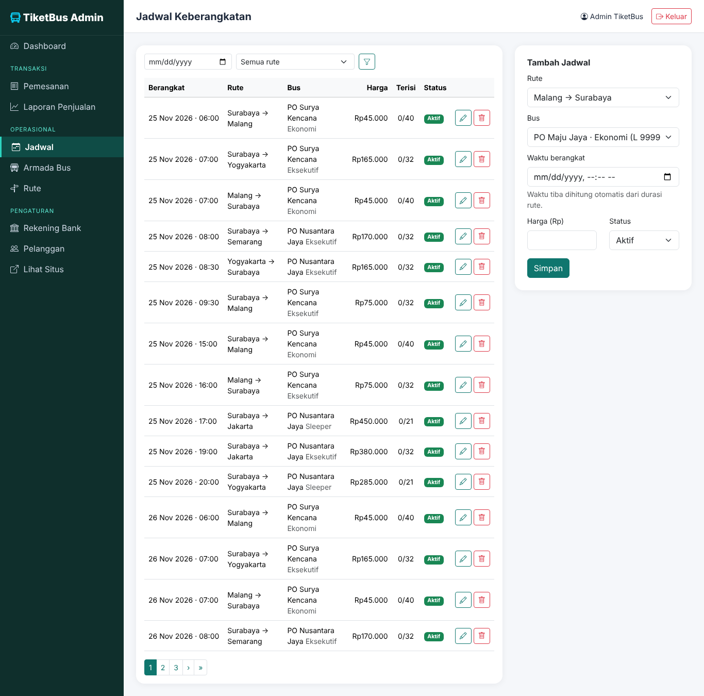 |

| Armada bus | Laporan penjualan |
|---|---|
| 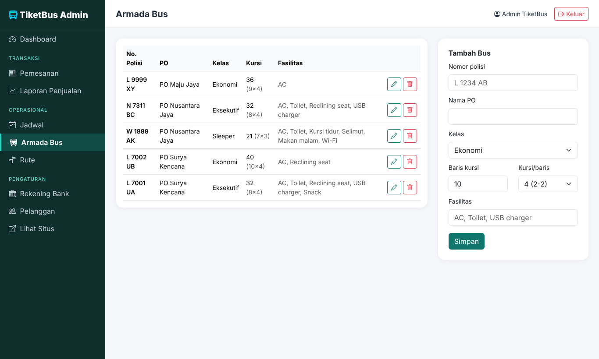 | 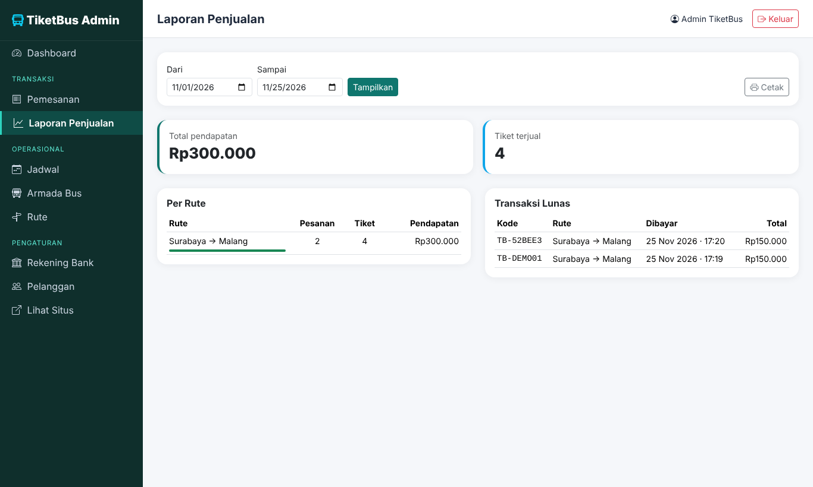 |

| Pesanan saya | Pesanan lunas |
|---|---|
| 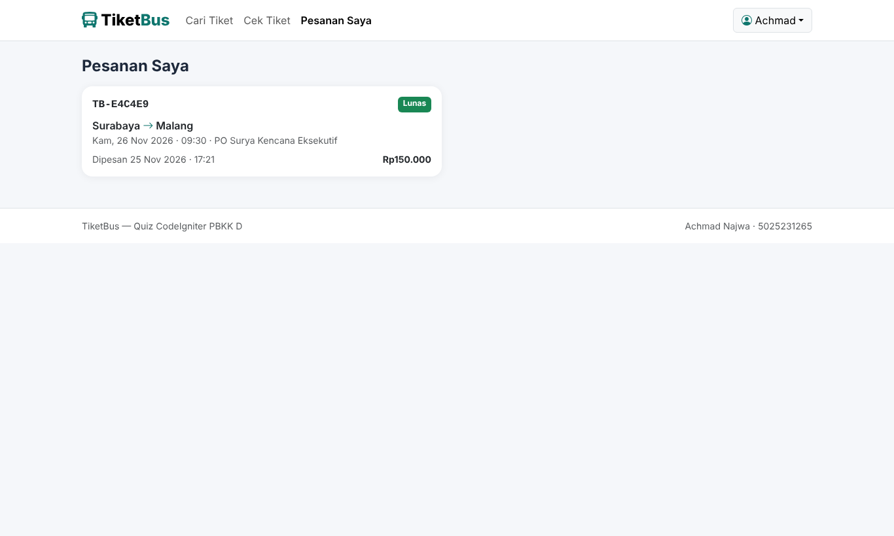 | 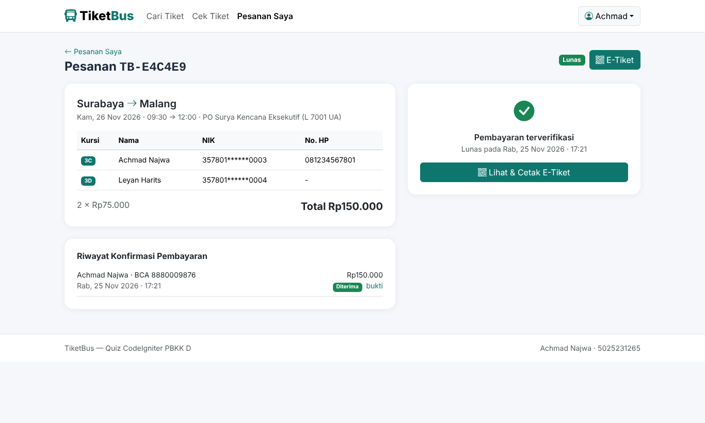 |

| E-tiket ber-QR | Cek tiket publik |
|---|---|
| 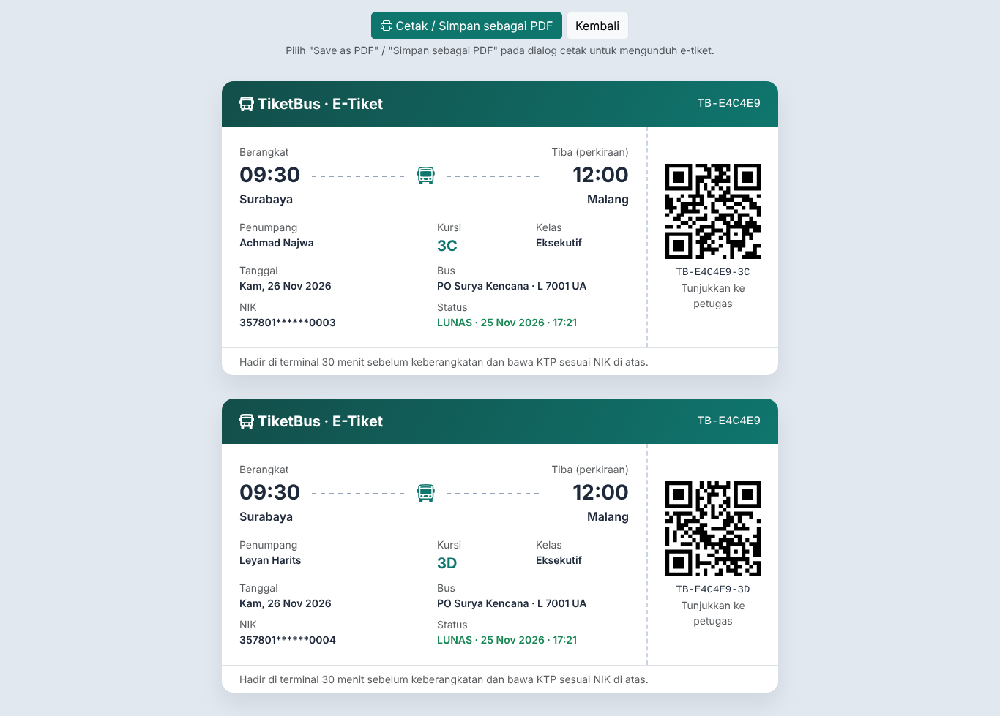 | 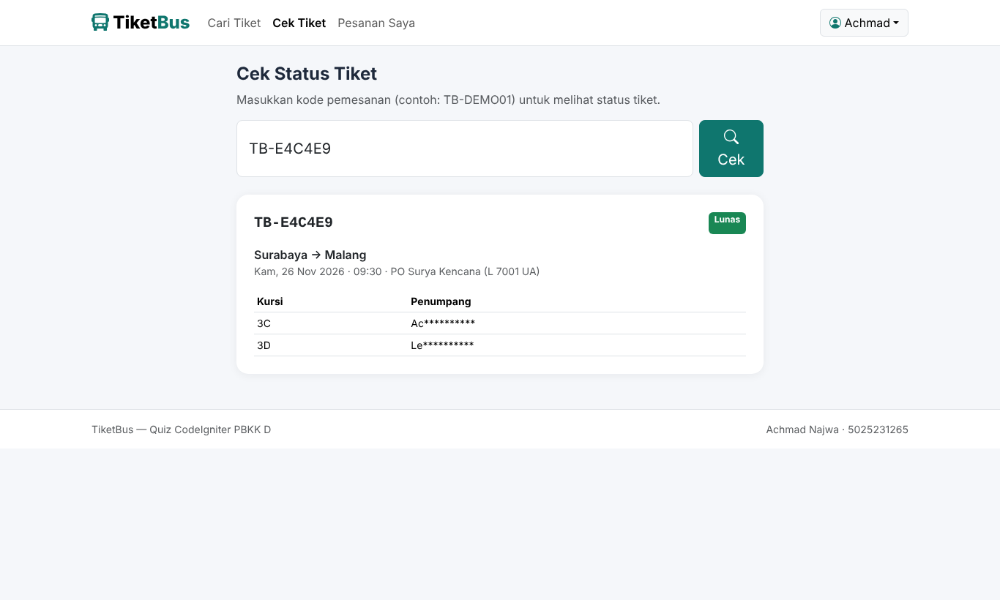 |

Contoh e-tiket hasil "Simpan sebagai PDF": [images/contoh-e-tiket.pdf](images/contoh-e-tiket.pdf)

## 7. Tugas 4 — Video Dokumentasi

> Tautan video YouTube: *(diisi setelah video direkam dan diunggah)*

Saran alur video (± 5–7 menit): pencarian jadwal → pilih kursi & isi penumpang → konfirmasi pembayaran → admin memverifikasi → unduh e-tiket PDF → admin melihat laporan penjualan.
