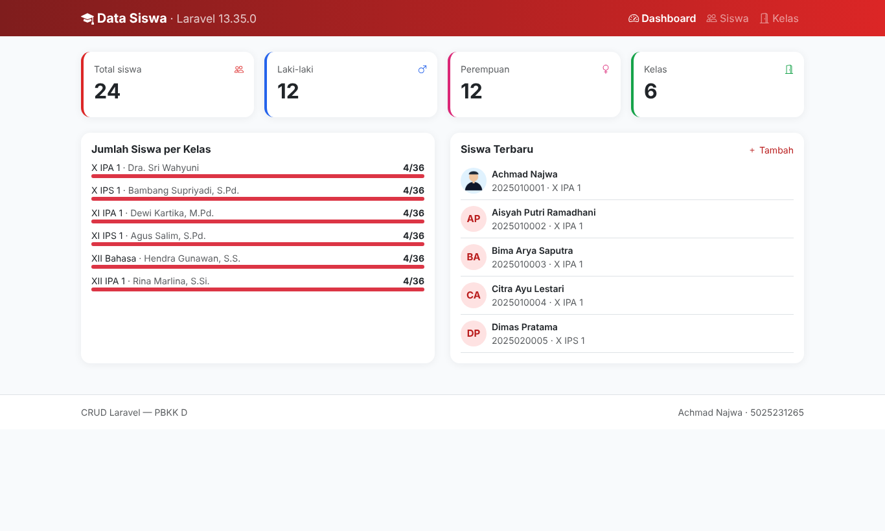
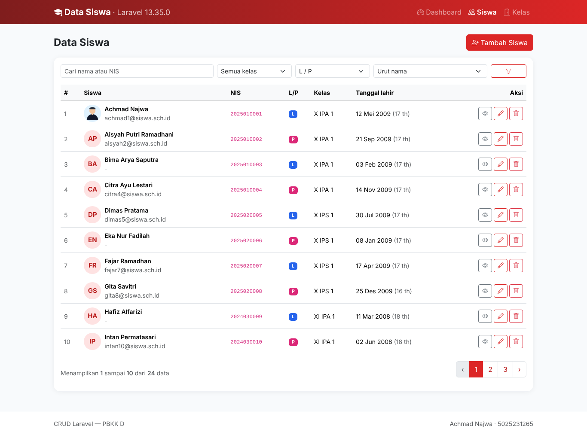
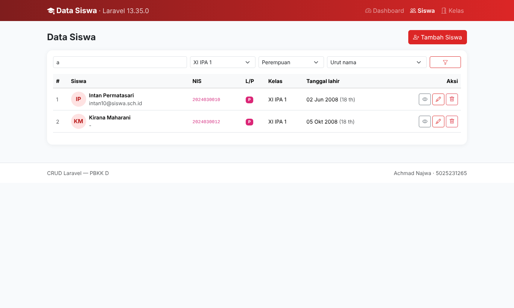
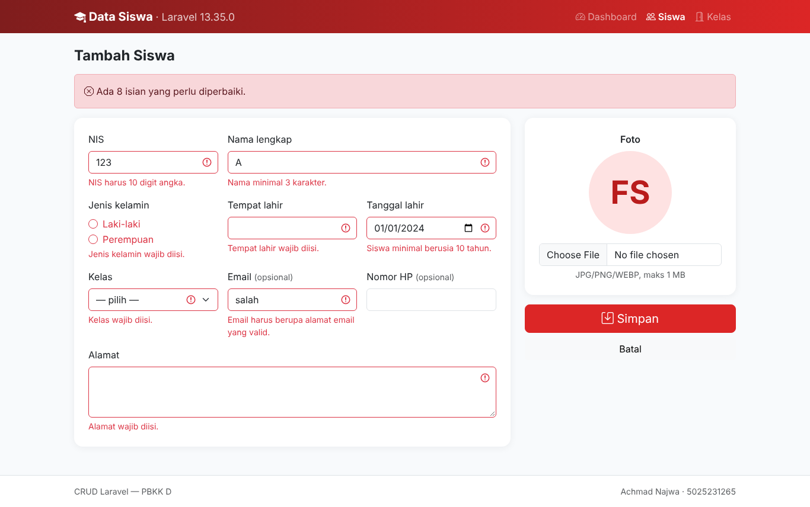
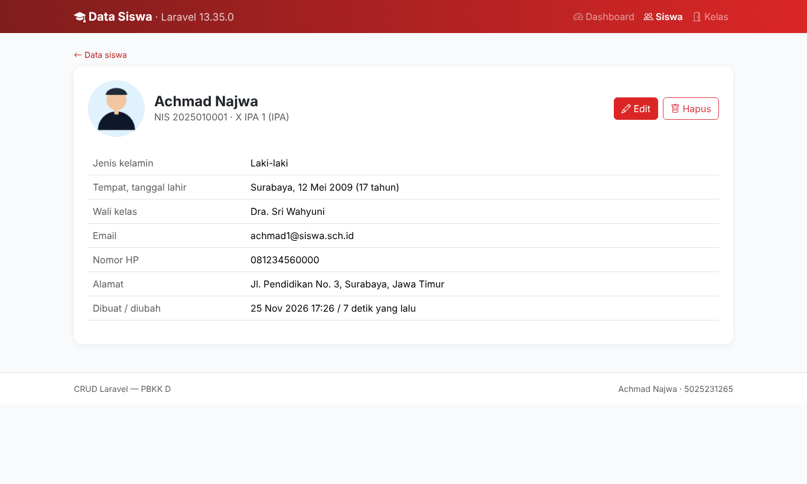
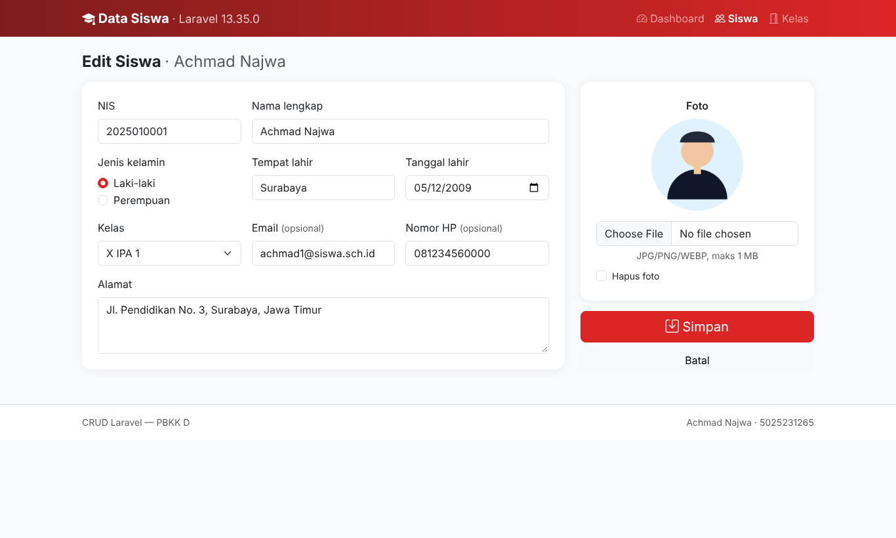
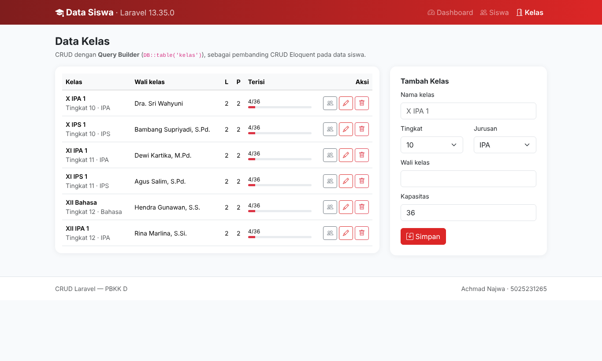
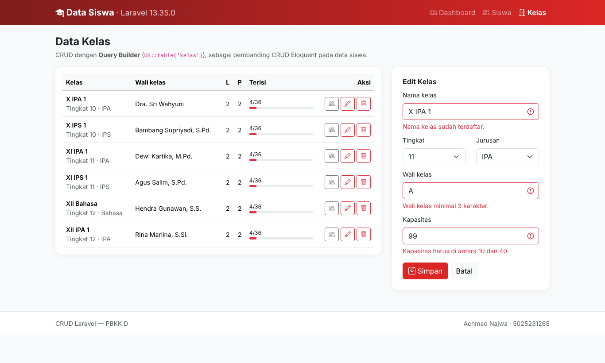
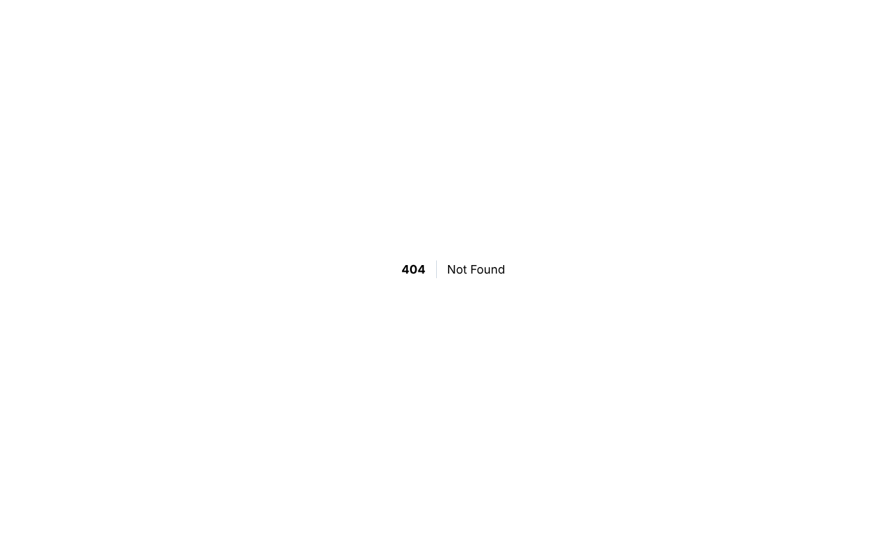

# Tugas Pemrograman Berbasis Kerangka Kerja (PBKK) — Minggu 14

**Nama:** Achmad Najwa
**NIM:** 5025231265
**Kelas:** PBKK D
**Materi:** Framework Laravel · CRUD dengan Laravel (1) & (2) — Aplikasi **Data Siswa**

---

## Daftar Isi

1. [Landasan Teori: Framework Laravel](#1-landasan-teori-framework-laravel)
2. [Deskripsi Aplikasi](#2-deskripsi-aplikasi)
3. [Instalasi dan Menjalankan](#3-instalasi-dan-menjalankan)
4. [Migration dan Seeder](#4-migration-dan-seeder)
5. [CRUD Laravel (1) — Eloquent + Resource Controller](#5-crud-laravel-1--eloquent--resource-controller)
6. [CRUD Laravel (2) — Query Builder](#6-crud-laravel-2--query-builder)
7. [View dengan Blade](#7-view-dengan-blade)
8. [Struktur Proyek](#8-struktur-proyek)
9. [Dokumentasi Pengujian](#9-dokumentasi-pengujian)

---

## 1. Landasan Teori: Framework Laravel

**Laravel** adalah framework PHP berpola MVC yang menonjol karena sintaksnya ekspresif dan ekosistemnya lengkap. Proyek ini memakai **Laravel 13** (PHP 8.3+).

| Komponen | Fungsi | Pada proyek |
|---|---|---|
| **Routing** | Memetakan URL ke controller | `routes/web.php`, `Route::resource()` |
| **Controller** | Menangani request | `SiswaController`, `KelasController`, `DashboardController` |
| **Eloquent ORM** | Model berbasis objek untuk tabel + relasi | `Siswa` *belongsTo* `Kelas`, `Kelas` *hasMany* `Siswa` |
| **Query Builder** | Menyusun SQL lewat method berantai | `DB::table('kelas')->...` |
| **Migration & Seeder** | Struktur tabel & data awal dalam kode | `database/migrations`, `DatabaseSeeder` |
| **Form Request** | Kelas khusus validasi | `SiswaRequest` |
| **Blade** | Template engine | `@extends`, `@section`, `@foreach`, `@error`, `@csrf` |
| **Artisan** | CLI Laravel | `php artisan migrate`, `serve`, `route:list` |

Perbandingan singkat dengan CodeIgniter 4 (Minggu 9–13):

| Aspek | CodeIgniter 4 | Laravel |
|---|---|---|
| ORM | Model sederhana (array/objek) | Eloquent: relasi, accessor, scope, *route model binding* |
| Template | PHP biasa + `$this->extend()` | Blade (`@if`, `@foreach`, komponen, direktif) |
| Validasi | Aturan string di Model/Controller | Form Request + `Rule::unique()->ignore()` |
| Route CRUD | Ditulis satu per satu | `Route::resource()` membuat 7 route sekaligus |
| Method HTTP form | POST saja | `@method('PUT')` / `@method('DELETE')` (method spoofing) |

## 2. Deskripsi Aplikasi

**Data Siswa** adalah aplikasi pengelolaan data siswa SMA dengan dua entitas yang berelasi:

| Halaman | URL | Fitur |
|---|---|---|
| Dashboard | `/` | Total siswa, laki-laki/perempuan, jumlah kelas, grafik siswa per kelas, siswa terbaru |
| Data siswa | `/siswa` | Daftar + pencarian nama/NIS, filter kelas & jenis kelamin, urutan, pagination 10 data |
| Tambah / edit siswa | `/siswa/create`, `/siswa/{id}/edit` | Form lengkap + upload/hapus foto, validasi Bahasa Indonesia |
| Detail siswa | `/siswa/{id}` | Biodata, umur (accessor), wali kelas (relasi), waktu dibuat/diubah |
| Data kelas | `/kelas` | Tabel + form tambah/edit dalam satu halaman, jumlah L/P, keterisian kelas |

## 3. Instalasi dan Menjalankan

Kebutuhan: PHP 8.3+, Composer, dan SQLite (bawaan PHP) atau MySQL.

```powershell
cd "D:\Semester 7\Pemrograman-Berbasis-Kerangka-Kerja\Minggu-14\data-siswa"
composer install
copy .env.example .env
php artisan key:generate
php artisan migrate --seed       # jika diminta membuat database.sqlite, pilih "yes"
php artisan storage:link         # agar foto di storage/app/public bisa diakses dari browser
php artisan serve                # http://127.0.0.1:8000
```

Proyek awal dibuat dengan `composer create-project laravel/laravel data-siswa`. Pengaturan `.env` yang dipakai: `APP_LOCALE=id` dan `DB_CONNECTION=sqlite`. Untuk MySQL, ubah `DB_CONNECTION=mysql` dan isi `DB_DATABASE`, `DB_USERNAME`, `DB_PASSWORD`.

## 4. Migration dan Seeder

```php
// 2026_12_01_000001_create_kelas_table.php
Schema::create('kelas', function (Blueprint $table) {
    $table->id();
    $table->string('nama', 20)->unique();
    $table->unsignedTinyInteger('tingkat');
    $table->string('jurusan', 20);
    $table->string('wali_kelas', 100);
    $table->unsignedTinyInteger('kapasitas')->default(36);
    $table->timestamps();
});

// 2026_12_01_000002_create_siswa_table.php
Schema::create('siswa', function (Blueprint $table) {
    $table->id();
    $table->string('nis', 10)->unique();
    $table->string('nama', 100);
    $table->enum('jenis_kelamin', ['L', 'P']);
    $table->string('tempat_lahir', 60);
    $table->date('tanggal_lahir');
    $table->foreignId('kelas_id')->constrained('kelas')->restrictOnDelete();
    $table->string('email', 120)->nullable()->unique();
    $table->string('no_hp', 20)->nullable();
    $table->text('alamat');
    $table->string('foto')->nullable();
    $table->timestamps();
});
```

`DatabaseSeeder` mengisi 6 kelas dan 24 siswa memakai `Kelas::create()` dan `Siswa::create()`.

## 5. CRUD Laravel (1) — Eloquent + Resource Controller

### 5.1 Model Eloquent

```php
class Siswa extends Model
{
    protected $table = 'siswa';                       // nama tabel tidak mengikuti bentuk jamak bahasa Inggris
    protected $fillable = ['nis', 'nama', 'jenis_kelamin', ..., 'foto'];
    protected function casts(): array { return ['tanggal_lahir' => 'date']; }

    public function kelas(): BelongsTo { return $this->belongsTo(Kelas::class); }      // relasi

    protected function umur(): Attribute { return Attribute::get(fn () => $this->tanggal_lahir?->age); }   // accessor $siswa->umur

    public function scopeCari(Builder $query, ?string $keyword): Builder               // local scope Siswa::cari('budi')
    {
        return $query->when($keyword, fn ($q) => $q->where(fn ($q) =>
            $q->where('nama', 'like', "%{$keyword}%")->orWhere('nis', 'like', "%{$keyword}%")));
    }
}
```

### 5.2 Route resource

```php
Route::resource('siswa', SiswaController::class)->parameters(['siswa' => 'siswa']);
```

| Method | URL | Action | Nama route |
|---|---|---|---|
| GET | `/siswa` | `index` | `siswa.index` |
| GET | `/siswa/create` | `create` | `siswa.create` |
| POST | `/siswa` | `store` | `siswa.store` |
| GET | `/siswa/{siswa}` | `show` | `siswa.show` |
| GET | `/siswa/{siswa}/edit` | `edit` | `siswa.edit` |
| PUT/PATCH | `/siswa/{siswa}` | `update` | `siswa.update` |
| DELETE | `/siswa/{siswa}` | `destroy` | `siswa.destroy` |

### 5.3 Controller

```php
public function index(Request $request): View
{
    $siswa = Siswa::with('kelas')                                   // eager loading, hindari N+1 query
        ->cari($request->query('q'))
        ->when($request->query('kelas'), fn ($q, $k) => $q->where('kelas_id', $k))
        ->when($request->query('jk'), fn ($q, $jk) => $q->where('jenis_kelamin', $jk))
        ->orderBy($this->sortColumn($request))                      // kolom urut dari daftar yang diizinkan
        ->paginate(10)->withQueryString();
    ...
}

public function store(SiswaRequest $request): RedirectResponse      // validasi otomatis oleh Form Request
{
    $data = $request->validated();
    if ($request->hasFile('foto')) {
        $data['foto'] = $request->file('foto')->store('foto-siswa', 'public');
    }
    $siswa = Siswa::create($data);
    return redirect()->route('siswa.index')->with('success', "Siswa {$siswa->nama} berhasil ditambahkan.");
}

public function update(SiswaRequest $request, Siswa $siswa)         // route model binding
public function destroy(Siswa $siswa)                               // $siswa->delete() + hapus file foto
```

### 5.4 Form Request

```php
public function rules(): array
{
    $id = $this->route('siswa')?->id;
    return [
        'nis'           => ['required', 'digits:10', Rule::unique('siswa', 'nis')->ignore($id)],
        'nama'          => ['required', 'string', 'min:3', 'max:100'],
        'tanggal_lahir' => ['required', 'date', 'before:-10 years', 'after:-25 years'],
        'kelas_id'      => ['required', 'exists:kelas,id'],
        'email'         => ['nullable', 'email', Rule::unique('siswa', 'email')->ignore($id)],
        'no_hp'         => ['nullable', 'regex:/^(08|\+628)\d{7,11}$/'],
        'foto'          => ['nullable', 'image', 'mimes:jpg,jpeg,png,webp', 'max:1024'],
        ...
    ];
}
```

`Rule::unique(...)->ignore($id)` membuat NIS/email tetap unik, tetapi tidak bentrok dengan data siswa itu sendiri saat diedit. Pesan error berbahasa Indonesia ada di `lang/id/validation.php`, dan teks pagination di `lang/id.json`.

## 6. CRUD Laravel (2) — Query Builder

Data kelas sengaja dikerjakan **tanpa Eloquent** untuk membandingkan dua pendekatan:

```php
// READ + agregasi
$kelas = DB::table('kelas')
    ->leftJoin('siswa', 'siswa.kelas_id', '=', 'kelas.id')
    ->select('kelas.*', DB::raw('COUNT(siswa.id) AS jumlah_siswa'),
             DB::raw("SUM(CASE WHEN siswa.jenis_kelamin = 'L' THEN 1 ELSE 0 END) AS laki"), ...)
    ->groupBy('kelas.id', ...)->orderBy('kelas.tingkat')->get();

// CREATE
DB::table('kelas')->insert($data + ['created_at' => now(), 'updated_at' => now()]);
// UPDATE
DB::table('kelas')->where('id', $id)->update($data + ['updated_at' => now()]);
// DELETE (dicegah bila masih ada siswa)
DB::table('kelas')->where('id', $id)->delete();
```

| Aspek | Eloquent (Siswa) | Query Builder (Kelas) |
|---|---|---|
| Hasil | Objek model dengan relasi & accessor | `stdClass` biasa |
| Timestamp | Otomatis | Diisi manual (`now()`) |
| Mass assignment | Dijaga `$fillable` | Hanya data hasil `validate()` yang dikirim |
| Cocok untuk | CRUD sehari-hari, relasi | Laporan/agregasi, query kompleks |

## 7. View dengan Blade

- `layouts/app.blade.php`: navbar, flash message, `@yield('content')`.
- `siswa/_form.blade.php`: form yang dipakai bersama oleh `create` dan `edit` (`@include`).
- Form edit memakai `@method('PUT')`, dan tombol hapus memakai `@method('DELETE')` + `@csrf`.
- Error per field: `class="@error('nis') is-invalid @enderror"` dan `@error('nis') {{ $message }} @enderror`.
- `old('nama', $siswa->nama)` menjaga isian saat validasi gagal.
- Pagination Bootstrap 5 diaktifkan dengan `Paginator::useBootstrapFive()` di `AppServiceProvider`.

## 8. Struktur Proyek

File yang dibuat/diubah dari skeleton Laravel:

```text
data-siswa/
├── app/
│   ├── Http/
│   │   ├── Controllers/       # DashboardController, SiswaController, KelasController
│   │   └── Requests/          # SiswaRequest
│   ├── Models/                # Siswa, Kelas
│   └── Providers/AppServiceProvider.php
├── config/app.php             # timezone Asia/Jakarta
├── database/
│   ├── migrations/            # create_kelas_table, create_siswa_table
│   └── seeders/DatabaseSeeder.php
├── lang/id/validation.php, lang/id.json
├── public/assets/             # Bootstrap 5 & Bootstrap Icons (lokal)
├── resources/views/
│   ├── layouts/app.blade.php, dashboard.blade.php
│   ├── siswa/                 # index, create, edit, show, _form, _avatar
│   └── kelas/index.blade.php
└── routes/web.php
```

## 9. Dokumentasi Pengujian

### Hasil uji fungsional

| No | Skenario | Hasil |
|---|---|---|
| 1 | Tambah siswa dengan 10 field tidak valid (termasuk file bukan gambar) | Semua pesan error tampil di bawah field masing-masing |
| 2 | NIS sudah terdaftar | "NIS sudah terdaftar." |
| 3 | Tambah siswa valid + foto | Tersimpan, foto di `storage/app/public/foto-siswa` |
| 4 | Edit: NIS tetap, pindah kelas, centang hapus foto | Tersimpan, kolom `foto` NULL dan file terhapus |
| 5 | Edit dengan email milik siswa lain | "Email sudah terdaftar." |
| 6 | Hapus siswa | Data dan foto terhapus |
| 7 | Tambah kelas dengan nama duplikat, tingkat/jurusan tidak valid, kapasitas 99 | Pesan validasi tampil |
| 8 | Tambah & edit kelas | Berhasil |
| 9 | Hapus kelas yang masih punya siswa | Ditolak: "Kelas masih memiliki 4 siswa" |
| 10 | Buka `/siswa/999` | 404 (route model binding) |

### Screenshot

| Dashboard | Data siswa |
|---|---|
|  |  |

| Cari & filter | Validasi form tambah |
|---|---|
|  |  |

| Detail siswa | Edit siswa |
|---|---|
|  |  |

| Data kelas (Query Builder) | Validasi kelas |
|---|---|
|  |  |

| 404 route model binding |
|---|
|  |
