# Tugas Pemrograman Berbasis Kerangka Kerja (PBKK) — Minggu 15

**Nama:** Achmad Najwa
**NIM:** 5025231265
**Kelas:** PBKK D
**Materi:** Latihan Studi Kasus Laravel — Aplikasi Kasir / Point of Sale (**KasirKu**)

---

## Daftar Isi

1. [Studi Kasus](#1-studi-kasus)
2. [Fitur dan Hak Akses](#2-fitur-dan-hak-akses)
3. [Instalasi dan Menjalankan](#3-instalasi-dan-menjalankan)
4. [Rancangan Database](#4-rancangan-database)
5. [Implementasi Laravel](#5-implementasi-laravel)
6. [Struktur Proyek](#6-struktur-proyek)
7. [Dokumentasi Pengujian](#7-dokumentasi-pengujian)

---

## 1. Studi Kasus

Materi *Latihan Studi Kasus Laravel* merujuk pada contoh proyek Laravel seperti sistem presensi, inventaris, **Point of Sale**, dan manajemen sekolah. Studi kasus yang dipilih adalah **aplikasi kasir (POS) untuk minimarket**:

- Kasir mencari/scan barang, memasukkan ke keranjang, menerima pembayaran (tunai, QRIS, kartu debit), lalu mencetak struk.
- Stok barang berkurang otomatis setiap transaksi.
- Pemilik toko (admin) mengelola produk, kategori, akun kasir, dan memantau omzet serta laba.

## 2. Fitur dan Hak Akses

| Fitur | Admin | Kasir |
|---|:---:|:---:|
| Login / logout (dibatasi 5 percobaan gagal per menit) | ✅ | ✅ |
| Dashboard: penjualan, transaksi, barang terjual hari ini, grafik 7 hari, produk terlaris, stok menipis | ✅ | ✅ (tanpa laba) |
| **Layar kasir**: grid produk, filter kategori, pencarian/scan kode (Enter), keranjang, diskon, metode bayar, kembalian otomatis, tombol uang pas | ✅ | ✅ |
| Struk transaksi (siap cetak printer thermal 80 mm) | ✅ | ✅ (hanya miliknya) |
| Riwayat transaksi: filter tanggal, no. nota, metode bayar | ✅ semua kasir | ✅ miliknya saja |
| CRUD produk (kode barang, harga beli/jual, stok, stok minimum, satuan, aktif/nonaktif) | ✅ | — |
| CRUD kategori (dengan warna label) | ✅ | — |
| Laporan: omzet, diskon, laba kotor, per hari, per produk, per metode bayar | ✅ | — |
| Manajemen akun kasir (tambah, ubah peran, reset password, nonaktifkan) | ✅ | — |

## 3. Instalasi dan Menjalankan

```powershell
cd "D:\Semester 7\Pemrograman-Berbasis-Kerangka-Kerja\Minggu-15\kasirku"
composer install
copy .env.example .env
php artisan key:generate
php artisan migrate --seed       # 3 akun, 6 kategori, 24 produk, ± 50 transaksi 7 hari terakhir
php artisan serve
```

| Peran | Email | Password |
|---|---|---|
| Admin | `admin@kasirku.test` | `Admin1234` |
| Kasir | `kasir@kasirku.test` | `Kasir1234` |

## 4. Rancangan Database

```
users (id, name, email UNIQUE, password, role: admin|kasir, is_active, timestamps)
categories (id, name UNIQUE, color)
products (id, sku UNIQUE, name, category_id FK, cost_price, price, stock, min_stock, unit, is_active)
transactions (id, invoice_no UNIQUE, user_id FK, subtotal, discount, total, payment_method, paid, change, note, timestamps)
transaction_items (id, transaction_id FK cascade, product_id FK nullOnDelete,
                   product_name, price, cost_price, qty, subtotal)
```

`transaction_items` menyimpan **salinan** nama, harga jual, dan harga beli saat transaksi. Hasilnya, struk dan laporan lama tetap benar walaupun harga produk diubah atau produknya dihapus (`product_id` menjadi `NULL`).

## 5. Implementasi Laravel

### 5.1 Autentikasi & otorisasi

- **Login manual** dengan `Auth::attempt($credentials + ['is_active' => true])`, sehingga akun nonaktif tidak bisa masuk. Setelah login, `session()->regenerate()` dipanggil.
- **RateLimiter**: 5 percobaan gagal per email + IP, lalu diminta menunggu.
- Password di-hash otomatis lewat cast `'password' => 'hashed'` pada model `User`.
- **Middleware** bawaan `auth` & `guest`, serta middleware buatan sendiri `EnsureRole` yang didaftarkan di `bootstrap/app.php`:

```php
$middleware->alias(['role' => \App\Http\Middleware\EnsureRole::class]);

// routes/web.php
Route::middleware('role:admin')->group(function () {
    Route::resource('produk', ProductController::class)->except('show')->names('products');
    Route::get('/laporan', [ReportController::class, 'index'])->name('reports.index');
    ...
});
```

### 5.2 Checkout: server tidak mempercayai data dari browser

Keranjang dikelola JavaScript di browser, tetapi saat pembayaran browser **hanya mengirim id produk dan jumlah**. Harga, stok, total, dan kembalian dihitung ulang di server, di dalam transaksi database dengan penguncian baris:

```php
$transaction = DB::transaction(function () use ($data, $request) {
    // lockForUpdate: dua kasir tidak bisa menjual stok terakhir yang sama secara bersamaan
    $products = Product::whereIn('id', collect($data['items'])->pluck('id'))->lockForUpdate()->get()->keyBy('id');

    foreach ($data['items'] as $item) {
        $p = $products[$item['id']];
        if (! $p->is_active)            throw ValidationException::withMessages(['items' => "Produk {$p->name} sudah tidak dijual."]);
        if ($item['qty'] > $p->stock)   throw ValidationException::withMessages(['items' => "Stok {$p->name} tidak cukup ..."]);
        $subtotal += $p->price * $item['qty'];                       // harga dari database
    }
    $discount = min($data['discount'] ?? 0, $subtotal);
    $total = $subtotal - $discount;
    $paid = $data['payment_method'] === 'tunai' ? $data['paid'] : $total;   // non-tunai dibayar pas
    if ($paid < $total) throw ValidationException::withMessages(['paid' => 'Uang yang dibayarkan kurang ...']);

    $trx = Transaction::create([... 'invoice_no' => Transaction::nextInvoiceNo(), 'change' => $paid - $total]);
    foreach ($lines as $l) {
        $trx->items()->create([...]);
        $l['product']->decrement('stock', $l['qty']);
    }
    return $trx;
});
```

Jika ada satu saja kesalahan, `ValidationException` membatalkan seluruh transaksi database: tidak ada nota setengah jadi dan stok tidak berubah. Nomor nota berformat `INV-YYMMDD-0001` dan berurutan per hari.

### 5.3 Eloquent

| Fitur | Contoh |
|---|---|
| Relasi | `Product belongsTo Category`, `Transaction hasMany TransactionItem`, `Transaction belongsTo User (cashier)` |
| Accessor | `$product->margin`, `$product->is_low_stock` |
| Local scope | `Product::active()->lowStock()->search($q)` |
| Agregat | `withCount('products')`, `withSum('transactions as omzet', 'total')`, `selectRaw('SUM((price - cost_price) * qty)')` |
| Route model binding | `show(Transaction $transaction)`, `update(Request $r, Product $product)` |

### 5.4 Validasi

- Produk: `sku` unik (diubah ke huruf besar **sebelum** divalidasi agar `mnm001` tidak lolos sebagai duplikat `MNM001`), `price` harus `gte:cost_price`, satuan dari daftar, stok ≥ 0.
- Pengguna: `Password::min(8)->letters()->numbers()`; admin tidak bisa menurunkan peran atau menonaktifkan akunnya sendiri.
- Kategori tidak bisa dihapus bila masih memiliki produk.
- Pesan validasi berbahasa Indonesia di `lang/id/validation.php`.

### 5.5 Antarmuka

- Layout sidebar Blade (`layouts/app.blade.php`) dengan menu admin yang hanya muncul untuk admin.
- Layar kasir dengan JavaScript: klik produk → masuk keranjang, tombol `+`/`−`, input diskon, pilihan metode bayar (input uang tunai disembunyikan untuk QRIS/debit), tombol "Uang pas" dan pecahan uang, kembalian langsung terhitung, tombol **Bayar** nonaktif bila keranjang kosong atau uang kurang. Scanner barcode cukup mengetik kode lalu Enter.
- Struk memakai CSS `@media print` dengan lebar 80 mm.
- Grafik penjualan 7 hari dibuat dari elemen HTML/CSS tanpa library tambahan.

## 6. Struktur Proyek

```text
kasirku/
├── app/
│   ├── Http/
│   │   ├── Controllers/   # Auth, Dashboard, Pos, Transaction, Product, Category, User, Report
│   │   └── Middleware/EnsureRole.php
│   ├── Models/            # User, Category, Product, Transaction, TransactionItem
│   ├── Providers/AppServiceProvider.php   # pagination Bootstrap 5
│   └── Support/helpers.php                # rupiah()
├── bootstrap/app.php      # alias middleware role, redirect tamu ke /login
├── database/
│   ├── migrations/2026_12_08_000001_create_pos_tables.php
│   └── seeders/DatabaseSeeder.php
├── lang/id/               # pesan validasi & pagination Bahasa Indonesia
├── public/assets/         # Bootstrap 5 & Bootstrap Icons (lokal)
├── resources/views/       # layouts, auth, dashboard, pos, transactions, products, categories, users, reports
└── routes/web.php
```

## 7. Dokumentasi Pengujian

### Hasil uji fungsional

| No | Skenario | Hasil |
|---|---|---|
| 1 | Login dengan password salah | "Email atau password salah, atau akun nonaktif." |
| 2 | Checkout melebihi stok (10 botol, stok 4) | "Stok Minuman Isotonik 500 ml tidak cukup (tersisa 4 botol)." |
| 3 | Checkout tunai dengan uang kurang | "Uang yang dibayarkan kurang dari total Rp8.000." |
| 4 | Checkout keranjang kosong | "Keranjang masih kosong." |
| 5 | Checkout produk yang dinonaktifkan | "Produk … sudah tidak dijual." |
| 6 | Checkout 3 produk + diskon Rp1.500, bayar Rp50.000, harga dimanipulasi di request (`items[0][price]=1`) | Harga manipulasi diabaikan, total = Rp28.500, kembalian Rp21.500, stok berkurang sesuai qty |
| 7 | Checkout QRIS | Dibayar pas, kembalian Rp0 |
| 8 | Kasir membuka `/produk`, `/laporan`, `/pengguna` | Dialihkan ke dashboard |
| 9 | Kasir membuka struk milik kasir lain | 404 |
| 10 | Kasir membuka dashboard | Kartu laba bertuliskan "hanya untuk admin" |
| 11 | Tambah produk: kode berspasi, nama 1 huruf, kategori tidak ada, satuan tidak valid, harga jual < harga beli, stok negatif | 6 pesan validasi |
| 12 | Tambah produk dengan kode `mnm002` (sudah ada `MNM002`) | "Kode barang sudah terdaftar." |
| 13 | Hapus produk yang sudah pernah terjual | Produk terhapus, 5 baris riwayat transaksinya tetap ada |
| 14 | Hapus kategori yang masih punya produk | Ditolak |
| 15 | Buat akun dengan password tanpa angka | "Password harus mengandung minimal satu angka." |
| 16 | Admin menurunkan peran akunnya sendiri | Ditolak |
| 17 | Akun kasir dinonaktifkan lalu mencoba login | Ditolak; setelah diaktifkan lagi, login berhasil |

### Screenshot

| Login | Dashboard admin |
|---|---|
| 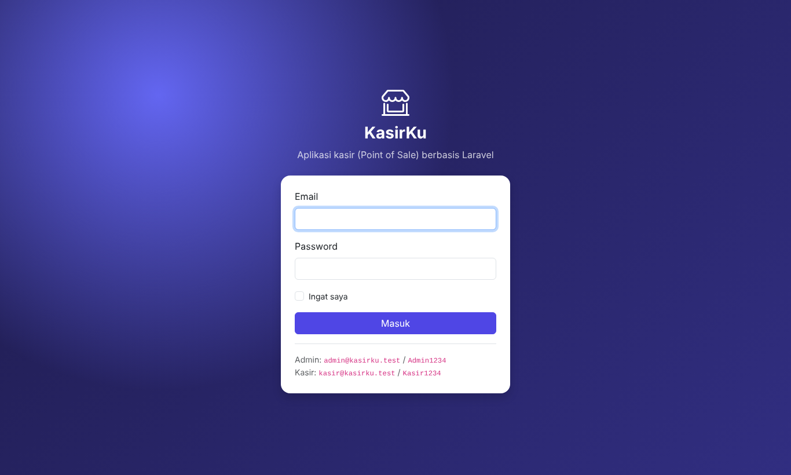 | 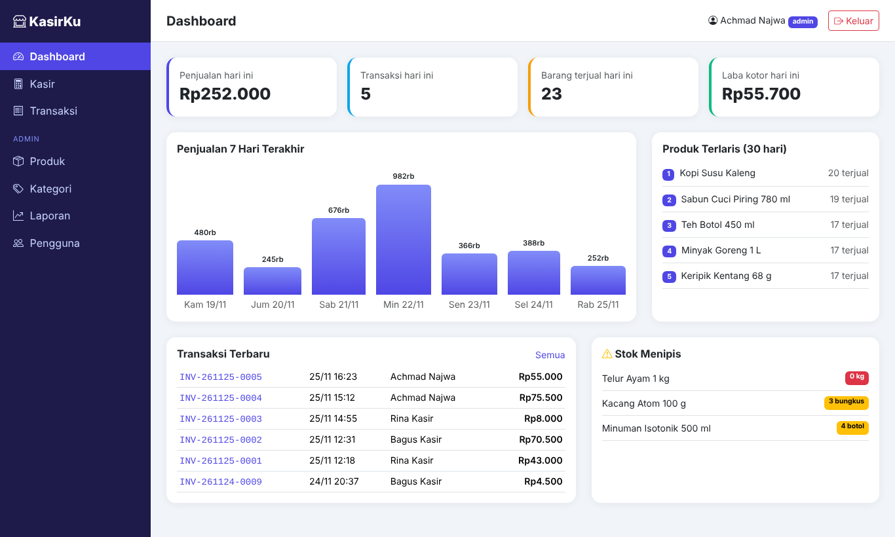 |

| Layar kasir | Struk |
|---|---|
| 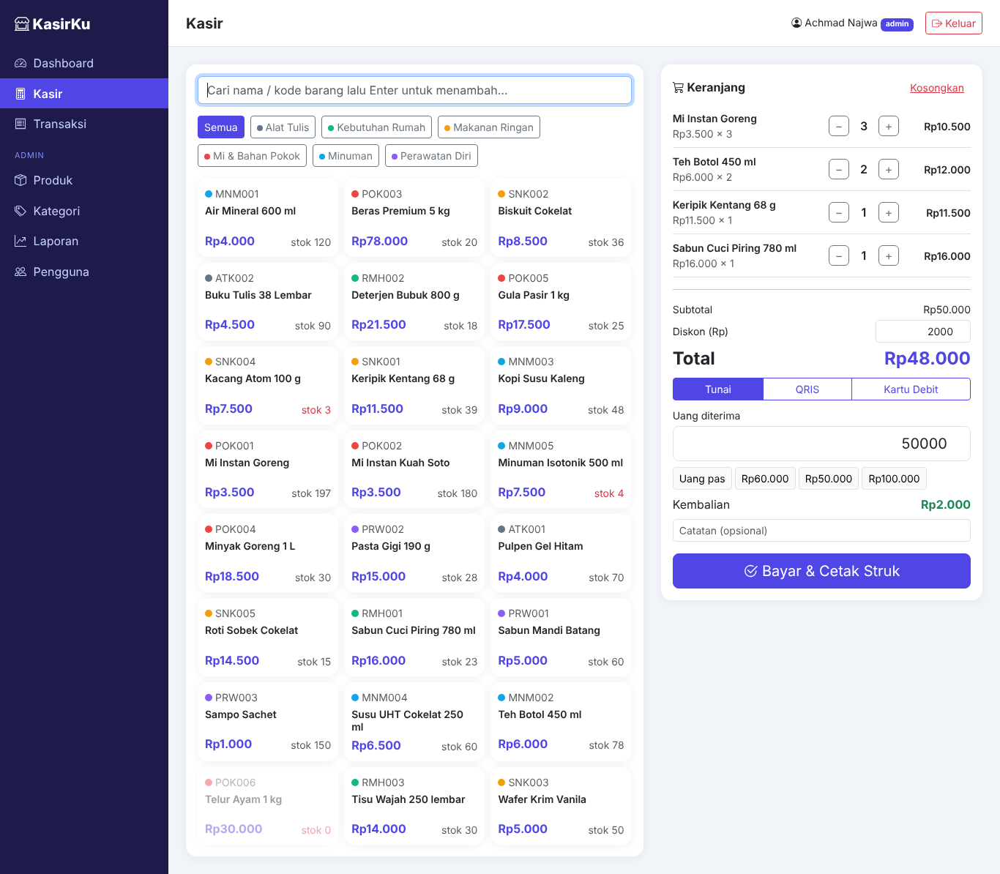 | 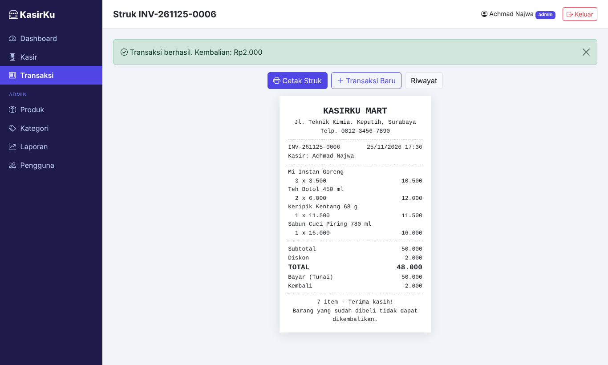 |

| Riwayat transaksi | Produk |
|---|---|
| 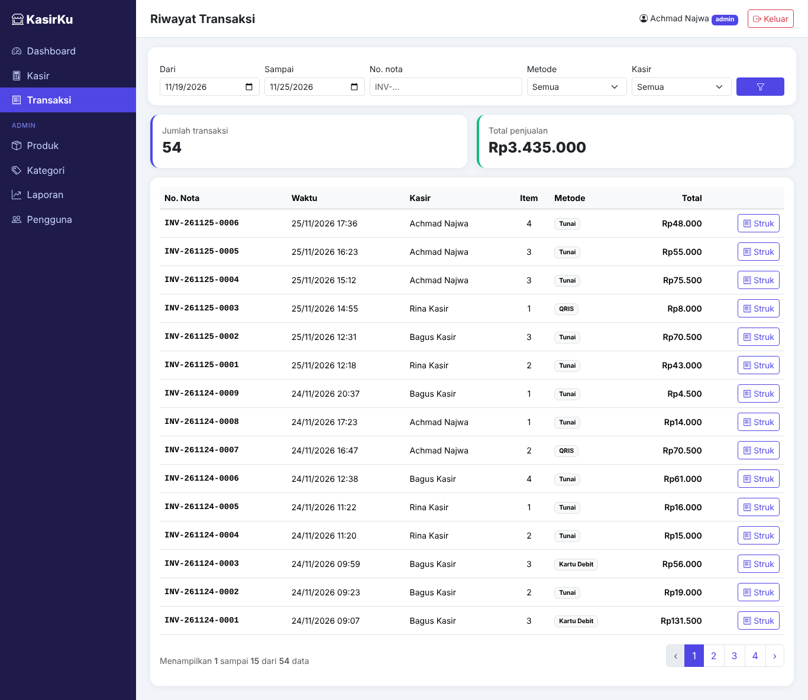 | 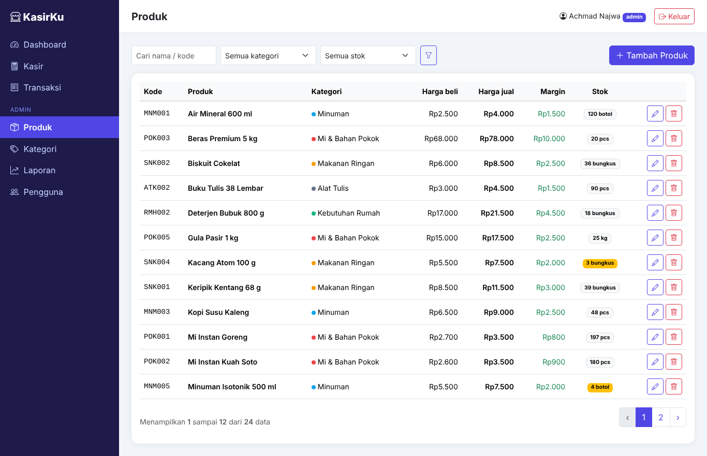 |

| Validasi produk | Kategori |
|---|---|
| 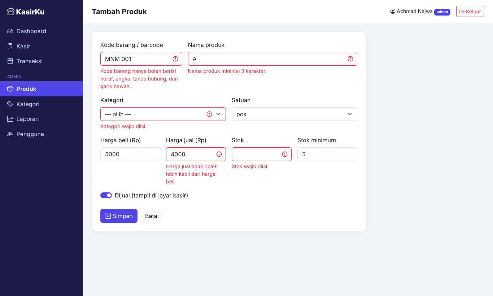 | 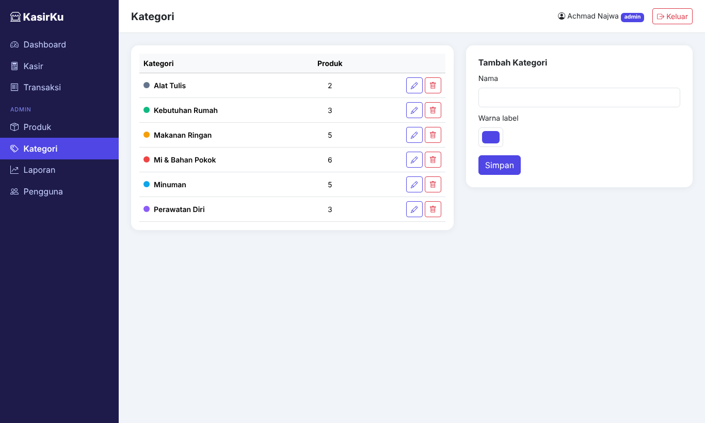 |

| Laporan | Pengguna |
|---|---|
| 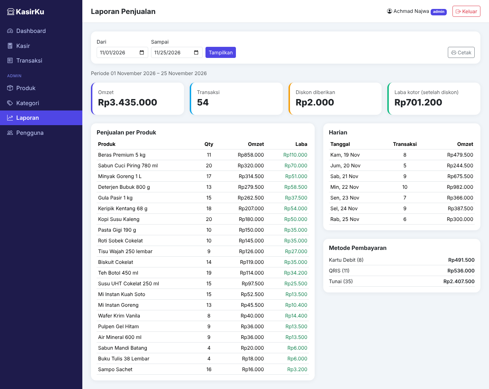 | 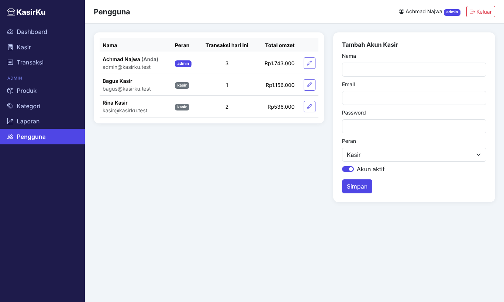 |

| Dashboard kasir (tanpa laba) | Kasir ditolak membuka menu admin |
|---|---|
| 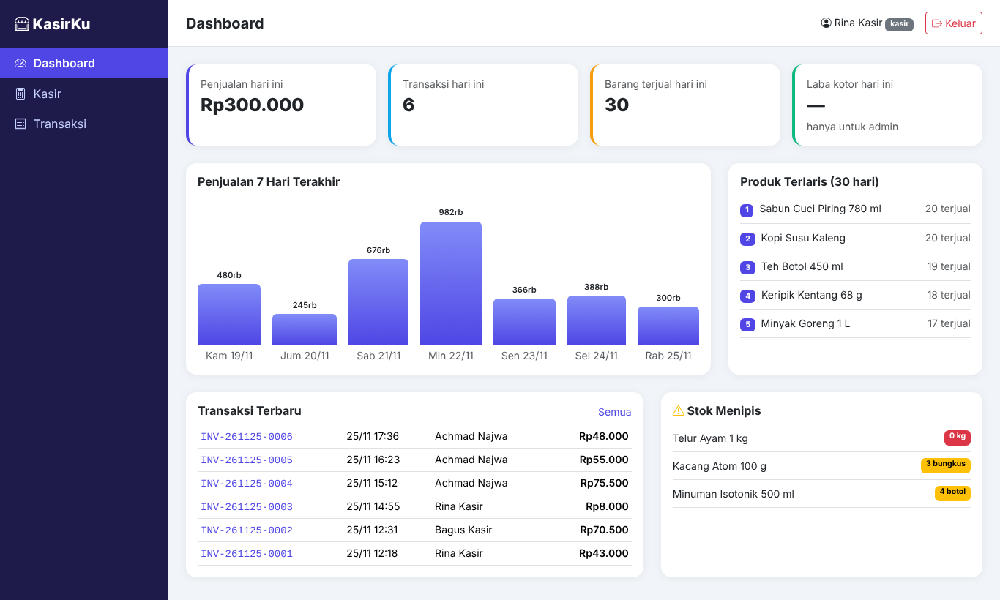 | 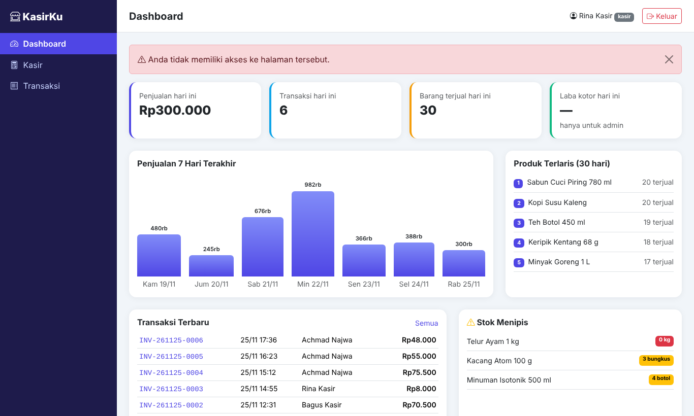 |
